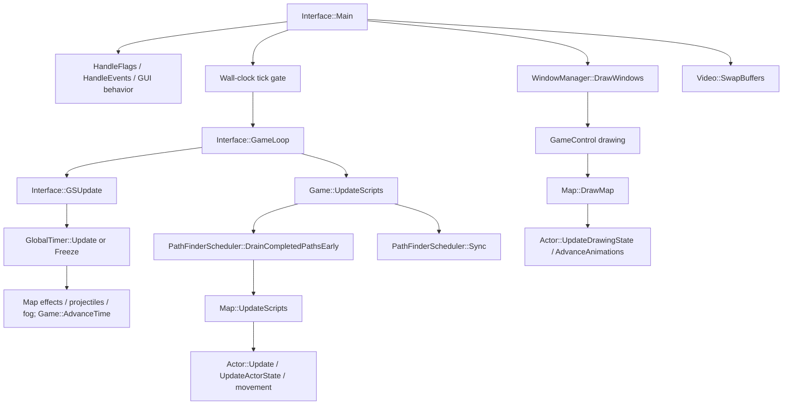
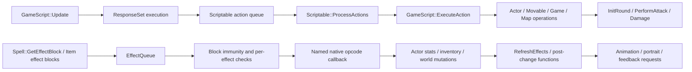
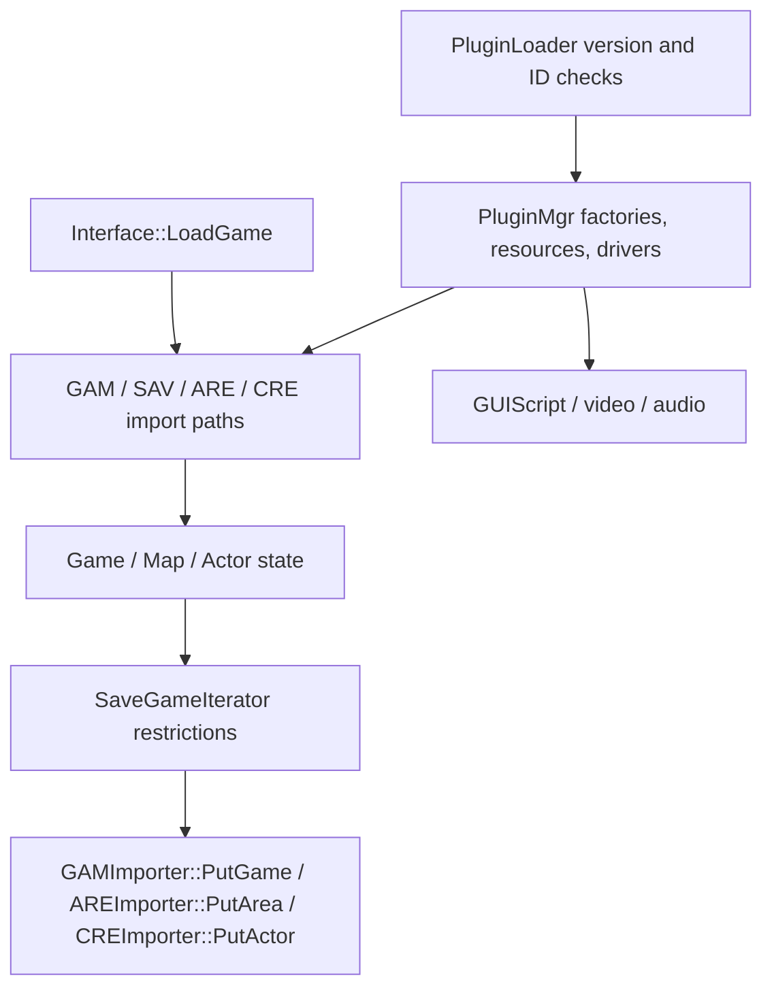

# Current system map — pinned GemRB

Scope and status: source-inspected on October 20, 2026 at the revision in the [audit](../BG_REDUX_PHASE0_AUDIT.md). Diagrams describe selected real call paths, not a claim of an exhaustive graph. No ordered simulation-phase trace was captured; [executed baseline](../testing/phase0-executed-baseline.md) now supplies runtime logs, tests and a shutdown backtrace.

## Loop, clocks and world updates

Evidence: [`gemrb/core/Interface.cpp:995`](https://github.com/gemrb/gemrb/blob/bcb5cfaa9f19ffbe8a51f25a3c014fa344173351/gemrb/core/Interface.cpp#L995) [`gemrb/core/Interface.cpp:1894`](https://github.com/gemrb/gemrb/blob/bcb5cfaa9f19ffbe8a51f25a3c014fa344173351/gemrb/core/Interface.cpp#L1894) [`gemrb/core/Interface.cpp:2468`](https://github.com/gemrb/gemrb/blob/bcb5cfaa9f19ffbe8a51f25a3c014fa344173351/gemrb/core/Interface.cpp#L2468) [`gemrb/core/GlobalTimer.cpp:122`](https://github.com/gemrb/gemrb/blob/bcb5cfaa9f19ffbe8a51f25a3c014fa344173351/gemrb/core/GlobalTimer.cpp#L122) [`gemrb/core/Game.cpp:1599`](https://github.com/gemrb/gemrb/blob/bcb5cfaa9f19ffbe8a51f25a3c014fa344173351/gemrb/core/Game.cpp#L1599) [`gemrb/core/Map.cpp:424`](https://github.com/gemrb/gemrb/blob/bcb5cfaa9f19ffbe8a51f25a3c014fa344173351/gemrb/core/Map.cpp#L424) [`gemrb/core/Map.cpp:918`](https://github.com/gemrb/gemrb/blob/bcb5cfaa9f19ffbe8a51f25a3c014fa344173351/gemrb/core/Map.cpp#L918). `GameLoop` calls script updates only when `GSUpdate` permits them. `GlobalTimer` handles fade/shake and dialogue behavior, not simply an isolated simulation clock. `Map::UpdateScripts` builds/sorts queues, runs area/actor/door/container/region logic and movement. `SortQueues` sorts by actor Y position [`gemrb/core/Map.cpp:2463`](https://github.com/gemrb/gemrb/blob/bcb5cfaa9f19ffbe8a51f25a3c014fa344173351/gemrb/core/Map.cpp#L2463); changing scheduling order requires tests, including tie cases. Drawing advances actor animations; projectile release reads the current frame [`gemrb/core/Scriptable/Actor.cpp:7915`](https://github.com/gemrb/gemrb/blob/bcb5cfaa9f19ffbe8a51f25a3c014fa344173351/gemrb/core/Scriptable/Actor.cpp#L7915). Preserve those observed semantics until characterization establishes which are necessary and which can be safely decoupled.

## Actor, actions and effects

Evidence: [`gemrb/core/GameScript/GameScript.cpp:1859`](https://github.com/gemrb/gemrb/blob/bcb5cfaa9f19ffbe8a51f25a3c014fa344173351/gemrb/core/GameScript/GameScript.cpp#L1859) [`gemrb/core/Scriptable/Scriptable.cpp:506`](https://github.com/gemrb/gemrb/blob/bcb5cfaa9f19ffbe8a51f25a3c014fa344173351/gemrb/core/Scriptable/Scriptable.cpp#L506) [`gemrb/core/GameScript/GameScript.cpp:2234`](https://github.com/gemrb/gemrb/blob/bcb5cfaa9f19ffbe8a51f25a3c014fa344173351/gemrb/core/GameScript/GameScript.cpp#L2234) [`gemrb/core/Scriptable/Actor.cpp:6814`](https://github.com/gemrb/gemrb/blob/bcb5cfaa9f19ffbe8a51f25a3c014fa344173351/gemrb/core/Scriptable/Actor.cpp#L6814) [`gemrb/core/Scriptable/Actor.cpp:7353`](https://github.com/gemrb/gemrb/blob/bcb5cfaa9f19ffbe8a51f25a3c014fa344173351/gemrb/core/Scriptable/Actor.cpp#L7353) [`gemrb/core/Scriptable/Actor.cpp:4296`](https://github.com/gemrb/gemrb/blob/bcb5cfaa9f19ffbe8a51f25a3c014fa344173351/gemrb/core/Scriptable/Actor.cpp#L4296) [`gemrb/core/EffectQueue.cpp:2277`](https://github.com/gemrb/gemrb/blob/bcb5cfaa9f19ffbe8a51f25a3c014fa344173351/gemrb/core/EffectQueue.cpp#L2277) [`gemrb/core/EffectQueue.cpp:1127`](https://github.com/gemrb/gemrb/blob/bcb5cfaa9f19ffbe8a51f25a3c014fa344173351/gemrb/core/EffectQueue.cpp#L1127) [`gemrb/core/Scriptable/Actor.cpp:2740`](https://github.com/gemrb/gemrb/blob/bcb5cfaa9f19ffbe8a51f25a3c014fa344173351/gemrb/core/Scriptable/Actor.cpp#L2740). The chart combines multiple ingress paths: projectile effects and direct `Interface` applications have separate callers. Do not assume one choke point captures every spell, equipment or scripted effect.

BCS semantics include interruption, `Continue`, action flags and ActionOverride, not only function dispatch. Unknown actions are warned and replaced with `NoAction` by `ExecuteAction`; compatibility tests must fail on relevant unknown-action diagnostics rather than accept continued execution as success.

## Resources and rendering

`Interface` installs ordered resource sources: cache, configured ModPath, GemRB override paths, game overrides/data/CD paths, KEY/BIF and lower-priority unhardcoded data [`gemrb/core/Interface.cpp:338`](https://github.com/gemrb/gemrb/blob/bcb5cfaa9f19ffbe8a51f25a3c014fa344173351/gemrb/core/Interface.cpp#L338). `ResourceManager::GetResourceStream` searches sources for one legacy type [`gemrb/core/ResourceManager.cpp:166`](https://github.com/gemrb/gemrb/blob/bcb5cfaa9f19ffbe8a51f25a3c014fa344173351/gemrb/core/ResourceManager.cpp#L166). `GetResource` selects registered descriptors, optionally prefers a legacy type, then traverses source paths [`gemrb/core/ResourceManager.cpp:185`](https://github.com/gemrb/gemrb/blob/bcb5cfaa9f19ffbe8a51f25a3c014fa344173351/gemrb/core/ResourceManager.cpp#L185). **Typed and descriptor-based lookup have different nesting/order rules.** Do not collapse them into one undocumented “override wins” rule.

`GameData` combines resource caches/factories, item/spell/store access and rule-table queries [`gemrb/core/GameData.h:123`](https://github.com/gemrb/gemrb/blob/bcb5cfaa9f19ffbe8a51f25a3c014fa344173351/gemrb/core/GameData.h#L123). BAM2, MOS2 and PVR-backed TIS parsing exist [`gemrb/plugins/BAMImporter/BAMImporter.cpp:33`](https://github.com/gemrb/gemrb/blob/bcb5cfaa9f19ffbe8a51f25a3c014fa344173351/gemrb/plugins/BAMImporter/BAMImporter.cpp#L33) [`gemrb/plugins/MOSImporter/MOSImporter.cpp:25`](https://github.com/gemrb/gemrb/blob/bcb5cfaa9f19ffbe8a51f25a3c014fa344173351/gemrb/plugins/MOSImporter/MOSImporter.cpp#L25) [`gemrb/plugins/TISImporter/TISImporter.cpp:41`](https://github.com/gemrb/gemrb/blob/bcb5cfaa9f19ffbe8a51f25a3c014fa344173351/gemrb/plugins/TISImporter/TISImporter.cpp#L41); PNG imports full-color images [`gemrb/plugins/PNGImporter/PNGImporter.cpp:56`](https://github.com/gemrb/gemrb/blob/bcb5cfaa9f19ffbe8a51f25a3c014fa344173351/gemrb/plugins/PNGImporter/PNGImporter.cpp#L56). These are useful adapters, not proof of complete modern animation metadata support.

`GameControl` delegates area drawing to `Map::DrawMap`; tiles/overlays, walls/stencils, height-sorted objects, fog and text eventually use `Video` and SDL implementations [`gemrb/core/GUI/GameControl.cpp:594`](https://github.com/gemrb/gemrb/blob/bcb5cfaa9f19ffbe8a51f25a3c014fa344173351/gemrb/core/GUI/GameControl.cpp#L594) [`gemrb/core/Map.cpp:918`](https://github.com/gemrb/gemrb/blob/bcb5cfaa9f19ffbe8a51f25a3c014fa344173351/gemrb/core/Map.cpp#L918) [`gemrb/core/Video/Video.h:57`](https://github.com/gemrb/gemrb/blob/bcb5cfaa9f19ffbe8a51f25a3c014fa344173351/gemrb/core/Video/Video.h#L57) [`gemrb/plugins/SDLVideo/SDL20Video.cpp:380`](https://github.com/gemrb/gemrb/blob/bcb5cfaa9f19ffbe8a51f25a3c014fa344173351/gemrb/plugins/SDLVideo/SDL20Video.cpp#L380). The boundary already supports RGBA8888 as well as paletted buffers. Retain it while testing palette changes, occlusion, blend modes and high-resolution UI. Do not infer speed or fidelity merely from API/backend names.

## Navigation and inventory

Movement intent lives in `Movable`; it packages path requests through `ScheduleFindPath` [`gemrb/core/Scriptable/Movable.cpp:459`](https://github.com/gemrb/gemrb/blob/bcb5cfaa9f19ffbe8a51f25a3c014fa344173351/gemrb/core/Scriptable/Movable.cpp#L459). `PathFinderScheduler` coordinates immutable snapshots, cancellation, result delivery, map deletion and synchronous/queued/worker modes [`gemrb/core/PathFinderScheduler.h:95`](https://github.com/gemrb/gemrb/blob/bcb5cfaa9f19ffbe8a51f25a3c014fa344173351/gemrb/core/PathFinderScheduler.h#L95). The terrain-level pathfinder is separable [`gemrb/core/PathFinder.h:230`](https://github.com/gemrb/gemrb/blob/bcb5cfaa9f19ffbe8a51f25a3c014fa344173351/gemrb/core/PathFinder.h#L230). Actor footprints, personal space, bump/backoff, final steering and combat range remain distributed across `Actor`, `Movable`, `Map` and script helpers. Changing traversal policy alone will not deliver the full Navigation Redux behavior.

`Actor::inventory` and container inventories store slot items. Equip effects use owner stats/effects and issue GUI events [`gemrb/core/Inventory.cpp:173`](https://github.com/gemrb/gemrb/blob/bcb5cfaa9f19ffbe8a51f25a3c014fa344173351/gemrb/core/Inventory.cpp#L173). BCS `HasItem`, `PartyHasItem` and `MoveItemCore` expose ownership and bag semantics [`gemrb/core/GameScript/Triggers.cpp:1045`](https://github.com/gemrb/gemrb/blob/bcb5cfaa9f19ffbe8a51f25a3c014fa344173351/gemrb/core/GameScript/Triggers.cpp#L1045) [`gemrb/core/GameScript/Triggers.cpp:1217`](https://github.com/gemrb/gemrb/blob/bcb5cfaa9f19ffbe8a51f25a3c014fa344173351/gemrb/core/GameScript/Triggers.cpp#L1217) [`gemrb/core/GameScript/GSUtils.cpp:646`](https://github.com/gemrb/gemrb/blob/bcb5cfaa9f19ffbe8a51f25a3c014fa344173351/gemrb/core/GameScript/GSUtils.cpp#L646). GUI drop logic is another mutation ingress [`gemrb/plugins/GUIScript/GUIScript.cpp:9443`](https://github.com/gemrb/gemrb/blob/bcb5cfaa9f19ffbe8a51f25a3c014fa344173351/gemrb/plugins/GUIScript/GUIScript.cpp#L9443). Save import/export preserves inventory slots [`gemrb/plugins/CREImporter/CREImporter.cpp:1941`](https://github.com/gemrb/gemrb/blob/bcb5cfaa9f19ffbe8a51f25a3c014fa344173351/gemrb/plugins/CREImporter/CREImporter.cpp#L1941). A shared stash must define every ingress and legacy query before replacing storage.

## Persistence and plugins

Evidence: [`gemrb/core/Interface.cpp:2509`](https://github.com/gemrb/gemrb/blob/bcb5cfaa9f19ffbe8a51f25a3c014fa344173351/gemrb/core/Interface.cpp#L2509) [`gemrb/core/SaveGameIterator.cpp:453`](https://github.com/gemrb/gemrb/blob/bcb5cfaa9f19ffbe8a51f25a3c014fa344173351/gemrb/core/SaveGameIterator.cpp#L453) [`gemrb/plugins/GAMImporter/GAMImporter.cpp:1186`](https://github.com/gemrb/gemrb/blob/bcb5cfaa9f19ffbe8a51f25a3c014fa344173351/gemrb/plugins/GAMImporter/GAMImporter.cpp#L1186) [`gemrb/plugins/AREImporter/AREImporter.cpp:2558`](https://github.com/gemrb/gemrb/blob/bcb5cfaa9f19ffbe8a51f25a3c014fa344173351/gemrb/plugins/AREImporter/AREImporter.cpp#L2558) [`gemrb/plugins/CREImporter/CREImporter.cpp:2625`](https://github.com/gemrb/gemrb/blob/bcb5cfaa9f19ffbe8a51f25a3c014fa344173351/gemrb/plugins/CREImporter/CREImporter.cpp#L2625) [`gemrb/core/PluginMgr.h:39`](https://github.com/gemrb/gemrb/blob/bcb5cfaa9f19ffbe8a51f25a3c014fa344173351/gemrb/core/PluginMgr.h#L39) [`gemrb/core/PluginLoader.cpp:110`](https://github.com/gemrb/gemrb/blob/bcb5cfaa9f19ffbe8a51f25a3c014fa344173351/gemrb/core/PluginLoader.cpp#L110). The diagrams omit packaging details; do not equate binary serialization with a full simulation checkpoint. `CanSave` rejects combat/dialogue/cutscene and other states. In-flight actions, RNG, worker requests and persistent identity still require explicit inventory and testing.

Uncertainty: campaign correctness, cost of each update phase, async ordering sensitivity, exact save-state loss and general UI mod composition. Validate through the [scenario plan](../testing/golden-scenarios.md), not source inspection alone.
