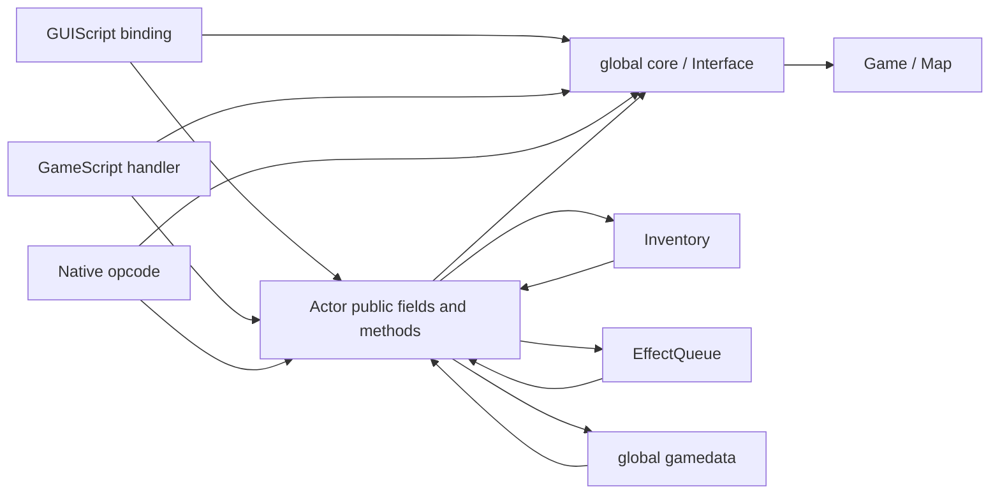

# Authoritative state and dependency map

Status: source-observed ownership and selected mutation routes at the pinned audit revision. A C++ member's location is not sufficient proof of exclusive ownership. Raw pointers and direct field writes matter as much as accessors.

| State | Storage / lifetime boundary | Known mutation routes | Risk and proposed boundary |
|---|---|---|---|
| Engine lifetime and orchestration | Interface owns Game, GUI/window services, timers and several UI interaction objects | Init/destruction, load/quit, GUI calls, script/effect callers through global `core` | Refactor lifecycle orchestration separately from per-game simulation and UI session state |
| Resource caches/rules data | Global `gamedata` object; GameData caches items/spells/effects/palettes/stores and tables | Importers, table consumers, store saves, source setup | Wrap resource lookup with explicit provenance and cache/lifetime policy |
| World | Game tracks party/NPC/map pointer collections, globals, time and combat state | Game/Map/script handlers/effects and GUI bindings | Define authoritative operations and tick phases; document actual pointer ownership before changing containers |
| Actor state | Public BaseStats/Modified/PrevStats, PCStats, inventory, spellbook, effect queue, timers and combat fields | Actor methods, effects, scripts, GUI setters, importers and direct writes | Refactor behind a compatible actor facade, one operation at a time |
| Runtime identity | Scriptable globalID; actor references, area associations and script names | Construction/load/map transfer/deletion paths | Runtime ID is not automatically a persistent ID; define serialized identity/remapping and generation-safe handles |
| Actions | Scriptable current action, queue, tick/state/target and interruption flags | BCS responses, GUI orders, scripts, ProcessActions | Preserve dispatch timing and ActionOverride; command admission can wrap existing methods |
| Effects | Actor effect queue; temporary blocks and projectiles during application | Native opcodes, RefreshEffects, equipment changes, direct applications | Keep ordering and first-apply/load distinction; add typed causal trace at actual resolution branches |
| Inventory | Actor/container slots; stores and bags introduce separate ownership paths | Inventory methods, GUI drag/drop, BCS item helpers, opcodes, CRE serialization | Explicit item transactions and legacy actor-ownership view; no UI-only storage redesign |
| Paths | Movable movement state; scheduler request/result queues and map snapshots | Walk requests, schedule/cancel/poll/step and map deletion | Results must validate origin and lifetime; keep snapshot workers from mutating live actors |
| Presentation | Actor stance/vfx; GameControl/WindowManager; Video buffers | Drawing-state advancement, stats/effects, input callbacks | Read-only presentation is a target, not current reality |

Evidence: [`gemrb/core/Interface.h:285`](https://github.com/gemrb/gemrb/blob/bcb5cfaa9f19ffbe8a51f25a3c014fa344173351/gemrb/core/Interface.h#L285) [`gemrb/core/Interface.cpp:66`](https://github.com/gemrb/gemrb/blob/bcb5cfaa9f19ffbe8a51f25a3c014fa344173351/gemrb/core/Interface.cpp#L66) [`gemrb/core/GameData.h:123`](https://github.com/gemrb/gemrb/blob/bcb5cfaa9f19ffbe8a51f25a3c014fa344173351/gemrb/core/GameData.h#L123) [`gemrb/core/Game.h:215`](https://github.com/gemrb/gemrb/blob/bcb5cfaa9f19ffbe8a51f25a3c014fa344173351/gemrb/core/Game.h#L215) [`gemrb/core/Scriptable/Actor.h:451`](https://github.com/gemrb/gemrb/blob/bcb5cfaa9f19ffbe8a51f25a3c014fa344173351/gemrb/core/Scriptable/Actor.h#L451) [`gemrb/core/Scriptable/Scriptable.h:249`](https://github.com/gemrb/gemrb/blob/bcb5cfaa9f19ffbe8a51f25a3c014fa344173351/gemrb/core/Scriptable/Scriptable.h#L249) [`gemrb/core/PathFinderScheduler.h:95`](https://github.com/gemrb/gemrb/blob/bcb5cfaa9f19ffbe8a51f25a3c014fa344173351/gemrb/core/PathFinderScheduler.h#L95).

## Actor mutation walkthrough

1. `SetBase` computes the existing modified-minus-base delta, clamps/sets the base value and calls `SetStat` [`gemrb/core/Scriptable/Actor.cpp:2555`](https://github.com/gemrb/gemrb/blob/bcb5cfaa9f19ffbe8a51f25a3c014fa344173351/gemrb/core/Scriptable/Actor.cpp#L2555).
2. `SetStat` can invoke a stat-specific post-change function; copying a raw value and invoking the setter are not interchangeable [`gemrb/core/Scriptable/Actor.cpp:2524`](https://github.com/gemrb/gemrb/blob/bcb5cfaa9f19ffbe8a51f25a3c014fa344173351/gemrb/core/Scriptable/Actor.cpp#L2524).
3. `GetSafeStat` uses previous stats while an effect recalculation is underway [`gemrb/core/Scriptable/Actor.cpp:451`](https://github.com/gemrb/gemrb/blob/bcb5cfaa9f19ffbe8a51f25a3c014fa344173351/gemrb/core/Scriptable/Actor.cpp#L451). Readers may intentionally see a completed previous state rather than partially recomputed state.
4. `RefreshEffects` applies queued effects, adjusts derived values, handles charm-related triggers, palette/overlay work and post-change callbacks [`gemrb/core/Scriptable/Actor.cpp:2740`](https://github.com/gemrb/gemrb/blob/bcb5cfaa9f19ffbe8a51f25a3c014fa344173351/gemrb/core/Scriptable/Actor.cpp#L2740).
5. Equipment removal calls `RefreshEffects` and requests animation refresh [`gemrb/core/Inventory.cpp:206`](https://github.com/gemrb/gemrb/blob/bcb5cfaa9f19ffbe8a51f25a3c014fa344173351/gemrb/core/Inventory.cpp#L206). Equipment addition applies effect blocks and may alter colors [`gemrb/core/Inventory.cpp:173`](https://github.com/gemrb/gemrb/blob/bcb5cfaa9f19ffbe8a51f25a3c014fa344173351/gemrb/core/Inventory.cpp#L173).

This is concrete evidence for incremental Refactor. It does **not** establish that every direct stat write is incorrect. Import/initialization and deliberate no-PCF writes need distinct semantics. First catalog writers for a selected stat/operation, then move that operation under one authority while keeping facade behavior.

## Interface dependency walkthrough

`core` is globally available [`gemrb/core/Interface.cpp:66`](https://github.com/gemrb/gemrb/blob/bcb5cfaa9f19ffbe8a51f25a3c014fa344173351/gemrb/core/Interface.cpp#L66). Interface owns the Game and window/GUI services while also exposing rule tables, current store/container/drag state, slot policy, pause and effect applications [`gemrb/core/Interface.h:285`](https://github.com/gemrb/gemrb/blob/bcb5cfaa9f19ffbe8a51f25a3c014fa344173351/gemrb/core/Interface.h#L285). Scripts, inventory and native opcodes call those services. A constructor-injected replacement of every global at once would be high-risk and unnecessarily broad.

Proposed extraction sequence: (1) introduce a narrow diagnostics dependency for the first real probe; (2) identify simulation clock/update context; (3) wrap inventory operations; (4) split UI interaction/session state as consumers migrate. The facade can forward to current methods until tests cover replacement. Avoid creating many small services that all still mutate the same global objects.

## Identity, deletion and concurrency obligations

The `UsedExit` comment explicitly notes that a global ID is not stable after loading a new area [`gemrb/core/Scriptable/Actor.h:493`](https://github.com/gemrb/gemrb/blob/bcb5cfaa9f19ffbe8a51f25a3c014fa344173351/gemrb/core/Scriptable/Actor.h#L493). Do not use an actor pointer, party index, ResRef or current globalID alone as a Redux persistent key. Spawned actors, clones, duplicate ResRefs, party changes and reload need separate tests.

Game/Map collections expose raw pointers; ownership varies with party membership and area lifecycle. This audit did not prove a complete deletion graph. Trace join/leave, map unload, death/resurrection, summons and shutdown before changing ownership types. Scheduler snapshots and `OnMapDeletion` are an existing safety mechanism [`gemrb/core/PathFinderScheduler.h:95`](https://github.com/gemrb/gemrb/blob/bcb5cfaa9f19ffbe8a51f25a3c014fa344173351/gemrb/core/PathFinderScheduler.h#L95); preserve them when introducing new actor handles.

Validation: writer inventory for one operation; load/unload and party-transfer fixtures; sanitizer runs; save identity remapping; disabled trace must produce identical state. Performance remains unmeasured. Profile actor/effect scans and snapshot copying before adding allocations or abstraction on hot paths. For AI-assisted development, document these exact ownership and callback rules beside each extracted contract; constrain each change to named ingress points and fixtures.
