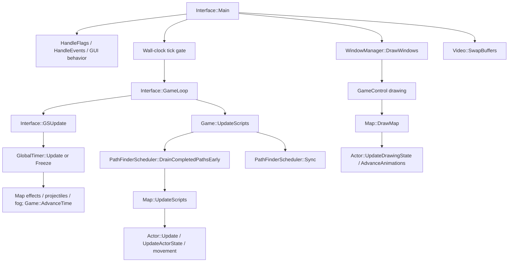
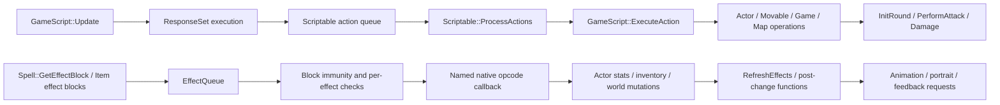
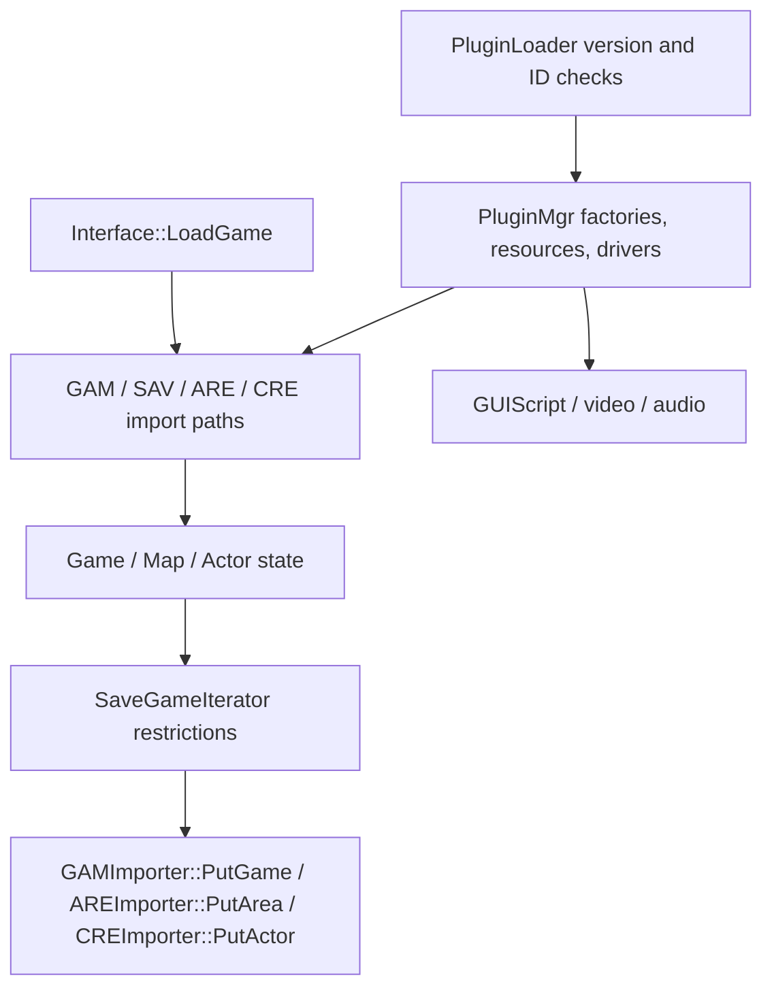
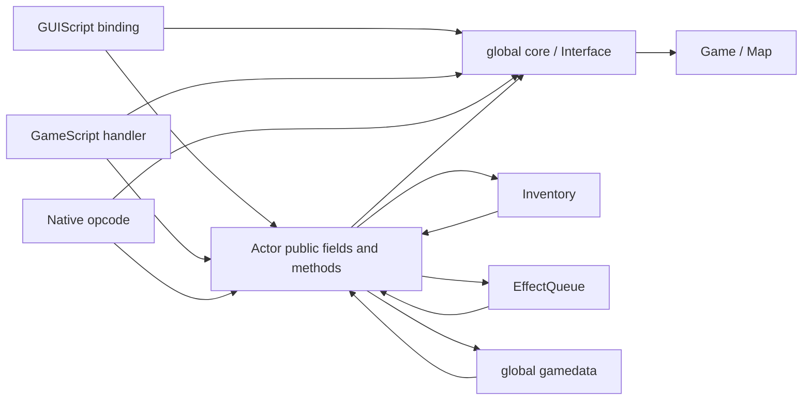
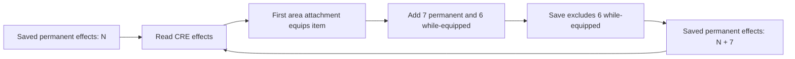

# BG Redux — complete continuation context

October 21 LAB update: Phase 0 technical evidence is consolidated in [the release record](../PHASE0_RELEASE.md). Base/context transfer and native validation are complete; engine source/binaries are unchanged. Host input isolation is user-confirmed. VM snapshots are optional and excluded from gates by explicit user instruction. Earlier pending-transfer/snapshot statements below are historical. Phase 1 engine implementation remains separately authorized work.

Guest continuation, October 21: [LAB bring-up results](../testing/lab-guest-bringup.md)
supersede historical physical-host-only status below. Guest execution and game
reference hashes are verified; private runtime transfer and migration acceptance
remain incomplete. Engine freeze and all prior compatibility limits still apply.

Prepared October 21, 2026. Read this file first, then the embedded specifications and linked evidence. This is a transfer of an ongoing project, not a fresh architectural proposal. Historical reports retain earlier states; the latest decision ledger below resolves conflicts.

## Immediate assignment and authority

Continue Phase 0 research, source inspection, build/test validation, architectural planning and the external AI-first harness. **Keep engine source and engine/plugin binaries unchanged.** Do not implement gameplay enhancements, native predicates, UI replacement, RNG/clock changes or the proposed MR instrumentation without a new authorization. Publishing the fork and committing documentation/external tooling is authorized. Do not interpret implementation suggestions inside older design documents as permission to execute them.

The immediate objective is to finish moving the testing environment onto the user's Windows VM, verify actual guest execution, then resume the compatibility investigations below. The user prefers autonomous progress and concise updates. Ask only for missing decisions or actions that genuinely block progress. Repeated manual menu navigation was slow and unreliable; prioritize observable harness operations and batching. Do not quietly label incomplete tests successful.

Authority order: latest explicit user decisions > original charter > supporting design proposals. The complete original charter and major reports are embedded later in this file to avoid dependence on chat memory. Older inventory requirements in that charter are superseded below.

## Product purpose and accepted decisions

Preserve the game. Modernize the engine. Refine the experience. Build a maintainable GemRB derivative that runs Baldur's Gate content faithfully while allowing modern internal contracts. Compatibility belongs at explicit boundaries; old architecture is neither automatically optimal nor a reason for a rewrite. Six-character real-time-with-pause combat, powerful/strange interactions, original world composition and expressive original artwork remain central.

- Initial target: clean BG2EE. Curated SCS/Ascension follows; broader saga/EET/EEex features are later, separately verified work. Resource mods and binary EEex hooks have different compatibility requirements. No universal mod promise.
- **Save policy approved:** import BG2EE saves; versioned Redux saves afterward. Exporting Redux saves back into the original executable is not an initial requirement. Import fidelity, identity and migration remain required.
- **UI approved:** modern UI preserving information and gameplay functions, closely inspired by Infinity UI++ and existing Inventory Redux work. Pixel-identical EE layouts and an EE Lua interpreter are not requirements. Missing information is still a present correctness failure.
- **Inventory amendments:** Party Stash always available; no Combat Pack; no threat/danger lock. Equipment and three quick weapon/ammo/item groups remain distinct. Secondary panel is **Stats**, without duplicated attributes/combat values, targeting no scrolling. Hypothetical equipment previews must actually calculate the hypothetical state. These override older charter/manifesto requirements. Capacity progression, overflow and legacy actor ownership policy remain unresolved. Do not enable future stash semantics in the unchanged baseline.
- Combat Info: causal resolution events and earned player knowledge are separate. The test oracle may inspect hidden state; the player UI must not reveal unknown defenses, hidden recasts or unobserved expiration. Do not infer causal outcomes from translated log strings or generic effect return codes.
- Movement: separate route planning, movement execution, animation and combat approach. Better realized APR can alter balance even when formulas are unchanged. Preserve lessons from EEex prototypes, not offsets/hooks.
- Buff planning: recipient-first, concurrent independent casters, dependencies for real shared resources. Duration compression is a deliberate optional gameplay change, not a baseline refactor.
- Tactical Time/Independent Interaction/multiplayer: future work. Plan authoritative mutation, load/session epochs, lifetime-safe identity and acknowledged intent. No lockstep/server model selected. No determinism claim.
- Retain original artistic proportions/composition, classic reference and human-led art direction. Full-color/high-resolution formats are future adapters. No AI art replacement or renderer rewrite authorized.
- Correctness and compatibility first; presentation next; foundational combat experiments before dependent spell/class/item/encounter tuning. Preserve stable Classic versus optional experimental profiles. No language rewrite mandate.

## Repository and machine identities

Physical-host workspace: `C:\Users\zach\Documents\ChatGPT\BG Multiplayer Redux`.

Pinned independent engine checkout: `gemrb/`, upstream `https://github.com/gemrb/gemrb.git`, revision **bcb5cfaa9f19ffbe8a51f25a3c014fa344173351**. Source examples under this workspace are `gemrb/gemrb/core/...`. The surrounding workspace contains unrelated Redux projects and has an empty Git repository without commits/remotes: **do not commit the entire workspace**.

Fork publication was explicitly authorized during this handoff. Consult `PUBLICATION.json` beside this file for the verified hosted URL, branch and commit after publication. Do not assume the upstream URL is the Redux fork. Published Phase 0 additions live in `redux/` within the engine fork so original tracked engine files remain untouched. For the existing harness layout, clone the fork into `C:\BGRedux\gemrb`, then copy its `redux/docs` and `redux/tools` into `C:\BGRedux\docs` and `C:\BGRedux\tools`. Private runtime data comes from the separate transfer package. Do not nest the game, toolchain or personal saves in a public commit.

The existing build is Windows Debug, MSYS2 UCRT64 GCC 16.2, Python 3.14.8, CMake 4.4.4, SDL2/OpenGL, tests enabled, libVLC disabled. `phase0-local/build/gemrb/gemrb.exe` runs against the unchanged engine DLL. DLL SHA256: `5b8719d3f3257404f4611927826af1ae9cdeb2c735fc0ed6d1afc981eb14c99f`. Four baseline engine/test binaries and 45 plugins were preserved. External dependency-discovery/test-entry adapters were used; engine files were not patched.

## Dedicated VM: actual status and next acceptance gates

VM: BG Redux Lab, `C:\Users\zach\Documents\Virtual Machines\BG Redux Lab\BG Redux Lab.vmx` on the physical host. User-approved settings: Windows 11 x64, EFI/virtual TPM, **12 GiB RAM, one socket with six cores, 100 GB expandable split disk, NAT, accelerated 3D, 4 GiB graphics-memory maximum**. This graphics limit is virtual/shared memory, not dedicated Radeon VRAM. Physical host: Ryzen 7 9800X3D, 32 GB RAM, Radeon RX 9070 XT, Windows 11 Home. VMware Workstation 26H1 was installed by the user.

The user reports Windows installed and booted, Codex remote setup paired, Steam and BG2EE installed in the VM. Game path there: `C:\Program Files (x86)\Steam\steamapps\common\Baldur's Gate II Enhanced Edition`. **This chat has not independently executed a guest shell or guest tests.** Its executor remains the physical host. Physical VMware CLI confirms the VM running. Do not mistake the identical game path on the physical host for VM evidence.

The connected device is named Lab, ID `remote-control:env_e_6ad921094914832d8d5bda6f49aa37e4`. Another host named Zach-PC is unrelated. Last project inventory had no Lab project. The available handoff tool cannot move its own calling chat. Same account does not make this local chat's execution/workspace automatically available on another machine. User chose this complete context file as a way to start a new VM chat. Do not create or message a new chat unless requested.

The guest Windows administrator has no password, per the user, and full administration is authorized. **VMware encryption has a separate password retained by the user.** `vmrun checkToolsState/getGuestIPAddress` stopped at an encryption-password requirement; that was not a Windows authentication failure. Do not reset encryption/TPM or extract stored secrets to work around project binding.

Private base package: `phase0-local/vm-transfer/20261021T183745Z/BGRedux`, intended destination `C:\BGRedux`. Its original manifest covers 43,358 files / 6,488,245,518 bytes, including source/.git, build, UCRT64 runtime, manifested game files, vanilla fixture and two historical oracle runs. A companion complete-context package adds all Phase 0 results/logs/config/screenshots and current docs/tooling; consult its manifest. These are private user-owned resources, not distributable assets. Preserve both manifests: the base one describes its original snapshot, not later documentation.

Guest bring-up order:

1. Bind a new chat to `C:\BGRedux` **on Lab**, verify hostname/VM model/user/OS/free disk and a guest screenshot. Verify VMware Tools/display driver and guest input isolation. A connection label alone is insufficient.
2. Copy the private base package and overlay the context companion. Verify each against its manifest before modification. Keep historical host provenance and failed runs intact.
3. Verify installed Steam executable/resource hashes against `docs/compatibility/evidence/bg2ee-copy-manifest.json`. Host reference: BG2EE 2.7.3.0, Steam build 23534562; Baldur.exe SHA256 `b51093a49140b2b8a7c046b4652bb8e535be24ebbc12b1d735e0b94217a14d57`. A different version needs a distinct reference, not overwritten fixtures.
4. Verify source revision and unchanged engine/plugin hashes. Rebuild **external native hosts only** to produce guest-local receipts. The copied CMake cache and `build-msys.sh` contain physical-host paths; do not rebuild engine in that cache.
5. Run harness unit tests, capabilities, original-vanilla import/reload, normal GUI/save path and presentation capture. Store fresh guest runs separately. Distinguish process success, scenario assertions, persistence differences and rendering observations.
6. Verify game/agent input stays inside the VM while the physical desktop remains usable. Create and independently verify clean/validated snapshots. Only then declare host migration complete.

## Verified architecture dispositions

No whole subsystem currently merits Replace. These are provisional source-grounded recommendations, not implementations.

| Subsystem | Decision | Main dependency/risk |
|---|---|---|
| Actor | Refactor | Stats/effects/inventory/combat/UI callbacks share ordered mutation; extracting fields can change semantics |
| Interface | Refactor | Broad mutable service access, lifecycle and game/UI/resource policy |
| GameScript | Wrap | Preserve BCS dispatch/queue semantics; narrow operations behind handlers; missing predicates are compatibility cases |
| GUIScript/UI | Refactor | Incomplete EE screen assembly; semantic view models and operations needed for modern UI/testing |
| Effects | Refactor | Retain opcode implementations/registry; explicit lifecycle and branch-specific causal outcomes |
| Resources | Wrap | Preserve parsers/providers; specify resource identity, override precedence/cache lifetime |
| Rendering | Retain | Existing full-color/backend support; benchmark and characterize fidelity before replacement |
| Simulation/time/RNG | Refactor | Wall-clock gates, animation-linked mutations, presentation RNG and worker delivery; determinism unproven |
| Save/load | Wrap | Legacy import plus explicit identity/snapshot/migration contract for versioned Redux state |
| Plugins | Refactor | Existing exact-version/lifecycle checks; capability/dependency/stability contracts missing |
| Navigation | Wrap | Reuse existing planner/scheduler; distinguish async delivery and movement execution |
| Inventory | Wrap | Preserve equipment/slot/item semantics; actor-specific ownership checks require explicit stash facade |

Read the embedded subsystem matrix, dependency map and extensibility contracts for exact source anchors, all evaluation dimensions and risks. Actor stats are operations with callbacks, not plain assignments. Effect `FX_NOT_APPLIED` is not universally failure. Animation-frame projectile release and DrawMap state advancement are verified couplings; FPS-induced damage changes remain a hypothesis. RNG is thread-local/time-seeded with no inspected public snapshot API; async paths do not establish lockstep. Existing plugin extensibility does not imply safe arbitrary mutation/hot reload.

## Executed results and limits — do not lose these distinctions

| Investigation | Actual result | Limit |
|---|---|---|
| Build/core tests | Build works; stock CTest 6/7 executables pass; managed core 219 pass, 9 skip, 1 locale failure, 6 disabled; movement 9/9 with external logger cleanup | Not all engine tests pass; locale remains platform issue; stock save skips not parity |
| Opening | User verified intro, character creation/opening playable; movement janky and fonts/text wrong | No campaign, performance or native-like claim |
| Isolated game copy | 2,324 original files / 3,888,110,389 bytes hashed source/copy | No WeiDU.log alone cannot establish pristine installation |
| Vanilla import | Original user-created GemRB save; import and two fresh reloads, 24/24 scenario observations | Raw wire/runtime differences and repeat-import color variation remain |
| Normal GUI/save | Real main loop + stock callbacks; create, empty-name/cancel, overwrite, fresh reload; 20/20 checks | Overall persistence comparison can correctly exit1 with `differences` |
| Fonts/missing UI | Stock/BAM/18px TTF change metrics/pixels; identical control-text JSON; inventory/record incomplete assembly | Font experiments do not restore blank content or constitute a fix |
| IMMCLOUD | 7→14→21 permanent equipped-effect records and +1,848 CRE bytes/reload in both original and GemRB | Accumulation alone is not a GemRB bug; opcode267 Parameter2 differs (original134/216, GemRB0) |
| Protection challenge | 48/48 selected message-protection behavior observations pass across remove/reapply | Not arbitrary-effect/mod or original-runtime parity |
| Wider equip scan | 2,867 ITM, 11,795 equip records, 84 permanent records/32 candidates; RING09 one-shot expires, MAGIWEB +6/cycle | Do not globally deduplicate or change timing; 4,735 CRE scan is exposure, not actual equip proof |
| Main-loop clocks | Initial8/10 exposed delayed LOADWIN unpause; corrected readiness yields10/10 pause/resume over cap30/60 | Short rates10.526/9.187 ticks/sec vsconfigured15; no deterministic stepping, FPS or movement conclusion |
| BCS query exposure | Each WeaponEffectiveVs/WeaponCanDamage stub returns0; each84 occurrences across24 scripts | Later attack fallbacks exist; no “companions cannot attack” claim |
| Eight query controls | Main/both fists original1/1; empty offhand/absent Player6 original0/0; GemRB all0/0 | Four mismatches/four matching negatives; not full predicate contract |
| Eight equipped/defense cases | Both engines complete identical-input guards;14/16 Boolean values differ | Query-only synthetic effects; damage parity and side-effect freedom untested |
| Native AI tails | Four runs actual AttackOneRound105 against named RDXFOE; stock Imoen/default tails118/310 vsquery-removed controls115/307 | Isolated tails, not full AI/target-selection/DPR proof |
| Original AI | Visible attack/slashing; completed branch-marker save absent, GUI save blocked in combat | Original selected branch unknown; stale output rejected |
| Harness units | Latest71 pass; copied UCRT64 package also71 pass after required oracle fixtures included | Harness tests are not engine tests or guest execution |

Equipped query truth table (EffectiveVs / CanDamage): original 1/1 for SW1H01 baseline, SW1H02 baseline, normal sword vs synthetic opcode120 magical-weapon protection, +1 sword vs Stoneskin, +1 sword vs Mirror Image, BOW01+AROW01 baseline. **+1 sword vs opcode120 gives0/1; normal slashing vs100% slashing resistance gives1/0.** GemRB gives0/0 in all eight. Distinct predicates need distinct contracts, not one generic damage forecast.

The first equipped fixtures accidentally selected fists and eight failed runs remain as invalid-setup evidence. Correct fixtures set GAM quick slots and CRE weapon/ability/ammo selections and verify guards/derived stats. Preserve appended-GAM creature relocation technique; do not apply general offsets blindly. AI completion markers alone do not prove action execution/queue completion. The native host samples actual action and target; generated-save failure remains separate. Wait3 completes around3s; no Wait timing defect established. Long AI captures did not produce autosaves; exact native SaveGame rejection reason was not observed.

Latest canonical raw runs:

- `20261021T174444Z-equipped-defenses-41fae879` — eight valid native cases.
- `20261021T180015Z-ai-fallback-c49ab895` — four valid native AI tails with frozen build/source provenance.
- `20261021T182110Z-original-equipped-ai-imoen-stock-1553baa3` — original AI incomplete capture, retained.
- `20261021T182334Z-harness-unit-13640894` —71 passing harness tests.
- `20261021T011818Z-gui-stock-verified-fe7b575f` and `20261020T230658Z-vanilla-oracle-f6a33b02` — real historical snapshots required by mutation tests.

Canonical summaries live in `docs/compatibility/evidence/*.json`; actual per-run sources, commands, snapshots, saves and logs live in private `phase0-local/results/`. Frozen historical receipts retain physical-host paths. Rebuilding a shared driver does not update historical provenance. Failed/timeout/stale-save results must remain accessible. The baseline personal save and original installation were protected; all engine preservation checks were clean before publishing additive documentation/tooling.

Older EEex-extended Chapter1 saves crash during effect initialization and remain unsupported negative fixtures. User subsequently created a vanilla save named GemRB; do not confuse it with an engine-created fixture. Private source fixture: `phase0-local/fixtures/original-bg2ee-20261020/GemRB`; original personal save000000033-GemRB was unchanged. No new clean-save request is currently needed.

## Harness capabilities, commands and gaps

`tools/phase0/harness.py` dispatches isolated bounded native operations. `save_harness.py`/native save probe support initialized-state import/query/resave/fresh reload. `gui_harness.py`/native GUI probe execute actual main/render loop and stock load/save callbacks, scoped control capture and read-only runtime action/target samples. `legacy_oracle.py` independently parses wire state. `effect_cycle.py`, `script_query_probe.py`, `query_matrix.py`, `equipped_defenses.py` and `ai_fallback.py` generate bounded fixtures. `capture_equipped_original.py` and `collect-equipped-evidence.py` attest original captures and guards. Original engine still uses observed GUI loading; its combat-independent observation channel is unfinished.

No interactive live-session RPC, universal semantic UI traversal, controlled tick stepping, seed/state control, complete replay or unattended campaign runner exists yet. Target architecture should make semantic query/command completion and readiness first-class, keep omniscient probes separate from player UI, and test normal gameplay operations alongside direct diagnostic queries. Screenshots remain necessary for typography/rendering; internal text presence is not readability proof.

Example PowerShell after guest files are verified (read each CLI's `--help` before selecting scenarios):

```powershell
Set-Location C:\BGRedux
$reduxPrefix = 'C:\BGRedux\phase0-local\toolchain\msys64\ucrt64'
$reduxPython = Join-Path $reduxPrefix 'bin\python.exe'
$env:PATH = "$reduxPrefix\bin;C:\BGRedux\phase0-local\build\gemrb;$env:PATH"
$env:PYTHONHOME = $reduxPrefix
$env:PYTHONPATH = "$reduxPrefix\lib\python3.14"
& $reduxPython tools/phase0/build-save-probe.py
& $reduxPython tools/phase0/build-gui-probe.py
& $reduxPython -m unittest discover -s tools/phase0/tests -v
& $reduxPython tools/phase0/harness.py --help
& $reduxPython tools/phase0/validate-audit.py
```

Do not override HOME/CODEX_HOME or confuse copied build caches with portable build instructions. `validate-audit.py` checks documentation/source links, not game correctness; it must not mutate historical success flags. Optional fixtures listed in fixtures.json may be absent. Required historical snapshot tests must fail explicitly when their inputs are missing.

## Prioritized continuation roadmap

1. Finish **verified VM migration** with fresh guest native hosts, unit/import/normal-GUI tests, captured rendering and input isolation. No remote setup-complete claim until observed.
2. Establish a **combat-independent original-engine observation channel** for branch/action results; current script-autosave route is blocked during the AI scenario. Do not equate visible attacks with selected block/action-ID proof.
3. Extend weapon-predicate matrix to ranged/ammo/hand/enchantment/protection contrasts and explicit side-effect controls. Specify two independent predicate contracts. This is a characterized compatibility candidate; it need not wait behind unrelated MR work, but engine implementation needs approval.
4. Specify harness readiness/update/command/observation semantics, immutable result provenance and durable semantic IDs. Add bounded normal operations as external capabilities where possible. Do not claim deterministic tests before clock/RNG/worker contracts exist.
5. Inventory/record **field/function coverage map**, modern view-model contract and typography reference captures: source/derived values/tooltips/interaction/ownership/preview, glyph metrics/coverage/scaling/clipping. Missing text has an assembly cause distinct from font appearance; retain useful resource import/renderer.
6. Continue save fidelity, transitions, dialogue/cutscene/timed effects/containers/combat exposure. Reconcile specific raw deltas before normalizing them. Establish portable CI/build lifecycle and retain locale failure.
7. Produce narrow ADRs for actor identity/lifetime, mutation boundary, resource ownership/precedence, versioned saves and extension contracts. Resolve product-changing choices with user input. Do not let architecture block measured compatibility progress indefinitely.

First-native-change document proposes opt-in immutable **magic-resistance causal branch diagnostics**, roughly3–6files, carefully separating branch choice from final enforcement and preserving RNG/order/lifetime. It is a proposal only. No Actor layout, combat math, save/UI or opcode changes are bundled. Readiness/observation safeguards come first. No proof-of-change engine experiment has been implemented under the Phase0 freeze.

Remaining user decisions when relevant: fork long-term release governance, Windows/Linux supported matrix, extension trust/stability, stash ownership/capacity policy, later networking model and any rules/art/balance changes. Publication itself is now authorized. Do not re-ask resolved save/UI/VM resource choices.

## Evidence reading order and completeness boundary

The handoff includes the full charter; Phase0 audit; architecture maps/matrix/contracts/proof; modern Redux context; risk register; first-native-change proposal; executed baseline/save/GUI/effect/query/AI reports; upstream issue roadmap; harness specifications; current VM checklist; JSON evidence; source and external tools. The companion private package carries all existing Phase0 raw results, logs, configs and screenshots, including failures. Referenced inventory/combat/multiplayer design notes are included as context, not proof of GemRB support.

This preserves recorded goals/decisions/rationale/evidence without claiming a verbatim transcript of every other project chat. Existing related chats were reviewed selectively, not exhaustively. If a needed design detail is absent, consult the preserved references or ask a targeted question instead of inventing it. The original full charter and key reports follow verbatim; their relative links refer to their original file locations in the complete package. The decision ledger above supersedes older contradictions. Exact machine paths, hashes and run IDs are historical records, not secret credentials or portable runtime guarantees.

## Paste into the new VM chat

> Continue the existing BG Redux project. Read BG_REDUX_COMPLETE_CONTEXT.md fully, including its embedded charter and reports, then consult the published fork's redux/ docs/tools and the private transfer manifests/results. Bind execution to C:\BGRedux on the Lab VM and verify that fact before testing. Continue Phase0: complete guest setup/validation, extend the AI-first harness and investigate the documented compatibility gaps. Keep engine code and engine/plugin binaries unchanged. Preserve failures and separate verified facts, user reports, hypotheses and proposals. The latest decision ledger supersedes older charter inventory rules. Work autonomously and ask only when an unresolved decision or external action actually blocks progress. Report the first concrete guest verification results and update the audit with actual evidence.

<!-- BEGIN EMBEDDED SOURCE DOCUMENTS -->

# Embedded authoritative and supporting documents

---

## Source document: `docs/charter/BG_REDUX_CODEX_PROJECT_CHARTER.md`

# BG Redux — Engineering Charter & Codex Development Context

> **Document type:** Living project charter and coding-agent instructions  
> **Status:** Design direction, not a claim that implementation is complete  
> **Baseline date:** October 2026  
> **Primary target:** Baldur's Gate II: Enhanced Edition (BG2EE), then curated mods and the broader saga  
> **Preferred starting foundation:** Audit and potentially fork GemRB; do not pre-commit to preserving its internals  
> **Intended audience:** Codex and other AI coding agents working in this repository

## 0. Read this first — the actual product

**BG Redux is not a new Baldur's Gate-like RPG.** It is an effort to play the *existing* Baldur's Gate games through a modern, fully controllable Infinity Engine-compatible runtime, with an increasingly polished collection of optional or curated improvements.

Preserve the original games' authored content, party identity, combat feel, extraordinary abilities, and painterly visual presentation. Replace technical limitations and unnecessary management friction. Add new gameplay design only deliberately, after observing the effects of lower-level changes.

> **Project mission:** Preserve the game. Modernize the engine. Refine the experience.
>
> **Engineering rule:** Compatibility at the boundary; freedom behind the boundary.
>
> **Gameplay rule:** Remove chores, preserve meaningful choices.
>
> **Balance rule:** Change foundations before dependent mechanics, and measure consequences before compensating.

Do **not** interpret this as authorization to rewrite Baldur's Gate's rules, overhaul encounters, generate replacement artwork, or rebuild GemRB wholesale. **The first success condition is a working, trustworthy, testable runtime of the original game.**

---

## 1. How Codex should use this document

1. Treat this document as a **design charter and decision history**. Repository source, actual test results, and current upstream documentation are the authority for implementation facts. Do not pretend an architectural boundary already exists because it is proposed here.
2. **Before changing code**, identify whether the requested work is compatibility, engine correctness, presentation/interaction, rules, AI, balance, or experimental work. State expected effects and dependencies.
3. Favor **small, reversible, tested changes** over broad speculative refactors. Keep the game playable throughout modernization.
4. Preserve **the original game's behavior as the reference** unless a change is explicitly approved. A behavior-preserving engine refactor may still affect realized combat effectiveness; measure it.
5. Identify *unknowns* explicitly. When upstream capabilities, file semantics, save details, hooks, plugin APIs, or EE behavior are uncertain, inspect actual source and run a proof-of-concept. **Do not invent API names, compatibility claims, or test results.**
6. Differentiate **decided design**, **proposed direction**, and **unresolved questions**. Never silently promote an exploratory idea to a product requirement.
7. Favor deterministic or reproducible test fixtures, structured diagnostic events, repeatable builds, and documentation that allows other agents to work independently.
8. Do not optimize around universal mod support before establishing a **curated verified compatibility baseline**. Treat **Architecture & Extensibility** (§6) as its own workstream with evidence-based subsystem acceptance reviews, not an excuse for speculative rewrites.
9. Keep code licensing and game-asset rights in mind: GemRB is GPL-licensed; a derivative engine has corresponding obligations. Do not bundle or redistribute copyrighted game assets without authorization. Flag legal questions for human review rather than giving legal guarantees.
10. If a proposed improvement conflicts with the original feel, surface the conflict and test it. **Mathematically cleaner is not automatically more enjoyable.**

### Suggested agent workflow for each task

- **Locate:** Trace actual code paths, state ownership, file formats, and caller dependencies.
- **Classify:** Does the change preserve rules but alter execution, or intentionally alter rules?
- **Specify:** Provide before/after observable behavior, invariants, and failure cases.
- **Assess:** Identify upstream and downstream gameplay dependencies, mod assumptions, and save compatibility.
- **Implement:** Minimal isolatable change, feature-gated or behind a rules profile when appropriate.
- **Verify:** Unit tests, scenario tests, save/load tests, comparisons against baseline and representative modded cases.
- **Report:** Exact changes, measured behavior differences, test results, remaining uncertainty, and recommendations.

Suggested PR/change report headings: `Goal`, `Actual architecture discovered`, `Behavior changed / unchanged`, `Risk & downstream effects`, `Validation`, `Known limitations`, `Next decision`.

---

## 2. Product boundaries and what must survive

### This project **is**

- A modernized **engine/runtime for the existing Baldur's Gate games**, initially derived from and evaluated against GemRB.
- An interpretation layer for IE/EE resources: areas, actors, items, spells, dialogue, scripts, world state, quests, and cinematics as supported.
- A way to make deep engine changes without continued reliance on invasive patches to Beamdog's executable.
- A curated player experience with modern UI, navigation, usability, instrumentation, and eventually visual upgrades and optional balance revisions.
- A foundation where original content remains playable in a **Classic/reference rules profile**.

### This project **is not**

- A ground-up original RPG, a conversion to D&D 5E, or an excuse to standardize every unusual BG mechanic.
- A commitment to rewriting the whole engine in Rust. Existing C++ is acceptable; consider replacement subsystems only with a demonstrated advantage.
- A commitment to preserving GemRB's internal data structures indefinitely.
- A promise of drop-in compatibility with all BG mods, EEex binary hooks, EE GUI Lua, or arbitrary EET installations.
- A promise of perfect round-trip saves to unmodified BG2EE.
- A mandate to replace legacy artwork with AI-generated images. Human-authored artwork and original artistic composition are explicit priorities.
- A requirement to implement multiplayer, new combat systems, or an HD remaster before the original campaign runs reliably.

### The feel to preserve

- **Continuous autonomous real-time-with-pause combat**: six characters fight simultaneously and keep expressing their builds without constant orders.
- **Low-input, high-complexity actions**: click a target; intricate stats, timing, items, and abilities resolve underneath.
- **Decisive consequences**: fast kills, interruptions, dangerous spells, audible/visual hit feedback, meaningful deaths.
- **Transformative progression**: characters sometimes outgrow enemies; do not scale all encounters to identical difficulty.
- **Strange, powerful, expressive systemic interactions**: do not flatten unusual spells and equipment merely for symmetry.
- **World-first art direction**: locations are authored as believable, distinctive places where combat happens—not standardized arenas decorated as locations.

---

## 3. Product structure: related but independently deliverable layers

```text
User-owned BG/BG2/BG2EE game data + supported installed mods
                          |
         Legacy resource and behavior adapters
                          |
        BG Redux engine/runtime (GemRB-derived)
          |             |               |
      Simulation     Scripting         Persistence
      / combat       / quests          / saves
          |             |               |
       Navigation | Inventory | Structured events | UI contracts
                          |
        Presentation / modern asset pipeline
          |                               |
     Faithful classic mode          Enhanced visual mode
                          |
           Curated BG Redux launcher/build recipes
```

The diagram is a **target separation of concerns**, *not* a claim about GemRB's current modules.

**Engine track:** Compatibility, source-level control, rendering infrastructure, stable APIs, tooling.

**Gameplay track:** Native Pathfinding Redux, Inventory Redux, Combat Info Redux, action bar improvements, and future optional combat experiments.

**Visual track:** Faithful classic rendering first; enhanced formats and carefully authored restoration later.

**Distribution/build track:** User supplies legally obtained game data; verified, pinned supported mod compositions; reproducible builds and drift detection.

**Multiplayer track:** Future goal (Tactical Time and Independent Interaction), with early architectural awareness but no premature rewrite in its name.

---

## 4. Order of operations — the onion model

This order is the most important long-term constraint on balancing and redesign.

| Layer | Name | Authorized focus | Exit condition |
|---|---|---|---|
| **0** | **Compatibility and observation** | Play original content, baseline mechanics, test fixtures, telemetry | Representative encounters produce known, explainable behavior |
| **1** | **Engine correctness** | Fix broken movement, scheduling defects, save hazards, pathological edge cases | Corrections are stable; unintended changes measured |
| **2** | **Presentation and interaction** | UI, targeting, search, feedback, accessibility, rendering | Usability improves; rules deviations explicitly accounted for |
| **3** | **Fundamental combat rules** | Attack resolution, AC/THAC0, action timing/APR, defenses, damage | Explicitly selected foundations with coherent tests |
| **4** | **Classes, spells, and equipment** | Rebalance individual abilities against the selected foundations | Distinctive builds and counters work under revised rules |
| **5** | **AI, encounters, and difficulty** | SCS adaptation, boss composition, difficulty curves | Encounters tuned for mechanics that are no longer moving |

**This is a dependency hierarchy, not a ban on exploration.** Isolated combat sandboxes can investigate layer-3/4/5 ideas early, but they must not silently enter the main compatibility branch.

### Two complementary tracks

- **Stable track:** Faithful, playable engine modernization; versioned compatibility baseline and regression tests.
- **Experimental track:** Sandboxed alternative rules, targeted encounter redesigns, combat-feel prototypes. Results are evaluated; only deliberately accepted changes enter the stable track.

### Foundational versus dependent changes

Example: SCS mages appear to overuse Stoneskin. **Do not immediately nerf Stoneskin.** First consider attack hit rates, realized melee APR, collision/pathfinding, interruption rules, how SCS evaluates threat, and spell timing. A THAC0 or movement change may alter Stoneskin's practical value even if its resource definition is untouched.

**Impact scope is the ordering heuristic.** A new hit/armor model impacts nearly every creature, item, and on-hit effect; changing one spell is narrower. Decide the global model first, tune the spell afterward.

### Rules-preserving ≠ balance-neutral

For example, better allied pathfinding may increase delivered attacks per round without changing the APR formula. Record that as a real balance impact, even if rules remain identical.

### AI rules

- **AI compatibility early; AI optimization/balance late.** Existing SCS scripts must execute and behave competently enough for comparison.
- For any fundamental rules experiment, use an *adapted-opponent test* alongside mechanical correctness tests; don't declare a new ability overpowered solely because old AI doesn't understand it.
- Never perform final encounter tuning against an unstable underlying combat model.

---

## 5. Balance profiles and regression discipline

Maintain explicit, versioned profiles where practical:

| Profile | Purpose | Constraints |
|---|---|---|
| **Classic Rules** | Enduring reference | Reproduce original BG2EE rules except documented fixes; preferred for parity testing |
| **Redux Foundations** | Controlled systemic experiments | Alternate timing, engagement, interrupts, defenses, etc.; no implied encounter rebalancing |
| **Redux Balanced** | Possible future curated experience | Class/item/spell/AI/encounter adjustments made *after* foundations settle |

Avoid assuming all profiles can be swapped mid-save. New state, effects, and progression may require explicit migrations or separate saves.

### Tests and measurements worth adding

**Mechanics:** hit/miss/critical rates, realized APR, cast timings, interruptions, saves/MR, dispels, effect timing, stacking, spell-protection removal, weapon enchantment thresholds, action ordering.

**Execution:** time unable to attack, blocked pursuit, doorway passage, ally/enemy pathing, target death during an order, charm/allegiance transitions, pauses mid-cast, quickload mid-effect.

**Encounter outcomes:** time to kill, damage contribution, spell success/failure causes, attacks absorbed by Stoneskin, time PfMW blocks weapons, resource consumption, party deaths, AI choices.

**Experience:** does an easy fight still feel satisfying? Are outcomes understandable? Does the player get to enjoy autonomous characters? Are difficult fights demanding through decisions rather than bugs?

Vary fixtures across early BG1, mid-BG2, endgame BG2, and Throne of Bhaal once those campaigns are supported; include solo and full-party cases, unmodded and selected SCS/Ascension scenarios. No benchmark is meaningful without recorded game build, difficulty, mods, random seed (where relevant), and rules profile.

### Balance change review template

```markdown
## Proposed rule change
Problem observed:
Evidence / reproduction:
Alternative root causes:
Upstream dependencies:
Downstream dependencies:
Original behavior:
Proposed behavior:
AI/SCS assumptions affected:
Mechanics tests:
Encounter and feel tests:
Rollback / profile strategy:
Decision: experimental / accepted / deferred / rejected
```

Do not approve a global rewrite of THAC0, six-second rounds, spell protections, or damage merely because a modern system looks more intuitive. First identify the experienced problem and test a narrower solution.

---

## 6. Engine architecture: preserve compatibility, permit replacement

### First engineering question: how much of GemRB do we truly need?

Inspect actual upstream code and current support before making changes. In particular investigate the actor model, effect queue and opcode processing, action scheduling, scripts, render interfaces, inventory semantics, save serialization, and currently supported EE resources. GemRB plugin architecture **does not** imply every major combat subsystem is hot-swappable. Document specific coupling with call graphs, state ownership, and tests.

### Proposed architectural contracts

- **Legacy resource adapter:** Loads supported original ARE/WED/TIS/MOS/BAM, CRE, ITM, SPL, BCS, DLG, 2DA, TLK, and other formats into canonical runtime representations. This is a proposed responsibility boundary; specific support requires verification.
- **Legacy behavior adapter:** Preserves trigger/action semantics expected by old scripts, including item and actor ownership expectations; translates legacy requests into modern runtime commands.
- **Authoritative simulation:** Owns actor state, timing, actions, navigation intent, combat resolution, inventory transactions, world variables, and effect lifetimes.
- **Structured event bus:** Emits causal events from the *actual resolution branch*, not reconstructed English combat-log text. Includes visibility/knowledge and provenance metadata where justified.
- **Presentation API:** Receives visual state and events; implements animation cadence, sprite placement, occlusion, effects, UI and audio without dictating combat rules.
- **Versioned persistence:** Preserve legacy import where practical. Allow additional Redux-specific save state instead of forcing all new mechanics into old binary save layouts.

### Architecture & Extensibility — a formal project workstream

**Mission:** Transform the GemRB-derived foundation into a sensible, maintainable, modifiable BG runtime. Source availability alone is insufficient: normal changes should not require unrelated engine surgery, and non-native modders must have supported ways to extend the game. This is a first-class workstream alongside compatibility, **not** a mandate to rewrite the engine before the game runs.

> **Acceptance principle:** Preserve original BG data and semantics where needed, preserve observable game behavior as an initial baseline, but do **not** assume GemRB's internal organization or old asset formats are the correct permanent standard.
>
> **Review question:** Does accepting this implementation make the *next related modification* easier or harder?

#### Specific existing GemRB areas to challenge before accepting

The following are **audit candidates and design questions, not verified current defects**. Source locations, responsibilities, plugin boundaries and implementation size must be checked against the pinned upstream revision. GemRB's plugin support does **not** imply every core system is replaceable through plugins.

| Current area | What to question in actual source | Potential modernization direction |
| --- | --- | --- |
| `Interface` | Is the central engine object responsible for too much? Does orchestration also own unrelated mutable state? | Separate orchestration from clear subsystem state ownership and narrow interfaces. |
| `Actor` | Are stats, combat, effects, inventory and rendering/presentation overly coupled? How many callers reach into its internals? | Introduce explicit actor-state, combat, inventory, effects and presentation boundaries where the code justifies them. |
| `GameScript` | Can legacy BCS triggers/actions interact through stable, testable game operations rather than reaching into implementation details? | Preserve script semantics through a compatibility service and introduce a separate, documented modern scripting API. |
| `GUIScript` | Does the Python GUI model permit independently composable mods, or require whole-screen overrides and fragile bindings? | UI component registration, layout extension points and versioned scripted interfaces; preserve old GUI behavior as needed. |
| Effect/opcode system | Can new effects be defined without treating historic numeric opcodes and special cases as the only extensibility mechanism? | Unified effect definitions/registry and resolution contracts, with legacy opcode adapters. |
| Resource managers | Can modern imagery, animations, metadata and other assets coexist with original BAM/MOS/TIS/etc. without forced lossy conversions? | Canonical runtime asset interfaces with multiple format providers and explicit compatibility adapters. |
| Main loop/time | Are simulation time, visual frames, RNG, action order and in-flight actions independently controllable and testable? | Explicit simulation clock and ordered update phases; evaluate deterministic fixtures before promising deterministic runtime. |
| Save/load | Do original binary layouts constrain new persistent state or require hidden state duplication? | Versioned Redux state and migrations, with import/compatibility support as needed. |
| Plugin manager | Can extensions declare versions, dependencies, capabilities and conflicts, and survive lifecycle changes safely? | Versioned plugin manifests, defined lifecycle hooks, validation and conflict diagnostics. |

**Scrutinize `Actor` and `Interface` early**, because broad responsibilities are likely to create downstream coupling. Do **not** diagnose architecture from source-file length alone. Earlier discussions noted an approximately 12,000-line `Actor.cpp`, but Codex must measure the *pinned current revision* rather than repeat that number as a fresh fact. A big stable class may be preferable to many small classes coupled through hidden shared state. The **decisive evidence** is actual dependency tracing and a proof-of-change: how many unrelated files and systems must change safely to add one isolated feature?

#### Required subsystem acceptance review

For each major area, document:

1. **State ownership:** Who owns the authoritative state? Who can mutate it, and through what operations?
2. **Coupling:** What are the direct and indirect dependencies? Which unrelated systems must change for a narrow feature?
3. **Extension surface:** Can an external module customize it through a documented API, data file, or script rather than recompiling the engine?
4. **Legacy semantics:** Which resource, script, save and mod assumptions are observable compatibility contracts?
5. **Observability:** Can actual causes and outcomes be inspected through structured diagnostics rather than parsing log text?
6. **Testability:** Can behavior run in isolation or headlessly? Are golden scenarios and regression fixtures possible?
7. **Content-format flexibility:** Can modern assets or rules be added without masquerading as legacy formats?
8. **Persistence and identity:** Are stable IDs, runtime handles, object lifetimes, migrations and in-flight operations handled explicitly?
9. **Performance:** Can it be profiled and optimized without undermining extension contracts?
10. **Agent maintainability:** Could a coding agent make a bounded change with source documentation and tests, without understanding the whole engine?

The review must end with **one explicit disposition**:

- **Retain** — adequate and well bounded for the actual goals.
- **Wrap** — keep implementation, protect it behind a clear interface/adapter.
- **Refactor** — preserve useful behavior but reshape responsibilities or state ownership.
- **Replace** — only when evidence shows the architecture blocks a necessary goal and incremental refactoring would be worse.

Every disposition requires **source evidence, tradeoffs, compatibility cost, regression plan, and a small proof-of-change** when feasible. Never automatically choose Replace because code is old, C++, long, or unfamiliar.

#### Extensibility tiers and compatibility boundaries

Provide three *conceptual* extension tiers, expanding them only in response to real features:

- **Data-level:** Original IE resources and supported WeiDU-modified content; eventually clear declarative definitions and semantic patching for items, spells, creatures and other content.
- **Script/UI-level:** Documented, versioned access to structured events, queries, commands, UI components, filters and behaviors. A UI++-style change should not require replacing an entire screen when the change is local.
- **Native/system-level:** Carefully bounded modules for navigation algorithms, rendering backends, simulation and other deep changes; not the default requirement for ordinary mods.

Avoid arbitrary external code mutating internal state. Prefer **validated operations → authoritative state → structured events**. Plugin hooks need defined ordering, lifetimes, failure modes and permissions where applicable. Composition is a goal, not a promise that logically contradictory mods can coexist. Detect and explain conflicts rather than hiding them.

For legacy BG content, keep compatibility at deliberate adapter boundaries. A script requesting an item from a particular character must receive defined semantics even if Redux uses a shared stash; **do not** proliferate `if (redux_mode)` branches across unrelated modules. Original BG resources, scripts and modifications remain a supported input contract; modern internal representation and new extension APIs may evolve independently.

#### Prove architecture with real Redux features

Use the known initiatives as acceptance probes, **not** as justification to implement them before the baseline:

| Probe | Extension-quality acceptance question |
| --- | --- |
| Pathfinding Redux | Can traversal policy, obstacle collision, steering and attack positioning be changed independently while scripts still work? |
| Inventory Redux | Can an alternate storage/capacity model be implemented without modifying unrelated actor, AI, renderer and quest code? |
| Combat Info Redux | Can UI/mod listeners consume structured *causal* resolution events with correct visibility/knowledge scope? |
| UI customization | Can two unrelated inventory/character UI additions coexist without replacing a common monolithic screen? |
| Scripted effects | Can a new effect use a modern registration/resolution contract while existing numeric opcodes remain supported? |

**Don't build a speculative universal modding framework.** Implement a narrow extension contract when a real feature exposes the need; prove it with a second use case or explicit legacy boundary; then document and version it.

#### Architecture audit artifacts Codex must produce

- `docs/architecture/subsystem-acceptance-matrix.md`: each area above; Retain/Wrap/Refactor/Replace decision, source evidence, unknowns and reasoning.
- `docs/architecture/state-and-dependency-map.md`: authoritative state owners, mutations, actor/engine/core coupling, cross-system calls and diagrams.
- `docs/architecture/extensibility-contracts.md`: proposed compatibility adapters, modern extension tiers, API stability and event/command contracts; clearly label *proposed* versus *implemented*.
- `docs/architecture/proof-of-change.md`: one narrow real change showing which files were touched, why, test results and what it reveals about coupling.

**Stage gate:** No major subsystem redesign is accepted until this evidence exists. Audit findings can recommend *deferring* redesign. Do not let architecture work block all runnable compatibility improvements; sequence shared contracts alongside verified baseline work.

### Timing and future multiplayer

Audit current update loops, RNG ownership, action ordering, animation-linked game mutations, scripting frequency, serialization of in-flight actions, and time scaling. Prefer a clearly controlled simulation clock and reproducible tests. **Do not promise determinism or lockstep without proving it.** Server-authoritative multiplayer could be an alternative, with its own tradeoffs. Multiplayer is a later project but may affect how foundations are chosen.

### Rendering and asset pipeline

Legacy BAM palettes, area tiling, and sprite animation metadata are **inputs**, not the permanent runtime representation. In the future, support full-color assets and modern animation metadata directly, GPU texture caching/atlases/palette shaders where useful, more flexible effects/compositing, and high-resolution interfaces. **Audit the actual current renderer before replacing it**; benchmark rather than assuming an API upgrade alone increases performance.

Classic-mode rendering remains the fidelity reference. Enhanced mode is optional and art-directed. A new renderer cannot generate detail absent from original sprites or hidden geometry absent from fixed painted backgrounds. Human-authored restored art is a separate large effort from rendering engineering.

### Architectural flexibility over language preference

C++ is a valid high-performance core. Rust can be considered for bounded modules with clear ABI and ownership contracts, not as a mandate. A full rewrite solely to change languages is not approved. Prioritize correctness, stable boundaries, tests, and actual maintainability over novelty.

---

## 7. Compatibility and release strategy

**Initial target:** BG2EE unmodified. Validate its actual status against current GemRB sources and reproducible playthrough/test results; do not assume full parity.

**Next:** Curated BG2EE with SCS and Ascension. Distinguish content/resource-mod compatibility from EE-specific runtime features and binary extensions (e.g. EEex). Most EEex features will need new native implementations rather than transferred hooks. Extend toward BG1EE, Siege of Dragonspear, EET and other titles only after establishing a stable foundation.

**Verification matrix** should include:

- File/resource load and reference resolution.
- Area navigation/occlusion/transitions and environmental scripts.
- Dialogues, cutscenes, timers, world/global variables, quests.
- Combat formulas, effects, spell visuals, projectiles, summoning, AI scripts.
- Inventory/equipment/containers/merchant interfaces and scripted item transfer.
- Save/load/character export and content-specific edge cases.
- Curated mod install order, content hashes, upstream versions, and known incompatibilities.

**Do not advertise universal mod support.** Prefer pinned, verified builds, reproducible installation recipes, status checks, and a clearly identified `Custom / Unverified` path for advanced users. Keep compatibility failures explicit rather than silently altering content.

**Distribution:** Engine and tooling can be distributed subject to their licenses; original commercial game content must come from an authorized, user-owned source. Derived/remastered art and rights-holder permissions need separate review.

---

## 8. Known Redux designs — distinguish settled, proposed, and optional

### 8.1 Pathfinding Redux — established behavior target

**Design maxim:** *Traversal is permissive; spacing is intentional.*

The current EEex project prototypes ally pass-through, gentle post-movement separation, improved melee attack positions and optional enemy-allied pass-through. A GemRB-native rewrite should preserve behavioral lessons and fixtures, **not port hook addresses or assume identical internals**.

Validate player-controlled movement, AI pursuit, moving targets, haste/slow, doorways, summons, formations, allegiance transitions, save/load and scripted movement. Avoid improving melee positioning at the cost of making all narrow spaces trivial; record combat effectiveness changes.

### 8.2 Inventory Redux — latest explored direction (prototype, not final balance)

**Design:** One real shared Party Stash with meaningful *party-wide slot capacity*, no six separate backpack management screens. Starting capacity around **40 slots is a hypothesis**, not a fixed balance rule. Show current/remaining projected capacity while examining loot. Consolidate compatible stacks automatically. Standard loot remains selectable; deciding what to keep should matter.

**Progression:** Acquiring Bags of Holding and specialized containers should expand storage automatically without manually depositing items in bag windows. Explore general and category-specific capacity; do not assume exact container capacities until analyzed and playtested. Define nondestructive behavior for losing capacity (e.g. reversible over-capacity, block additional pickups; decision pending).

**Combat access:** Party Stash is locked during combat. Characters have **three personal Combat Pack slots** in addition to equipment, three Quick Weapons, three Ammo Slots and three Quick Items. Nearby eligible allied characters may transfer Combat Pack items; when both packs are full, user selects the recipient slot and an **atomic swap** occurs. Preserve locality and meaningful preparation without full personal backpacks. Do **not** insert a permanent combat-accessible shared overflow layer. No invented swap dialogs required; highlight destination slots and allow a second click. Charm/allegiance restrictions should be validated against intended rules. Combat Pack concept was reconsidered and accepted for further prototyping; **the exact three-slot count and lock-entry behavior still need testing**.

**UI:** Left character/equipment and compact quick slots; right unified searchable/sortable Party Stash with contextual details; equipment preview is state-driven. On item pickup show only changed derived stats, with expandable full stats. Item pickup uses native-feeling cursor semantics. Right click inspects; stack interaction conventions are left-click max, Shift+left half, Ctrl+left one, subject to capacity and stack limits. Do not force new modal dialogues for routine actions. Show APR decimals (e.g. `1.5`) rather than fractions, with optional explanation; lower THAC0/AC/saves is beneficial.

**Cautions:** Scripted items, quest checks for specific actor ownership, equipped items, item charges, containers, resurrection, charm, loot dropped during combat, capacity removal, merchant transactions, save migration, and interactions across legacy inventories may require a compatibility facade. UI design does not itself determine engine storage semantics.

### 8.3 Combat Info Redux — design principles and presentation

- **Mystery before evidence; clarity after evidence.**
- **Information follows resolution.**
- **Show outcomes where they happen. Show knowledge when requested. Keep the log authoritative.**
- **Observation should be rewarded, not repeatedly demanded.**
- **Known information can be remembered automatically; unknown information must be discovered.**

Produce authoritative cause-specific events: an effect stopped by Spell Trap, resisted by MR, saved against, blocked by enchantment threshold, suppressed by immunity, removed by a counter, or successful but with no applicable protections. Do not infer causes from translated combat-log strings. Resolve distinct components separately; never report speculative hypothetical blockers as actual causes.

Maintain an evidence-based knowledge layer by creature instance/archetype/family, with **fact-specific propagation**: inherit only genuinely guaranteed shared properties. Mods/SCS variants require conservative fallback. Distinguish currently observed, last-observed/uncertain, and explicitly confirmed removed effects. Do not reveal unobserved expirations, hidden recasts, intrinsic traits, or exact timers merely because the engine stores them.

Presentation: optional brief floating text for tactically consequential outcomes; detailed combat log; Shift-hover (or equivalent) inspect of observed defenses and earned knowledge; deeper explanation on demand. Avoid notification overload. Build causal instrumentation before the final UI.

### 8.4 Tactical Time and Independent Interaction — future, not MVP

Explore full pause and optional 20% tactical slow, with transparent control attribution. Test **unlimited pause/slow first** before introducing recharge meters, charges, or restrictive rules. Time scaling must preserve authoritative simulation semantics. Independent multiplayer dialogue/shop interaction may require shared/local world-state locks and careful scripting compatibility. Do not retrofit these via untested assumptions about current GemRB networking.

### 8.5 Combat and encounter refinements — experimental only

Potential directions: melee engagement, meaningful martial pressure and interrupts, better combat-defense counterplay, intelligent AI responses, and occasional ambitious, thematic boss encounters. Preserve powerful characters, exceptional spells, meaningful easy encounters and the existing game's overall identity. **Don't nerf individual spells as compensation for underlying movement/hit-rate/timing defects.** SCS and Ascension are optional reference points, not proof that harder encounters are always better.

---

## 9. Artistic direction and visual preservation

**Artistic charter:** *The world is not a set of gameplay arenas decorated as places; it is a set of authored places where gameplay happens.*

Favor irregular, specific, painterly environments with intentionally composed lighting, architecture and spatial relationships. Engine tools must accommodate unusual authored spaces when practical, without sacrificing basic navigation and interaction correctness. Reuse assets when it follows believable world history or artistic intent—not solely because the asset pipeline prefers uniform modular scenery.

Modern renderer ≠ modern-looking art. A fixed camera, pre-rendered/painted backgrounds, small expressive characters, restrained VFX, and sharp attack/death feedback may be deliberately retained. An enhanced visual profile should iterate beside faithful classic mode and be validated against original composition, color and animation feel. Artwork should be human authored; AI may assist technical workflows and validation.

Do **not** prematurely generate or replace art assets as part of an engineering task unless explicitly requested.

---

## 10. Development milestones and stage gates

### Phase 0 — Feasibility and evidence (START HERE)

- Pin upstream GemRB revision, build instructions, toolchain, and relevant licenses.
- Confirm actual current BG2EE support with reproducible fixtures rather than relying on summaries.
- Produce a source-level architecture map: actor/effects/action timing, scripting, navigation, inventory, rendering, persistence.
- Audit `Interface`, `Actor`, `GameScript`, `GUIScript`, effect/opcode handling, resources, main loop, saves and plugin management using the **Architecture & Extensibility acceptance review** in §6. Record Retain/Wrap/Refactor/Replace decisions with source evidence, not file-size heuristics.
- Establish automated build, smoke test and logging pipeline.
- Identify known incompatibilities against unmodded BG2EE and eventual SCS/Ascension.
- Decide fork strategy only after assessing coupling and change surface.

**Gate:** A working engine baseline, evidence-based compatibility report, prioritized risk register, and first repeatable tests.

### Phase 1 — Faithful playable BG2EE

- Improve BG2EE resource/script/effect parity enough to play and validate the campaign.
- Establish mechanical golden scenarios and representative game-state/save fixtures.
- Avoid redesigning gameplay in this phase.

**Gate:** Core campaign progression is repeatably playable and major compatibility failures are documented and decreasing.

### Phase 2 — Instrumentation and engine correctness

- Add authoritative structured events, profiling, and controlled test scenarios.
- Implement or prototype native Navigation Redux against known movement fixtures.
- Quantify effects on realized melee effectiveness and encounter outcomes.

**Gate:** Reproducible parity/correction evidence; no unexplained systemic balance shift.

### Phase 3 — User experience and first native modules

- UI infrastructure, Combat Info MVP, Inventory Redux proof of concept.
- Verify vanilla script and save compatibility for new storage semantics.
- Test interactions in ordinary play and SCS-style encounters.

**Gate:** Distinctly improved experience without unmeasured gameplay regressions.

### Phase 4 — Curated modded campaign

- Verify supported SCS/Ascension resource semantics, AI behavior and quests.
- Native replacements for selected EEex-dependent improvements as needed.
- Rebaseline combat feel before changing numerical rules.

**Gate:** Fully playable, tested curated challenging campaign.

### Phase 5 — Modern graphics infrastructure

- Audit and extend existing renderer; support modern direct asset formats and high-res UI.
- Maintain faithful original mode; prototype optional enhanced visual profile.
- Do not block stable gameplay on full HD artwork production.

**Gate:** Old content draws faithfully and new formats work correctly, with comparable behavior/performance.

### Phase 6 — Broader saga, optional rules, multiplayer, visual remaster

- Expand supported games and mods deliberately.
- Evaluate fundamental combat experiments, adjust dependent spells/classes/AI/encounters in the onion order.
- Pursue tactical multiplayer and human-led remaster only after architectural gates are satisfied.

**Gate:** Separate features ship when verified; no expectation of a single massive final rewrite.

Phases may overlap where independence is demonstrable; stage gates prevent speculative systems from entering the stable baseline prematurely.

---

## 11. Agent decision hierarchy and stop signs

When facing a tradeoff, generally prioritize:

1. **Existing game content remains functional.**
2. **The BG player experience and combat feel remain recognizable.**
3. **The requested change has clear observable semantics and tests.**
4. **Engine architecture remains comprehensible and replaceable.**
5. **Changes are incremental, documented, and reversible.**
6. **Performance is improved based on profiling, not assumptions.**
7. **Specific balance goals outrank generic modernization fashion.**

**Stop and request a design decision** before:

- Changing THAC0/AC, APR, six-second round semantics, foundational spell protections, stacking rules, or permanent character progression.
- Removing vanilla content or rewriting quests/encounters.
- Converting a user-facing convenience feature into unapproved power or information gain.
- Introducing a new persistence format that cannot import existing saves, without a transition plan.
- Committing to an engine-wide rewrite or language migration.
- Assuming use of proprietary Baldur's Gate assets or other copyrighted content in distributable builds.
- Quietly declaring unresolved compatibility scenarios fixed.

### Things we have deliberately *not* decided

- Exact BG2EE parity state of the chosen GemRB revision until audit.
- Whether full deterministic lockstep or server-authoritative multiplayer is desirable.
- Whether any fundamental combat mathematics should change at all.
- Whether combat engagement/interrupt rules should enter the main experience.
- Final Party Stash starting capacity, Bag of Holding capacity progression, category-specific allocation, and overflow semantics.
- Full Combat Pack UX and edge-case rules pending playtest.
- Scope and method of any HD restoration and ownership/distribution permissions.
- Whether source-level GemRB refactoring remains cheaper than selective replacement over the long term.

---

## 12. Working first assignment for Codex

**Do not implement major gameplay changes yet.** Begin with a source-level GemRB feasibility audit and reproducible BG2EE baseline.

Deliver:

1. `docs/architecture/current-system-map.md` — current code paths and dependency diagrams for engine loop, actor/action/effects, script interpreter, inventory, navigation, renderer and saves. Link exact source symbols/files and distinguish observations from guesses.
2. `docs/compatibility/bg2ee-baseline.md` — actual tested BG2EE capabilities, failures, repro instructions and versions. Do not claim full campaign support without evidence.
3. `docs/testing/golden-scenarios.md` — minimum mechanical, movement, script, save/load and visual fixtures; indicate which can run headlessly.
4. `docs/risks/modernization-risk-register.md` — highest coupling and migration risks, compatibility obligations and mitigation strategies.
5. `docs/roadmap/first-native-change.md` — a small, safe candidate improvement (prefer navigation or instrumentation) with test plan and estimated touch points.
6. `docs/architecture/subsystem-acceptance-matrix.md` — disposition and reasoning for all nine explicitly named architecture candidates in §6.
7. `docs/architecture/state-and-dependency-map.md` — source-grounded state ownership, coupling and mutation paths, especially `Actor` and `Interface`.
8. `docs/architecture/extensibility-contracts.md` — legacy compatibility versus proposed data/script/native extension layers; versioned APIs, commands and causal events.
9. `docs/architecture/proof-of-change.md` — one bounded architectural experiment and observed change surface, or a clearly justified reason it cannot yet be safely executed.

For each deliverable include **evidence, uncertainty, and validation steps**. Do not use fictional function names or assert capabilities without checking. Prefer upstream contribution-compatible changes where practical; a fork is a tool, not an end in itself.

---

## Final reminder

**BG Redux succeeds when the player can play Baldur's Gate itself—recognizably, faithfully, and joyfully—through an engine we can inspect and improve without fighting the original executable.**

Everything else is layered in deliberately: first compatibility, then trustworthy implementation, then a better interface, then carefully measured systemic improvements, and finally optional refinements in balance, encounters, graphics and multiplayer.

> **Modernize from the foundations outward. Keep a faithful reference. Explain the effect of every change. Never sacrifice Baldur's Gate's distinctive feel just to make the system look cleaner on paper.**

---

## Source document: `docs/BG_REDUX_PHASE0_AUDIT.md`

# BG Redux — Phase 0 source audit and prioritized roadmap

**Continuation update, October21:** The user authorized publishing the derivative at [zach-hopkins/bg-redux](https://github.com/zach-hopkins/bg-redux). The `codex/phase0-audit` branch carries additive Phase0 documentation/external tools under `redux/`, based on the pinned engine revision; engine code remains unchanged. Read the [complete handoff](handoff/BG_REDUX_COMPLETE_CONTEXT.md) and [publication record](handoff/PUBLICATION.json). Earlier statements that no hosted fork exists are historical. The user now reports Windows/Codex/Steam ready in the VM, but guest execution and tests remain independently unverified. The physical-host executor has not migrated. The complete-context companion preserves all existing private Phase0 raw results alongside the earlier runtime bundle; neither is public game data.

Audit date: October 20, 2026 (America/Los_Angeles). Scope: research, source inspection, build/test validation and architectural planning; no gameplay implementation. No engine code was modified. This is an architectural assessment, not a passed Phase 0 feasibility gate.

## Recommendation

Use a narrowly maintained GemRB derivative as the **provisional foundation**. Preserve its resource parsers, BCS semantics, effect implementations, inventory behavior and existing rendering backend while establishing explicit state, timing, persistence and extension contracts. The inspected evidence supports incremental modernization; it does not justify an engine-wide rewrite, ECS conversion, language migration or renderer replacement.

The largest immediate risk is **BG2EE compatibility**, ahead of architectural elegance. The pinned configuration explicitly calls BG2EE experimental [`gemrb/GemRB.cfg.sample.in:23`](https://github.com/gemrb/gemrb/blob/bcb5cfaa9f19ffbe8a51f25a3c014fa344173351/gemrb/GemRB.cfg.sample.in#L23). The engine now builds and the opening is human-verified playable, but fonts, inventory labels and record text are incorrect and movement looks unsmooth. Full campaign parity remains unverified. See [executed baseline](testing/phase0-executed-baseline.md). Newer EE formats and working GUI paths are useful evidence of implementation, not proof of parity.

The actual opening-area run also evaluated the stubbed `WeaponEffectiveVs` trigger twice; its handler returns0. This is a concrete compatibility investigation ahead of gameplay enhancements. The user approved a modern UI inspired by Infinity UI++ and existing Redux work; [project context](architecture/redux-project-context.md) captures that decision. The [AI-first harness](testing/ai-first-harness.md) now includes a native initialized-state client: original save import/resave/fresh-process reload, snapshots, JSON queries, party selection and scenario assertions. [Actual save results](testing/save-import-and-harness-results.md) include 24/24 scenario assertions and two reloads with zero collected normalized-state differences in the latest run; repeat-import color variability and raw wire/runtime differences keep full fidelity open. A newer [normal-GUI/save investigation](testing/gui-save-and-presentation-results.md) runs the actual main/render loop and stock load/save callbacks: create/cancel/overwrite and fresh GUI reload exit0, with20/20 content/callback checks. Runtime control/font captures reproduce incomplete EE screen assembly. The [IMMCLOUD lifecycle investigation](testing/immcloud-lifecycle-investigation.md) now identifies repeated item-equipping plus permanent-effect persistence: saved records grow7→14→21→28→35; a private timing-only control stops growth. Original BG2EE now shows matching selected count growth7→14→21 and CRE sizes; opcode267 Parameter2 differs, so full save fidelity stays open and no production fix is justified by accumulation alone. Interactive RPC, deterministic stepping and universal UI traversal remain proposed.

## Baseline and provenance

- Cloned `https://github.com/gemrb/gemrb.git` into this workspace's `gemrb/` as an independent, shallow Git repository. Upstream branch: `master`; inspected HEAD: **bcb5cfaa9f19ffbe8a51f25a3c014fa344173351**. Commit subject: `Inventory::EquipBestWeapon: don't bail out early when checking both types`; commit timestamp: `2026-10-20T13:13:54Z`.
- `origin` is still upstream. No GitHub-hosted fork was created and nothing was pushed. The requested clone is complete; fork publishing and permanent repository layout remain decisions after this assessment.
- The supplied charter was read in full and preserved at [charter/BG_REDUX_CODEX_PROJECT_CHARTER.md](charter/BG_REDUX_CODEX_PROJECT_CHARTER.md). Its design directions guide this report; the user's explicit Phase 0 restriction takes priority over the charter's suggested implementation experiments.
- **User decision, October 20:** import existing BG2EE saves; allow versioned Redux saves afterward. Reverse export into the original executable is not an initial acceptance requirement. Migration, import fidelity and clear format identification remain required.
- Read-only inspection found the nominated Steam BG2EE installation, executable file/product version **2.7.3.0**, Steam build ID **23534562**. `engine.lua` identifies BG2EE. No `WeiDU.log` was found at that root. This does not prove pristine contents. A fresh isolated copy is complete: 2,324 files / 3,888,110,389 bytes, all source/copy hashes matched. Post-run verification still matches every original member; four GemRB runtime files were added to the disposable copy. [Complete manifest](compatibility/evidence/bg2ee-copy-manifest.json).
- **Windows build executed successfully:** workspace-local MSYS2 UCRT64, GCC 16.2, CMake 4.4.4, Python 3.14.8, SDL2/OpenGL, Debug, tests on, libVLC off. External dependency-discovery and test-entry adapters avoid engine source edits. Stock CTest: 6/7 executables pass; expanded managed core: 219 pass, 9 skip, 1 locale failure, 6 disabled. Movement 9/9 passes with normal exit after explicit logger cleanup. The unchanged upstream Windows test still skips, but a separate native host now validates import and fresh-process reload using the user’s newly created vanilla save. Full fidelity remains open. Full details, hashes, failures and reproduction caveats: [executed baseline](testing/phase0-executed-baseline.md).
- Source: CMake >=3.25, C++14, Python 3, SDL, zlib and iconv; optional image/audio/video/test dependencies [`CMakeLists.txt:5`](https://github.com/gemrb/gemrb/blob/bcb5cfaa9f19ffbe8a51f25a3c014fa344173351/CMakeLists.txt#L5). SPDX headers use GPL-2.0-or-later, and bundled components/assets have additional licenses in `REUSE.toml` [`REUSE.toml:22`](https://github.com/gemrb/gemrb/blob/bcb5cfaa9f19ffbe8a51f25a3c014fa344173351/REUSE.toml#L22). Preserve notices and inventory distribution contents; this is not legal clearance.

Source citations throughout point to the exact pinned commit. [phase0-evidence.json](phase0-evidence.json) stores verified symbol anchors, hashes and local inspection facts. **Verified** means source or local metadata observed; **inference** means architectural consequence; **proposed** means future design; **unverified** means requires execution or more tracing. [phase0-validation.json](phase0-validation.json) records documentation/citation checks and checkout cleanliness; documentation checks and engine execution outcomes are recorded separately; skipped cases do not establish compatibility.

## Dispositions

These apply to the current architecture as a whole, not every implementation detail. No subsystem currently merits a Replace verdict.

| Subsystem | Disposition | Key reason | Priority |
|---|---|---|---|
| Interface | **Refactor** | Lifecycle orchestration owns game/UI/resource-facing policy and broad mutable service access | P1 |
| Actor | **Refactor** | Public stats, effects, inventory, combat and presentation share mutation paths and callbacks | P1 |
| GameScript | **Wrap** | Preserve mature BCS dispatch/action semantics; introduce narrow operations behind handlers | P1 |
| GUIScript / UI | **Refactor** | Current EE screens lose information; modern UI is approved. Preserve engine operations and make view models/control semantics testable | P0/P1 |
| Effect resolution | **Refactor** | Keep named/native registry and opcode behavior; add causal outcomes and explicit lifecycle boundaries | P1 |
| Resource management | **Wrap** | Existing providers and canonical objects are valuable; clarify precedence, identity and cache lifetime | P1 |
| Rendering | **Retain** | Video backend and full-color providers already exist; first characterize fidelity and simulation coupling | P2 |
| Main loop / time / RNG | **Refactor** | Wall-clock gates, presentation-dependent state and async paths prevent assuming reproducibility | P0/P1 |
| Save/load | **Wrap** | Preserve legacy importers; version Redux state around a defined identity and snapshot contract | P0/P1 |
| Plugin infrastructure | **Refactor** | Exact engine-version checks and basic lifecycle exist; capability/dependency contracts are missing in inspected API | P2 |
| Navigation (additional probe) | **Wrap** | Existing pathfinder, snapshot scheduler and fixtures offer a useful boundary | P1 |
| Inventory (additional probe) | **Wrap** | Keep slot/equipment semantics first; ownership-sensitive scripts block a UI-only shared-stash redesign | P2 |

Full ten-dimension reviews, tradeoffs and regression plans: [subsystem acceptance matrix](architecture/subsystem-acceptance-matrix.md).

## Verified architectural findings

1. **Actor mutations are observable operations, not plain data assignments.** `SetBase` preserves a base/modified delta and can invoke stat post-change functions; `GetSafeStat` can read previous stats during recalculation [`gemrb/core/Scriptable/Actor.cpp:2555`](https://github.com/gemrb/gemrb/blob/bcb5cfaa9f19ffbe8a51f25a3c014fa344173351/gemrb/core/Scriptable/Actor.cpp#L2555) [`gemrb/core/Scriptable/Actor.cpp:451`](https://github.com/gemrb/gemrb/blob/bcb5cfaa9f19ffbe8a51f25a3c014fa344173351/gemrb/core/Scriptable/Actor.cpp#L451). Equipment removal refreshes effects and requests UI updates [`gemrb/core/Inventory.cpp:206`](https://github.com/gemrb/gemrb/blob/bcb5cfaa9f19ffbe8a51f25a3c014fa344173351/gemrb/core/Inventory.cpp#L206). Extracting fields without preserving ordering can change deaths, derived stats, protections and paperdolls.
2. **The simulation/presentation boundary is incomplete.** `Main` gates one game-loop invocation on elapsed wall time and draws separately [`gemrb/core/Interface.cpp:995`](https://github.com/gemrb/gemrb/blob/bcb5cfaa9f19ffbe8a51f25a3c014fa344173351/gemrb/core/Interface.cpp#L995). `GlobalTimer::Update` owns effects/projectile updates, game-time advancement and fade/dialogue gates [`gemrb/core/GlobalTimer.cpp:122`](https://github.com/gemrb/gemrb/blob/bcb5cfaa9f19ffbe8a51f25a3c014fa344173351/gemrb/core/GlobalTimer.cpp#L122). `Map::DrawMap` calls actor drawing-state advancement [`gemrb/core/Map.cpp:1049`](https://github.com/gemrb/gemrb/blob/bcb5cfaa9f19ffbe8a51f25a3c014fa344173351/gemrb/core/Map.cpp#L1049); attack projectile release reads an animation frame in `UpdateActorState` [`gemrb/core/Scriptable/Actor.cpp:7915`](https://github.com/gemrb/gemrb/blob/bcb5cfaa9f19ffbe8a51f25a3c014fa344173351/gemrb/core/Scriptable/Actor.cpp#L7915). These are verified dependencies. Frame-rate-induced gameplay defects remain a hypothesis until controlled runs compare results.
3. **Reproducibility needs more than setting a seed.** RNG construction uses time and a thread-local instance [`gemrb/core/RNG.cpp:18`](https://github.com/gemrb/gemrb/blob/bcb5cfaa9f19ffbe8a51f25a3c014fa344173351/gemrb/core/RNG.cpp#L18); the inspected public API exposes no seed/state snapshot facility [`gemrb/core/RNG.h:24`](https://github.com/gemrb/gemrb/blob/bcb5cfaa9f19ffbe8a51f25a3c014fa344173351/gemrb/core/RNG.h#L24). Camera shake also consumes RNG. Path results are drained before actor stepping and synchronized at tick end [`gemrb/core/Game.cpp:1599`](https://github.com/gemrb/gemrb/blob/bcb5cfaa9f19ffbe8a51f25a3c014fa344173351/gemrb/core/Game.cpp#L1599). Worker availability can affect delivery timing. No lockstep or cross-platform determinism claim is justified.
4. **Combat Info needs instrumentation at several real branches.** Spell-block immunity, per-effect probability/opcode immunity/MR/saves and native opcode outcomes are distinct [`gemrb/core/EffectQueue.cpp:2277`](https://github.com/gemrb/gemrb/blob/bcb5cfaa9f19ffbe8a51f25a3c014fa344173351/gemrb/core/EffectQueue.cpp#L2277) [`gemrb/core/EffectQueue.cpp:1078`](https://github.com/gemrb/gemrb/blob/bcb5cfaa9f19ffbe8a51f25a3c014fa344173351/gemrb/core/EffectQueue.cpp#L1078) [`gemrb/core/EffectQueue.cpp:1127`](https://github.com/gemrb/gemrb/blob/bcb5cfaa9f19ffbe8a51f25a3c014fa344173351/gemrb/core/EffectQueue.cpp#L1127). Generic return codes erase some causal distinctions, and successful instant effects can also return `FX_NOT_APPLIED`. A universal “spell failed because X” interpretation of that code would be wrong.
5. **GemRB is already extensible in specific ways.** Named native effects bind through `effects.ids` [`gemrb/core/EffectQueue.cpp:34`](https://github.com/gemrb/gemrb/blob/bcb5cfaa9f19ffbe8a51f25a3c014fa344173351/gemrb/core/EffectQueue.cpp#L34) [`gemrb/core/EffectQueue.cpp:65`](https://github.com/gemrb/gemrb/blob/bcb5cfaa9f19ffbe8a51f25a3c014fa344173351/gemrb/core/EffectQueue.cpp#L65); resource providers create runtime objects [`gemrb/core/ResourceManager.cpp:185`](https://github.com/gemrb/gemrb/blob/bcb5cfaa9f19ffbe8a51f25a3c014fa344173351/gemrb/core/ResourceManager.cpp#L185); Python mod overrides precede game/shared modules [`gemrb/plugins/GUIScript/GUIScript.cpp:13237`](https://github.com/gemrb/gemrb/blob/bcb5cfaa9f19ffbe8a51f25a3c014fa344173351/gemrb/plugins/GUIScript/GUIScript.cpp#L13237); the video API already supports several buffer formats [`gemrb/core/Video/Video.h:57`](https://github.com/gemrb/gemrb/blob/bcb5cfaa9f19ffbe8a51f25a3c014fa344173351/gemrb/core/Video/Video.h#L57). None establishes hot-swappable combat, safe arbitrary plugin mutation, or automatic UI mod composition.
6. **Legacy storage ownership is a compatibility contract.** Actor-specific and party-wide item queries differ [`gemrb/core/GameScript/Triggers.cpp:1045`](https://github.com/gemrb/gemrb/blob/bcb5cfaa9f19ffbe8a51f25a3c014fa344173351/gemrb/core/GameScript/Triggers.cpp#L1045) [`gemrb/core/GameScript/Triggers.cpp:1217`](https://github.com/gemrb/gemrb/blob/bcb5cfaa9f19ffbe8a51f25a3c014fa344173351/gemrb/core/GameScript/Triggers.cpp#L1217). `MoveItemCore` removes from an actor/container, handles bag lookup and may drop overflow [`gemrb/core/GameScript/GSUtils.cpp:646`](https://github.com/gemrb/gemrb/blob/bcb5cfaa9f19ffbe8a51f25a3c014fa344173351/gemrb/core/GameScript/GSUtils.cpp#L646). Shared storage requires an explicit legacy ownership policy, not only an inventory screen replacement.
7. **Existing tests are useful but can overstate assurance.** Terrain path tests need no live engine [`gemrb/tests/core/Test_PathFinder.cpp:5`](https://github.com/gemrb/gemrb/blob/bcb5cfaa9f19ffbe8a51f25a3c014fa344173351/gemrb/tests/core/Test_PathFinder.cpp#L5); movement tests bootstrap an engine and force synchronous pathfinding [`gemrb/tests/core/LiveGameFixture.h:24`](https://github.com/gemrb/gemrb/blob/bcb5cfaa9f19ffbe8a51f25a3c014fa344173351/gemrb/tests/core/LiveGameFixture.h#L24). Save tests skip unconfigured games [`gemrb/tests/core/Test_SaveGame.cpp:82`](https://github.com/gemrb/gemrb/blob/bcb5cfaa9f19ffbe8a51f25a3c014fa344173351/gemrb/tests/core/Test_SaveGame.cpp#L82), and `saveDiffer.sh` exits successfully when `IEDIFF` is absent [`gemrb/tests/resources/saves/saveDiffer.sh:10`](https://github.com/gemrb/gemrb/blob/bcb5cfaa9f19ffbe8a51f25a3c014fa344173351/gemrb/tests/resources/saves/saveDiffer.sh#L10). A green test command alone cannot certify BG2EE save parity or async movement.

## Prioritized Phase 0 roadmap

| Order | Work package | Dependencies and concrete output | Exit condition |
|---|---|---|---|
| P0.1 | Build/test baseline — Windows executed, gate partial | Windows Debug build and demo-backed movement work; toolchain/package inventory recorded; stock and adapted test failures retained | Portable dependency lock, minimal-fixture fix, clean test lifecycle and Linux/Xvfb reproduction remain |
| P0.2 | Validate BG2EE — copy/opening executed, gate partial | Full hashed isolated copy; launch/character creation/opening human-verified; typography/missing-text and movement-feel failures recorded | Usable inventory/record UI; library and normal-GUI import/reload executed; remaining effect delta, combat and transitions remain |
| P0.3 | Compatibility exposure — initial issue/data scan executed | [Upstream EE issue roadmap](compatibility/upstream-issue-roadmap.md), KEY/TLK/CHU/font metadata probe and startup action warnings recorded | Join used BCS/effect modes to missing semantics; reproduce high-impact issues; preserve existing mitigations |
| P0.4 | Characterize timing and persistence | Inventory update phases, frame-dependent attack delivery, RNG calls, worker delivery, save restrictions and runtime identity | Repeatable trace specifications across FPS/paused/dialogue/fade/worker settings; save import identity checklist |
| P0.5 | Architectural decisions | Save direction and modern UI approved; [project context](architecture/redux-project-context.md) captures existing Redux aims; platform/fork/identity choices remain | Narrow ADRs for safe update/command boundary, resource identity/ownership, UI view model and persistence |
| P0.6 | AI-first harness foundation | Native state client and actual-loop stock GUI load/save/capture adapter work; controlled stepping/RNG and universal semantic UI remain proposed | Fixture lifecycle and observation contract first; MR causal trace follows as first combat instrumentation task |
| P1 onward | Incremental compatibility and boundaries | Repair demonstrated BG2EE failures alongside narrow service extraction | Compatibility progress measured; architecture work does not become an indefinite pre-playability rewrite |

The source assessment, Windows build, opening smoke, baseline tests and initial upstream EE issue survey are complete. **Phase 0 acceptance remains open**: presentation correctness, deeper normal-mode save fidelity, combat/transition/timing evidence and portable CI are unfinished. Required vanilla import/reload execution is now established for one fixture. No native-like, performance, full-campaign or save-parity claim is made.

Before gameplay enhancements: settle the faithful reference dataset; characterize timing; define save/identity policy; establish causal instrumentation and a test harness. Then improve compatibility. Defer shared stash semantics, path traversal changes, tactical slow, multiplayer protocol, alternate combat rules and enhanced graphics until their respective gates.

## Decisions still requiring input

- **Resolved inputs:** nominated Steam 2.7.3 copy is manifested and running; legacy save import followed by versioned Redux saves is approved. **Resolved UI direction:** modern UI preserving information/functions, inspired by Infinity UI++ and existing Redux work. Historical mod reports are context, not GemRB test evidence.
- **Platform/repository:** proposed Windows player builds plus Linux headless CI; a small GemRB derivative with upstream-compatible fixes and frequent merges. A hosted fork needs an owner/name before publishing. No remote setup is required for this source audit.
- **Multiplayer:** defer lockstep versus server authority. Plan single authoritative mutation and lifetime-safe handles now, but do not let an unselected network model dictate an engine rewrite.
- **Extension stability:** proposed trusted in-process Python/native extensions first, explicitly versioned, with no sandbox or hot reload promise. Wider untrusted execution would require a separately scoped design.

## Supporting audit files

1. [Current system map](architecture/current-system-map.md)
2. [BG2EE baseline and reproducibility](compatibility/bg2ee-baseline.md)
3. [Golden scenarios](testing/golden-scenarios.md)
4. [Modernization risk register](risks/modernization-risk-register.md)
5. [First native change proposal](roadmap/first-native-change.md)
6. [Subsystem acceptance matrix](architecture/subsystem-acceptance-matrix.md)
7. [State and dependency map](architecture/state-and-dependency-map.md)
8. [Extensibility contracts](architecture/extensibility-contracts.md)
9. [Proof-of-change assessment](architecture/proof-of-change.md)
10. [Executed build/runtime/test results](testing/phase0-executed-baseline.md)
11. [Upstream EE issue roadmap](compatibility/upstream-issue-roadmap.md)
12. [AI-first testing harness](testing/ai-first-harness.md)
13. [Existing Redux context and modern UI decision](architecture/redux-project-context.md)
14. [Executed save import/reload and native harness](testing/save-import-and-harness-results.md)
15. [Normal GUI save/reload and missing-text/font investigation](testing/gui-save-and-presentation-results.md)

External research was restricted to primary upstream material. The [GemRB repository](https://github.com/gemrb/gemrb) and [MSVC build guide](https://gemrb.org/MSVC-build.html) provide context. The [MSYS2 guide](https://gemrb.org/MSYS2-build.html) still describes Python 2, conflicting with this checkout's INSTALL; source requirements take precedence. These web pages are not evidence of a successful local build or BG2EE parity.

## Latest Phase 0 persistence finding

[IMMCLOUD reload accumulation](testing/immcloud-lifecycle-investigation.md) is characterized, with nine assertions across seven fresh normal-mode processes and twenty passing harness tests. Seven permanent equip effects are saved and reapplied on each load; two same-session refreshes do not grow the queue. All collected target stats and protection queries remain stable, while the saved CRE grows1,848 bytes/cycle. Keep this as a bounded equip/persistence compatibility case. The original BG2EE follow-up below supersedes the prior pending reference; no engine changes were made.

## Wider equip exposure and original-reference status

[Exposure and reference results](testing/equip-exposure-and-original-reference.md): a bounded scan parsed2,867 items and11,795 equip records, finding84 permanent-timing records across32 candidate items. Controlled carrier tests distinguish consumed one-shot cures (RING09, no saved growth) from retained protections (MAGIWEB, six records added per cycle). Do not treat all32 as defects or change timing globally. Four additional normal-mode processes exit0; five characterization checks and26 harness tests pass. Codex subsequently created r1/r2 through clean Steam BG2EE2.7.3.0: counts7→14→21 and CRE bytes3,008→4,856→6,704 agree with GemRB. This retires accumulation alone as evidence of a GemRB-specific defect. Original opcode267 Parameter2 remains134/216; GemRB clears it to0. The comparator preserves that wire difference. Twenty-eight harness tests pass. UI observations, save hashes, brief pre-pause AI activity and original source verification are documented in the linked report. Full save/runtime parity remains open; engine code is unchanged.

## Behavior and real-loop observation follow-up

[Protection/clock execution](testing/behavior-and-live-clock.md) adds three fresh normal-mode protection challenges with48/48 behavioral observations: loaded protections suppress all five messages, explicit removal restores display, and reapplication suppresses again. This supports the current Parameter2 normalization for the selected fixture without proving original-runtime or arbitrary-mod parity. A4,735-creature scan finds IMMCLOUD in53 resources and MAGIWEB in none; packaged item references are not runtime equipping or campaign exposure proof.

The first actual-loop clock test caught a delayed load-screen unpause, keeping its8/10 result visible. After the external adapter waits for LOADWIN closure, two fresh cap30/cap60 runs pass10/10 pause/resume observations. Their short-window game-tick rates are10.526/9.187 per wall second against configured15; achieved FPS, movement smoothness and original-engine timing remain unverified. Native build/source drift now fails before launch. Thirty-nine harness tests pass; engine source and binaries remain unchanged. Prioritize an explicit readiness/clock/observation contract before deterministic simulation or multiplayer work.

## EE weapon-query compatibility follow-up

[Source and packaged-script census](testing/weapon-query-exposure.md) finds both WeaponEffectiveVs and WeaponCanDamage are false-returning stubs, each referenced84 times across24 BCS scripts. The baseline assigns BDIMOENC to Imoen. Positive query conditions gate attack decisions, but later attack fallbacks exist; no claim that companions cannot attack is justified. Prioritize an original-engine query truth table and runtime branch/action trace before a narrow predicate implementation. Retain the BCS interpreter; do not redesign combat to compensate.43 harness tests pass; engine code remains unchanged.

## Original-engine query comparison executed

[Scripted original comparison](testing/original-script-query-results.md) now establishes one real behavioral difference: the identical generated BCS/CRE-input fixture saves WeaponEffectiveVs=1 and WeaponCanDamage=1 in original BG2EE, versus0/0 in GemRB. Both write explicit completion/final-stage markers. This is the protagonist's fists MAINHAND query against baseline Imoen, not the full weapon/defense truth table. It raises these missing predicates from source-only exposure to an observed compatibility case; later companion attack fallback and campaign severity remain unmeasured.

The AI-first harness gains a generated-BCS → query-globals → automatic-save → independent-parser route, avoiding repeated save-menu interaction. Original execution still uses an observed GUI load. Private Steam-cloud imports and two startup failures are recorded, with successful isolation achieved by retaining the optional Steam library under an inert name in the copied game. The executable remains original;2,323 copied original files match hashes after the declared profile exclusion. Normal baseline save and GemRB engine source/binaries remain unchanged.52 harness unit tests pass. Next prioritize batched positive/negative weapon controls, combat-query side effects and actual AI branch traces before a narrow implementation proposal.

The follow-up eight-query batch now executes MAINHAND/OFFHAND/BOTH and absent-Player6 controls in both runtimes. Original returns1/1 for main/both and0/0 for empty offhand/absent target; GemRB returns0/0 throughout. All Boolean/completion globals exist. Four measured mismatches and four matching negative controls strengthen the fixture without establishing the full predicate contract.56 harness tests pass. Next extend equipped melee/ranged and defense contrasts, then query side effects and actual companion fallback decisions; engine changes remain deferred.

The earlier equipped-case source/resource preflight is superseded by the executed equipment/defense follow-up below. Reporting was also hardened: document validation no longer writes runtime-success flags, and an evidence hash check verifies read-only treatment of historical outcomes. A final preservation check finds zero mismatches across four baseline binaries and45 plugins, clean engine Git state and unchanged baseline saves. These are Phase0 integrity checks, not native-like acceptance.

## Equipped defenses and AI fallback executed

[Equipment/defense and AI report](testing/equipped-defenses-and-ai-fallback.md) completes eight identical-input query cases in both GemRB and original BG2EE. All complete with declared weapon/ammo/defense guards. GemRB returns0/0 throughout; original yields1/1 for six cases,0/1 for the +1 sword versus magical-weapon protection, and1/0 for normal slashing versus100% resistance. Fourteen of16 values differ. EffectiveVs and CanDamage require distinct contracts; neither should be replaced with a shared generic damage forecast. Synthetic effects and query-only observations do not establish damage parity or side-effect freedom.

Four fresh native attack-tail runs also confirm actual AttackOneRound105 against the declared foe. Stock BDIMOENC/BDDEFAI tails choose fallback blocks118/310; private controls removing only the query guards choose115/307. This proves branch diversion while preserving a working attack fallback in this bounded scenario. It does not measure full-script decisions, target selection under multiple foes or DPR. Original AI visibly attacks, but no completed branch-marker save was captured; manual saving explicitly reports combat restriction. Its selected block remains unresolved.

The external harness adds read-only action/target samples, final state, equipment/derived-stat preflight and frozen per-run driver provenance. A first equipment setup incorrectly selected fists and was rejected; those failed runs remain visible.71 harness tests pass. A long Wait3 trace finishes normally around3s; no timing defect or exact native scripted-save rejection is established. Engine code and engine/plugin binaries remain unchanged. Next priorities are a combat-independent original observation channel, remaining weapon/defense/side-effect controls, and a narrow predicate contract proposal before any implementation.

## Dedicated VM host migration requested

The user requested a dedicated local VM as the intended new project host. [Migration preparation and acceptance gates](testing/vm-host-migration.md) now record the created Windows11-target VMware VM, BG Redux Lab:12GiB RAM, one socket with6cores,100GB expandable split disk,NAT,3D acceleration and4GiB maximum graphics memory. The signed VMware installer was installed by the user and the Windows ISO is complete. The VM has powered on, but first-run pop-ups interrupted ISO boot and EFI network fallback is observed; Windows Setup, installation and guest tests remain incomplete. A private verified transfer package contains the licensed game data, pinned source, Windows build and external harness. Its copied runtime passes71 tests on the physical host after adding two required historical oracle runs; this is not guest execution. No registry migration is planned. Preserve the engine-code freeze, regenerate native-host receipts in the guest, and verify guest-local automation/input isolation before unattended tests or active-host migration acceptance.

---

## Source document: `docs/architecture/current-system-map.md`

# Current system map — pinned GemRB

Scope and status: source-inspected on October 20, 2026 at the revision in the [audit](../BG_REDUX_PHASE0_AUDIT.md). Diagrams describe selected real call paths, not a claim of an exhaustive graph. No ordered simulation-phase trace was captured; [executed baseline](../testing/phase0-executed-baseline.md) now supplies runtime logs, tests and a shutdown backtrace.

## Loop, clocks and world updates



Evidence: [`gemrb/core/Interface.cpp:995`](https://github.com/gemrb/gemrb/blob/bcb5cfaa9f19ffbe8a51f25a3c014fa344173351/gemrb/core/Interface.cpp#L995) [`gemrb/core/Interface.cpp:1894`](https://github.com/gemrb/gemrb/blob/bcb5cfaa9f19ffbe8a51f25a3c014fa344173351/gemrb/core/Interface.cpp#L1894) [`gemrb/core/Interface.cpp:2468`](https://github.com/gemrb/gemrb/blob/bcb5cfaa9f19ffbe8a51f25a3c014fa344173351/gemrb/core/Interface.cpp#L2468) [`gemrb/core/GlobalTimer.cpp:122`](https://github.com/gemrb/gemrb/blob/bcb5cfaa9f19ffbe8a51f25a3c014fa344173351/gemrb/core/GlobalTimer.cpp#L122) [`gemrb/core/Game.cpp:1599`](https://github.com/gemrb/gemrb/blob/bcb5cfaa9f19ffbe8a51f25a3c014fa344173351/gemrb/core/Game.cpp#L1599) [`gemrb/core/Map.cpp:424`](https://github.com/gemrb/gemrb/blob/bcb5cfaa9f19ffbe8a51f25a3c014fa344173351/gemrb/core/Map.cpp#L424) [`gemrb/core/Map.cpp:918`](https://github.com/gemrb/gemrb/blob/bcb5cfaa9f19ffbe8a51f25a3c014fa344173351/gemrb/core/Map.cpp#L918). `GameLoop` calls script updates only when `GSUpdate` permits them. `GlobalTimer` handles fade/shake and dialogue behavior, not simply an isolated simulation clock. `Map::UpdateScripts` builds/sorts queues, runs area/actor/door/container/region logic and movement. `SortQueues` sorts by actor Y position [`gemrb/core/Map.cpp:2463`](https://github.com/gemrb/gemrb/blob/bcb5cfaa9f19ffbe8a51f25a3c014fa344173351/gemrb/core/Map.cpp#L2463); changing scheduling order requires tests, including tie cases. Drawing advances actor animations; projectile release reads the current frame [`gemrb/core/Scriptable/Actor.cpp:7915`](https://github.com/gemrb/gemrb/blob/bcb5cfaa9f19ffbe8a51f25a3c014fa344173351/gemrb/core/Scriptable/Actor.cpp#L7915). Preserve those observed semantics until characterization establishes which are necessary and which can be safely decoupled.

## Actor, actions and effects



Evidence: [`gemrb/core/GameScript/GameScript.cpp:1859`](https://github.com/gemrb/gemrb/blob/bcb5cfaa9f19ffbe8a51f25a3c014fa344173351/gemrb/core/GameScript/GameScript.cpp#L1859) [`gemrb/core/Scriptable/Scriptable.cpp:506`](https://github.com/gemrb/gemrb/blob/bcb5cfaa9f19ffbe8a51f25a3c014fa344173351/gemrb/core/Scriptable/Scriptable.cpp#L506) [`gemrb/core/GameScript/GameScript.cpp:2234`](https://github.com/gemrb/gemrb/blob/bcb5cfaa9f19ffbe8a51f25a3c014fa344173351/gemrb/core/GameScript/GameScript.cpp#L2234) [`gemrb/core/Scriptable/Actor.cpp:6814`](https://github.com/gemrb/gemrb/blob/bcb5cfaa9f19ffbe8a51f25a3c014fa344173351/gemrb/core/Scriptable/Actor.cpp#L6814) [`gemrb/core/Scriptable/Actor.cpp:7353`](https://github.com/gemrb/gemrb/blob/bcb5cfaa9f19ffbe8a51f25a3c014fa344173351/gemrb/core/Scriptable/Actor.cpp#L7353) [`gemrb/core/Scriptable/Actor.cpp:4296`](https://github.com/gemrb/gemrb/blob/bcb5cfaa9f19ffbe8a51f25a3c014fa344173351/gemrb/core/Scriptable/Actor.cpp#L4296) [`gemrb/core/EffectQueue.cpp:2277`](https://github.com/gemrb/gemrb/blob/bcb5cfaa9f19ffbe8a51f25a3c014fa344173351/gemrb/core/EffectQueue.cpp#L2277) [`gemrb/core/EffectQueue.cpp:1127`](https://github.com/gemrb/gemrb/blob/bcb5cfaa9f19ffbe8a51f25a3c014fa344173351/gemrb/core/EffectQueue.cpp#L1127) [`gemrb/core/Scriptable/Actor.cpp:2740`](https://github.com/gemrb/gemrb/blob/bcb5cfaa9f19ffbe8a51f25a3c014fa344173351/gemrb/core/Scriptable/Actor.cpp#L2740). The chart combines multiple ingress paths: projectile effects and direct `Interface` applications have separate callers. Do not assume one choke point captures every spell, equipment or scripted effect.

BCS semantics include interruption, `Continue`, action flags and ActionOverride, not only function dispatch. Unknown actions are warned and replaced with `NoAction` by `ExecuteAction`; compatibility tests must fail on relevant unknown-action diagnostics rather than accept continued execution as success.

## Resources and rendering

`Interface` installs ordered resource sources: cache, configured ModPath, GemRB override paths, game overrides/data/CD paths, KEY/BIF and lower-priority unhardcoded data [`gemrb/core/Interface.cpp:338`](https://github.com/gemrb/gemrb/blob/bcb5cfaa9f19ffbe8a51f25a3c014fa344173351/gemrb/core/Interface.cpp#L338). `ResourceManager::GetResourceStream` searches sources for one legacy type [`gemrb/core/ResourceManager.cpp:166`](https://github.com/gemrb/gemrb/blob/bcb5cfaa9f19ffbe8a51f25a3c014fa344173351/gemrb/core/ResourceManager.cpp#L166). `GetResource` selects registered descriptors, optionally prefers a legacy type, then traverses source paths [`gemrb/core/ResourceManager.cpp:185`](https://github.com/gemrb/gemrb/blob/bcb5cfaa9f19ffbe8a51f25a3c014fa344173351/gemrb/core/ResourceManager.cpp#L185). **Typed and descriptor-based lookup have different nesting/order rules.** Do not collapse them into one undocumented “override wins” rule.

`GameData` combines resource caches/factories, item/spell/store access and rule-table queries [`gemrb/core/GameData.h:123`](https://github.com/gemrb/gemrb/blob/bcb5cfaa9f19ffbe8a51f25a3c014fa344173351/gemrb/core/GameData.h#L123). BAM2, MOS2 and PVR-backed TIS parsing exist [`gemrb/plugins/BAMImporter/BAMImporter.cpp:33`](https://github.com/gemrb/gemrb/blob/bcb5cfaa9f19ffbe8a51f25a3c014fa344173351/gemrb/plugins/BAMImporter/BAMImporter.cpp#L33) [`gemrb/plugins/MOSImporter/MOSImporter.cpp:25`](https://github.com/gemrb/gemrb/blob/bcb5cfaa9f19ffbe8a51f25a3c014fa344173351/gemrb/plugins/MOSImporter/MOSImporter.cpp#L25) [`gemrb/plugins/TISImporter/TISImporter.cpp:41`](https://github.com/gemrb/gemrb/blob/bcb5cfaa9f19ffbe8a51f25a3c014fa344173351/gemrb/plugins/TISImporter/TISImporter.cpp#L41); PNG imports full-color images [`gemrb/plugins/PNGImporter/PNGImporter.cpp:56`](https://github.com/gemrb/gemrb/blob/bcb5cfaa9f19ffbe8a51f25a3c014fa344173351/gemrb/plugins/PNGImporter/PNGImporter.cpp#L56). These are useful adapters, not proof of complete modern animation metadata support.

`GameControl` delegates area drawing to `Map::DrawMap`; tiles/overlays, walls/stencils, height-sorted objects, fog and text eventually use `Video` and SDL implementations [`gemrb/core/GUI/GameControl.cpp:594`](https://github.com/gemrb/gemrb/blob/bcb5cfaa9f19ffbe8a51f25a3c014fa344173351/gemrb/core/GUI/GameControl.cpp#L594) [`gemrb/core/Map.cpp:918`](https://github.com/gemrb/gemrb/blob/bcb5cfaa9f19ffbe8a51f25a3c014fa344173351/gemrb/core/Map.cpp#L918) [`gemrb/core/Video/Video.h:57`](https://github.com/gemrb/gemrb/blob/bcb5cfaa9f19ffbe8a51f25a3c014fa344173351/gemrb/core/Video/Video.h#L57) [`gemrb/plugins/SDLVideo/SDL20Video.cpp:380`](https://github.com/gemrb/gemrb/blob/bcb5cfaa9f19ffbe8a51f25a3c014fa344173351/gemrb/plugins/SDLVideo/SDL20Video.cpp#L380). The boundary already supports RGBA8888 as well as paletted buffers. Retain it while testing palette changes, occlusion, blend modes and high-resolution UI. Do not infer speed or fidelity merely from API/backend names.

## Navigation and inventory

Movement intent lives in `Movable`; it packages path requests through `ScheduleFindPath` [`gemrb/core/Scriptable/Movable.cpp:459`](https://github.com/gemrb/gemrb/blob/bcb5cfaa9f19ffbe8a51f25a3c014fa344173351/gemrb/core/Scriptable/Movable.cpp#L459). `PathFinderScheduler` coordinates immutable snapshots, cancellation, result delivery, map deletion and synchronous/queued/worker modes [`gemrb/core/PathFinderScheduler.h:95`](https://github.com/gemrb/gemrb/blob/bcb5cfaa9f19ffbe8a51f25a3c014fa344173351/gemrb/core/PathFinderScheduler.h#L95). The terrain-level pathfinder is separable [`gemrb/core/PathFinder.h:230`](https://github.com/gemrb/gemrb/blob/bcb5cfaa9f19ffbe8a51f25a3c014fa344173351/gemrb/core/PathFinder.h#L230). Actor footprints, personal space, bump/backoff, final steering and combat range remain distributed across `Actor`, `Movable`, `Map` and script helpers. Changing traversal policy alone will not deliver the full Navigation Redux behavior.

`Actor::inventory` and container inventories store slot items. Equip effects use owner stats/effects and issue GUI events [`gemrb/core/Inventory.cpp:173`](https://github.com/gemrb/gemrb/blob/bcb5cfaa9f19ffbe8a51f25a3c014fa344173351/gemrb/core/Inventory.cpp#L173). BCS `HasItem`, `PartyHasItem` and `MoveItemCore` expose ownership and bag semantics [`gemrb/core/GameScript/Triggers.cpp:1045`](https://github.com/gemrb/gemrb/blob/bcb5cfaa9f19ffbe8a51f25a3c014fa344173351/gemrb/core/GameScript/Triggers.cpp#L1045) [`gemrb/core/GameScript/Triggers.cpp:1217`](https://github.com/gemrb/gemrb/blob/bcb5cfaa9f19ffbe8a51f25a3c014fa344173351/gemrb/core/GameScript/Triggers.cpp#L1217) [`gemrb/core/GameScript/GSUtils.cpp:646`](https://github.com/gemrb/gemrb/blob/bcb5cfaa9f19ffbe8a51f25a3c014fa344173351/gemrb/core/GameScript/GSUtils.cpp#L646). GUI drop logic is another mutation ingress [`gemrb/plugins/GUIScript/GUIScript.cpp:9443`](https://github.com/gemrb/gemrb/blob/bcb5cfaa9f19ffbe8a51f25a3c014fa344173351/gemrb/plugins/GUIScript/GUIScript.cpp#L9443). Save import/export preserves inventory slots [`gemrb/plugins/CREImporter/CREImporter.cpp:1941`](https://github.com/gemrb/gemrb/blob/bcb5cfaa9f19ffbe8a51f25a3c014fa344173351/gemrb/plugins/CREImporter/CREImporter.cpp#L1941). A shared stash must define every ingress and legacy query before replacing storage.

## Persistence and plugins



Evidence: [`gemrb/core/Interface.cpp:2509`](https://github.com/gemrb/gemrb/blob/bcb5cfaa9f19ffbe8a51f25a3c014fa344173351/gemrb/core/Interface.cpp#L2509) [`gemrb/core/SaveGameIterator.cpp:453`](https://github.com/gemrb/gemrb/blob/bcb5cfaa9f19ffbe8a51f25a3c014fa344173351/gemrb/core/SaveGameIterator.cpp#L453) [`gemrb/plugins/GAMImporter/GAMImporter.cpp:1186`](https://github.com/gemrb/gemrb/blob/bcb5cfaa9f19ffbe8a51f25a3c014fa344173351/gemrb/plugins/GAMImporter/GAMImporter.cpp#L1186) [`gemrb/plugins/AREImporter/AREImporter.cpp:2558`](https://github.com/gemrb/gemrb/blob/bcb5cfaa9f19ffbe8a51f25a3c014fa344173351/gemrb/plugins/AREImporter/AREImporter.cpp#L2558) [`gemrb/plugins/CREImporter/CREImporter.cpp:2625`](https://github.com/gemrb/gemrb/blob/bcb5cfaa9f19ffbe8a51f25a3c014fa344173351/gemrb/plugins/CREImporter/CREImporter.cpp#L2625) [`gemrb/core/PluginMgr.h:39`](https://github.com/gemrb/gemrb/blob/bcb5cfaa9f19ffbe8a51f25a3c014fa344173351/gemrb/core/PluginMgr.h#L39) [`gemrb/core/PluginLoader.cpp:110`](https://github.com/gemrb/gemrb/blob/bcb5cfaa9f19ffbe8a51f25a3c014fa344173351/gemrb/core/PluginLoader.cpp#L110). The diagrams omit packaging details; do not equate binary serialization with a full simulation checkpoint. `CanSave` rejects combat/dialogue/cutscene and other states. In-flight actions, RNG, worker requests and persistent identity still require explicit inventory and testing.

Uncertainty: campaign correctness, cost of each update phase, async ordering sensitivity, exact save-state loss and general UI mod composition. Validate through the [scenario plan](../testing/golden-scenarios.md), not source inspection alone.

---

## Source document: `docs/architecture/extensibility-contracts.md`

# Extensibility contracts — proposed boundaries

Everything described as a contract below is **proposed**, unless explicitly identified as current implementation. No new API, event bus, manifest system or persistence format was implemented in Phase 0.

## Current surfaces and what to preserve

Current GemRB provides resource-source/importer registration [`gemrb/core/ResourceManager.cpp:185`](https://github.com/gemrb/gemrb/blob/bcb5cfaa9f19ffbe8a51f25a3c014fa344173351/gemrb/core/ResourceManager.cpp#L185) [`gemrb/core/PluginMgr.h:39`](https://github.com/gemrb/gemrb/blob/bcb5cfaa9f19ffbe8a51f25a3c014fa344173351/gemrb/core/PluginMgr.h#L39), native named effect registration linked to legacy IDs [`gemrb/core/EffectQueue.cpp:34`](https://github.com/gemrb/gemrb/blob/bcb5cfaa9f19ffbe8a51f25a3c014fa344173351/gemrb/core/EffectQueue.cpp#L34) [`gemrb/core/EffectQueue.cpp:65`](https://github.com/gemrb/gemrb/blob/bcb5cfaa9f19ffbe8a51f25a3c014fa344173351/gemrb/core/EffectQueue.cpp#L65), Python GUI overrides/callbacks [`gemrb/plugins/GUIScript/GUIScript.cpp:13237`](https://github.com/gemrb/gemrb/blob/bcb5cfaa9f19ffbe8a51f25a3c014fa344173351/gemrb/plugins/GUIScript/GUIScript.cpp#L13237), video/audio drivers [`gemrb/core/Video/Video.h:57`](https://github.com/gemrb/gemrb/blob/bcb5cfaa9f19ffbe8a51f25a3c014fa344173351/gemrb/core/Video/Video.h#L57), and loader init/cleanup with exact engine-version matching [`gemrb/core/PluginLoader.cpp:110`](https://github.com/gemrb/gemrb/blob/bcb5cfaa9f19ffbe8a51f25a3c014fa344173351/gemrb/core/PluginLoader.cpp#L110). These are foundations with distinct responsibilities. They do not constitute stable actor/combat module APIs.

## Compatibility at boundaries

| Tier | Supported responsibility to design | Boundary and composition rules | First proof and second consumer |
|---|---|---|---|
| Legacy data | Existing formats, ResRefs, IDS/2DA, override precedence and WeiDU-modified content as verified | Import/lookup adapters retain original selection semantics; unsupported modes produce actionable diagnostics | Provider provenance fixture; modern image provider with exact legacy precedence |
| New data | Declarative definitions only as a real feature needs them | Namespaced IDs/schema versions; lower to canonical runtime values without forcing everything into old binary fields | One modern definition; second asset/effect use case before generalizing |
| Legacy behavior | BCS triggers/actions/dialogues and object/item ownership expectations | Compatibility facade forwards current operations with current immediate/blocking timing | Existing query/transfer fixture; future shared-storage ownership view |
| Script/UI | Read queries, validated commands, visibility-filtered events, component registration | Ordered callbacks and named slots; explicit conflicts; read snapshots; no arbitrary shared actor field mutation | One diagnostic consumer; second log/UI consumer; two independent UI additions |
| Native/system | Providers, navigation policy, rendering backend and selected deep interfaces | Explicit lifecycle/thread/ownership contract; exact supported ABI/toolchain; no hot swap guarantee | Preserve path request boundary; second algorithm/policy only when needed |

Modern extension semantics must not accidentally change legacy `AF_IMMEDIATE` behavior [`gemrb/core/GameScript/GameScript.cpp:2234`](https://github.com/gemrb/gemrb/blob/bcb5cfaa9f19ffbe8a51f25a3c014fa344173351/gemrb/core/GameScript/GameScript.cpp#L2234). Validate and execute commands at specified phases; do not defer every operation by default. Queries used in legacy conditions must observe the same state point. UI commands can have explicit admission points and failure reasons.

## First narrow event contract

Proposed prototype: internal diagnostic record for a **single actual MR rejection**, not a general gameplay knowledge API. Candidate fields: schema version, logical tick, monotonic sequence, event/cause/parent IDs, runtime target/caster handle, originating spell/item/effect reference and component identity, reached branch, result and relevant roll/threshold when available. Distinguish block-level from component-level scope. Fields must correspond to real data; absent/unknown remains explicit.

Do not infer from translated log text or equate `FX_NOT_APPLIED` with resistance [`gemrb/core/EffectQueue.cpp:1127`](https://github.com/gemrb/gemrb/blob/bcb5cfaa9f19ffbe8a51f25a3c014fa344173351/gemrb/core/EffectQueue.cpp#L1127). The MR sequencer exception in `CheckResistances` can override an MR check result [`gemrb/core/EffectQueue.cpp:1078`](https://github.com/gemrb/gemrb/blob/bcb5cfaa9f19ffbe8a51f25a3c014fa344173351/gemrb/core/EffectQueue.cpp#L1078): report a check at its branch, and a final rejection only where actually enforced. A later save or opcode event cannot claim to be a cause if execution never reached it. Save-for-half modifies rather than necessarily rejects an effect.

Diagnostic events may contain hidden authoritative data. **Player-facing listeners must not receive that raw stream.** Add a separately tested observation policy before Combat Info: filter by observer/visibility and earned knowledge; do not leak unobserved defenses, timers, removals or recasts. Instance/archetype/family propagation is a separate evidence policy, not implied by an actor sharing a ResRef.

Publish immutable records only; listeners cannot mutate the current resolution. Define delivery order, buffer lifetime, bounded storage/backpressure and reentrancy. Prototype can use one synchronous non-mutating sink/no-op default. A future queued bus must specify ordering relative to deletion and state transitions. Formatting and allocation should be outside hot branches or disabled by default; performance budgets require measurement.

## Commands, queries and inventory

An inventory operation should validate source/target identity, access/allegiance, slot/stack/capacity and equipment effects, then commit once or fail without loss/duplication. Preserve legacy actor-local queries separately from party aggregate queries [`gemrb/core/GameScript/Triggers.cpp:1045`](https://github.com/gemrb/gemrb/blob/bcb5cfaa9f19ffbe8a51f25a3c014fa344173351/gemrb/core/GameScript/Triggers.cpp#L1045) [`gemrb/core/GameScript/Triggers.cpp:1217`](https://github.com/gemrb/gemrb/blob/bcb5cfaa9f19ffbe8a51f25a3c014fa344173351/gemrb/core/GameScript/Triggers.cpp#L1217). Current `MoveItemCore` behavior, including bags and overflow, is the reference to characterize [`gemrb/core/GameScript/GSUtils.cpp:646`](https://github.com/gemrb/gemrb/blob/bcb5cfaa9f19ffbe8a51f25a3c014fa344173351/gemrb/core/GameScript/GSUtils.cpp#L646). Proposed atomic pack swap is not implemented or implicitly approved here.

Use a per-game lifetime scope and generation-checked runtime handles. Introduce persistent IDs with mapping only after auditing import/save identities; do not reuse pointers, party indices or current globalIDs as durable keys [`gemrb/core/Scriptable/Actor.h:493`](https://github.com/gemrb/gemrb/blob/bcb5cfaa9f19ffbe8a51f25a3c014fa344173351/gemrb/core/Scriptable/Actor.h#L493). Queries should declare whether they return current committed state or a stable previous snapshot during recalculation [`gemrb/core/Scriptable/Actor.cpp:451`](https://github.com/gemrb/gemrb/blob/bcb5cfaa9f19ffbe8a51f25a3c014fa344173351/gemrb/core/Scriptable/Actor.cpp#L451).

## Versioning, lifecycle and persistence

- Keep native plugins tied to the supported engine build initially. A version string match alone does not certify compiler ABI or capability compatibility. Proposed manifests declare module ID/version, API compatibility, dependencies, load order, capabilities and conflicts; log selected driver explicitly instead of hiding fallback [`gemrb/core/PluginMgr.cpp:80`](https://github.com/gemrb/gemrb/blob/bcb5cfaa9f19ffbe8a51f25a3c014fa344173351/gemrb/core/PluginMgr.cpp#L80).
- Define registration, per-game attach/detach and final cleanup ownership. Native/Python extensions are trusted in process initially; no sandbox, hot reload, safe unloading or network replication is promised. Unregister callbacks before their objects disappear.
- User-approved direction: legacy BG2EE save import followed by versioned Redux saves. Proposed container/envelope should include schema/rules profile, engine/module compatibility and content manifest references, persistent identity mapping and migration history. Extra state must be committed consistently with legacy-imported state; avoid sidecar divergence. Exact packaging and migration API remain undecided until state inventory.
- Handle newer schema, missing module/data and incompatible rules profile explicitly. Do not allow automatic mid-save profile switches without proving migration. Importers/writers remain adapters [`gemrb/plugins/GAMImporter/GAMImporter.cpp:1186`](https://github.com/gemrb/gemrb/blob/bcb5cfaa9f19ffbe8a51f25a3c014fa344173351/gemrb/plugins/GAMImporter/GAMImporter.cpp#L1186) [`gemrb/plugins/CREImporter/CREImporter.cpp:2625`](https://github.com/gemrb/gemrb/blob/bcb5cfaa9f19ffbe8a51f25a3c014fa344173351/gemrb/plugins/CREImporter/CREImporter.cpp#L2625); no new format is committed by this report.

Validation: branch cause fixtures, listener non-mutation/lifecycle checks, two consumers, two composable UI changes, save migrations and module conflict startup. Unknowns include full authoring requirements, event cost and exact save schema. Grow only contracts demanded by actual features; do not build a speculative universal modding framework.

---

## Source document: `docs/architecture/proof-of-change.md`

# Proof-of-change — source-only bounded probe

Status: **static change-surface assessment only; no engine change executed**. The user's explicit instruction prohibits engine code modifications in this task. The charter permits a justified deferral when a safe experiment cannot yet be executed. A Windows build and test baseline is now available; required effect/save/timing fixtures are not yet established. This report therefore does not claim an observed implementation change surface or passed behavioral tests.

## Probe: one authoritative MR rejection diagnostic

Question: can Combat Info consume one factual cause without modifying Actor layout, script actions, resource importers, saves or GUI screens? This probes observation extensibility; it does not validate Inventory Redux, navigation policy or a complete event architecture.

### Observed paths

1. Spell/item/projectile blocks enter effect processing; block immunity can reject or bounce before per-effect checks [`gemrb/core/EffectQueue.cpp:2277`](https://github.com/gemrb/gemrb/blob/bcb5cfaa9f19ffbe8a51f25a3c014fa344173351/gemrb/core/EffectQueue.cpp#L2277). Direct effect application is another ingress. These paths must be distinguished.
2. First application passes through `EffectQueue::ApplyEffect` and `CheckResistances` [`gemrb/core/EffectQueue.cpp:1127`](https://github.com/gemrb/gemrb/blob/bcb5cfaa9f19ffbe8a51f25a3c014fa344173351/gemrb/core/EffectQueue.cpp#L1127) [`gemrb/core/EffectQueue.cpp:1078`](https://github.com/gemrb/gemrb/blob/bcb5cfaa9f19ffbe8a51f25a3c014fa344173351/gemrb/core/EffectQueue.cpp#L1078). The latter checks probability, level, opcode immunity, MR and saves.
3. `CheckMagicResistance` has the source-local “resisted effect” rejection branch [`gemrb/core/EffectQueue.cpp:987`](https://github.com/gemrb/gemrb/blob/bcb5cfaa9f19ffbe8a51f25a3c014fa344173351/gemrb/core/EffectQueue.cpp#L987). It already has access to actor/effect and computes resistance; this is a factual observation point.
4. The caller has a sequencer exception to the MR result [`gemrb/core/EffectQueue.cpp:1078`](https://github.com/gemrb/gemrb/blob/bcb5cfaa9f19ffbe8a51f25a3c014fa344173351/gemrb/core/EffectQueue.cpp#L1078). Therefore a raw record from the check must say “MR check resisted”; a final “component rejected by MR” record belongs at the enforcing return after accounting for that exception. Native opcode completion can also return `FX_NOT_APPLIED`; result-only inference is invalid.
5. Actor refresh and queued/load-time effects reuse effect processing [`gemrb/core/Scriptable/Actor.cpp:2740`](https://github.com/gemrb/gemrb/blob/bcb5cfaa9f19ffbe8a51f25a3c014fa344173351/gemrb/core/Scriptable/Actor.cpp#L2740). First-apply gating and lifecycle identity are essential to avoid repeating “new rejection” events during refresh/load.

### Expected future touch points — estimate, not observed diff

| File / boundary | Why it might change | Bound |
|---|---|---|
| `gemrb/core/EffectQueue.cpp` | Emit a typed diagnostic at actual enforced MR rejection, preserving branch/exception behavior | Required resolution edit |
| `gemrb/core/EffectQueue.h` or a small diagnostics header | Define a tiny immutable record/sink seam; avoid a public general bus | Design choice; choose only one place |
| `gemrb/tests/core/` new effect fixture | Construct target/caster/effect cases, verify actual state and trace | New tests, use existing bootstrap |
| `gemrb/CMakeLists.txt` | Register new test source with current core test target [`gemrb/CMakeLists.txt:205`](https://github.com/gemrb/gemrb/blob/bcb5cfaa9f19ffbe8a51f25a3c014fa344173351/gemrb/CMakeLists.txt#L205) | Test wiring |
| One existing logging/diagnostic adapter or test-only sink | Store records without translated-text parsing | Optional; do not require a UI consumer yet |

Expected surface: roughly 3–6 files depending on record/sink placement, **not measured implementation churn**. Stop and reassess if it requires Actor serialization changes, new globals used across unrelated systems, UI changes or widespread opcode edits merely to expose MR rejection. Full spell-protection diagnosis would necessarily touch more resolution branches and should be a later task.

### Validation and rollback

- 100%/0% MR and controlled effect probability; non-resistible effect; opcode immunity before MR; saving throw after MR; save-for-half; sequencer exception. Assert the branch reached, actual HP/stats/effect state, component count and no invented later blocker.
- Trace enabled/disabled must leave RNG draws, state and ordering equal. Listeners cannot modify state or retain dead pointers. No allocations/formatted strings on disabled path; measure enabled overhead rather than assuming zero cost.
- Assert refresh/load does not duplicate a first-application rejection. Test two consumers only after one record is correct; filter hidden information before any player UI exposure.
- Rollback: remove the optional sink/record integration; no file format, numeric opcode, rules or persistent state changes.

**Observed results in this task:** source paths and enforcing exception traced; no engine source files touched. The separate [baseline build/tests](../testing/phase0-executed-baseline.md) ran; this MR observation probe itself remains unimplemented and unexecuted. The general architecture remains provisional until a real implemented probe records actual files, tests, overhead and second-consumer change surface. This deferral obeys the Phase 0 scope rather than silently doing engine work.

---

## Source document: `docs/architecture/redux-project-context.md`

# Redux project context and UI direction

Recorded October 20, 2026 during Phase 0. **Current user decision: build a modern UI preserving BG2EE's information and gameplay functions, closely inspired by Infinity UI++ and existing Inventory Redux work.** Pixel-identical Enhanced Edition screens and executing its Lua UI implementation are not acceptance requirements. Usable, complete information, faithful underlying game behavior and the original artistic character remain requirements.

The [engine charter](../charter/BG_REDUX_CODEX_PROJECT_CHARTER.md) and current conversation govern this audit. Other project chats/specifications provide design context. Their older implementation instructions, EEex offsets, test counts and launch procedures do not authorize new engine work here and are not GemRB validation results.

## Context reviewed

Recent relevant exchanges were read from the inventory, Combat Info, movement, buff-preset, visual-remaster and reconstruction-estimate project conversations. This was targeted familiarization, not a claim to have read every historical tool output. Preserved specifications and latest amended playtest notes were checked where they explain current intent:

| Workstream | Existing context | Foundation implication for GemRB |
|---|---|---|
| Inventory Redux | [Current project summary](../../inventory/README.md), [original manifesto](../../reference/inventory-redux/Inventory_Redux_Codex_Manifesto_and_Wireframe.md), [designer brief](../Inventory_Redux_GUI_Designer_Brief.md), [latest playtest guide](../../inventory/design/PLAYTEST_GUIDE.md) | Separate storage/ownership, equipped state, quick bindings, cursor transactions, query/view model and previews. Reuse product behavior and conservation tests; avoid porting original-executable memory hooks |
| Combat Info Redux | Conversation intent and [discovered-defense state policy](../../combat/research/DISCOVERED_DEFENSE_STATE_POLICY.md) | Authoritative causal observations, learned facts, temporary-state lifecycle and player-visible filtering are different concerns. The diagnostic oracle may see hidden state; player UI must reveal only earned knowledge |
| Pathfinding Redux | Movement conversation, including ordinary-movement/haste ambiguity and dependency-version support failures | Keep route planning, movement execution, animation speed and combat approach separate. Capability/version diagnostics and actual speed traces avoid confusing a dependency failure or visual stop with changed haste mechanics |
| Buff/preset work | Recipient-first planning, concurrent independent casters, explicit shared-item dependencies, simple duration sorting and mixed execution | Command queues need acknowledgements and observable timing; dependencies should express actual shared resources. Duration compression is an explicitly designed gameplay option, not a baseline engine refactor |
| Multiplayer / Independent Interaction / Tactical Time | [Manager summary](../manager-summary.md), [interaction policy](../interaction-policy.md), [time defaults](../tactical-time-defaults-2026-10-09.md) | Future authority, session/load epochs, per-player intent, script continuations and simulation-time accounting matter. Existing two-PC EEex results do not prove GemRB multiplayer. Defer network-model choice while preserving explicit authoritative mutation boundaries |
| Visual modernization | Earlier remaster discussion and current charter | Preserve authored map proportions/world composition and classic compatibility; treat UI scaling, high-resolution assets and world-coordinate changes separately. No renderer replacement or art conversion is justified by the present font failures |

Conversation IDs reviewed: `01a11a16-2dd2-7ae2-8ae1-5b9ddde8206e`, `01a11c25-a57d-7380-883c-eb97795ff103`, `01a0e244-e05a-7532-b953-aac814bbb5ce`, `01a1563b-060f-7391-8956-f12b427021a7`, `01a140f4-8e5c-7f83-a5b8-e462020d087a`, `01a13924-6759-75c1-be51-01dbec5ad10a`. No messages were sent and those projects were not modified.

## Resolve older inventory contradictions explicitly

Later user amendments supersede the preserved original manifesto: **Party Stash always available; no Combat Pack; no threat/danger lock**. Equipment and three quick weapons/ammo/items remain distinct from stash. The current playtest calls the secondary panel **Stats**, excludes repeated attributes/combat values there and targets no scrolling. This supersedes the older designer brief's “Full Stats” wording/scrolling allowance. Accurate hypothetical equipment previews remain future work; existing actual stats are not a hypothetical preview.

These are long-term feature requirements, not changes to enable in the Phase 0 Classic baseline. Shared storage still needs a documented legacy ownership policy for actor-specific quest/item checks. Class/slot changes and always-available stash are intentional future gameplay/usability choices, not automatic consequences of replacing a UI.

## Infinity UI++: reference, not assumed portability

The primary [InfinityUI repository](https://github.com/Renegade0/InfinityUI) describes an EE UI overhaul. Its [showcase](https://github.com/Renegade0/InfinityUI/issues/39) illustrates inventory/bags, stores, spell selection, character information and dialogue. These are useful interaction and composition references; the showcase is not a GemRB implementation contract. Upstream [GemRB UI discussion](https://github.com/gemrb/gemrb/issues/2535) and local GUIINV source expose the classic CHU/Python versus EE menu assembly gap.

Recommended direction: a **native semantic UI/view-model layer over narrow engine operations**, with theme/layout/art separated from item transactions and rule resolution. First prove one inventory/record view on existing rendering/input primitives and measure layout/font adequacy. Retain useful CHU loaders as compatibility adapters. Do not select a browser stack, wholesale GUI toolkit rewrite or EE Lua interpreter merely because a modern layout is desired.

Before choosing whether to retain or replace particular controls/layout infrastructure, measure Unicode glyph coverage, font metrics, scaling at the 720p floor and 1080p/1440p/4K, clipping, keyboard focus, cursor/drag semantics, event lifetime, accessibility and agent traversal. Missing labels are a current correctness failure; polishing borders is later work.

## Decisions carried into the roadmap

1. Preserve authored content/rules through explicit legacy adapters; provide freedom behind those boundaries.
2. Make normal user operations queryable and commandable for the [AI-first harness](../testing/ai-first-harness.md), with renderer/input checks remaining independent evidence.
3. Keep item conservation, ownership, actual/preview state and transaction acknowledgement explicit. UI success must follow authoritative success.
4. Keep omniscient test traces separate from player-earned combat knowledge.
5. Use native engine seams to avoid repeating the original-executable hook/clone-lifetime complexity, while still proving RNG/effect/lifetime non-interference for previews.
6. Maintain an unchanged compatibility reference while optional Redux mechanics are developed later. No previous mod feature or test result closes a GemRB compatibility gate.

---

## Source document: `docs/architecture/state-and-dependency-map.md`

# Authoritative state and dependency map

Status: source-observed ownership and selected mutation routes at the pinned audit revision. A C++ member's location is not sufficient proof of exclusive ownership. Raw pointers and direct field writes matter as much as accessors.

| State | Storage / lifetime boundary | Known mutation routes | Risk and proposed boundary |
|---|---|---|---|
| Engine lifetime and orchestration | Interface owns Game, GUI/window services, timers and several UI interaction objects | Init/destruction, load/quit, GUI calls, script/effect callers through global `core` | Refactor lifecycle orchestration separately from per-game simulation and UI session state |
| Resource caches/rules data | Global `gamedata` object; GameData caches items/spells/effects/palettes/stores and tables | Importers, table consumers, store saves, source setup | Wrap resource lookup with explicit provenance and cache/lifetime policy |
| World | Game tracks party/NPC/map pointer collections, globals, time and combat state | Game/Map/script handlers/effects and GUI bindings | Define authoritative operations and tick phases; document actual pointer ownership before changing containers |
| Actor state | Public BaseStats/Modified/PrevStats, PCStats, inventory, spellbook, effect queue, timers and combat fields | Actor methods, effects, scripts, GUI setters, importers and direct writes | Refactor behind a compatible actor facade, one operation at a time |
| Runtime identity | Scriptable globalID; actor references, area associations and script names | Construction/load/map transfer/deletion paths | Runtime ID is not automatically a persistent ID; define serialized identity/remapping and generation-safe handles |
| Actions | Scriptable current action, queue, tick/state/target and interruption flags | BCS responses, GUI orders, scripts, ProcessActions | Preserve dispatch timing and ActionOverride; command admission can wrap existing methods |
| Effects | Actor effect queue; temporary blocks and projectiles during application | Native opcodes, RefreshEffects, equipment changes, direct applications | Keep ordering and first-apply/load distinction; add typed causal trace at actual resolution branches |
| Inventory | Actor/container slots; stores and bags introduce separate ownership paths | Inventory methods, GUI drag/drop, BCS item helpers, opcodes, CRE serialization | Explicit item transactions and legacy actor-ownership view; no UI-only storage redesign |
| Paths | Movable movement state; scheduler request/result queues and map snapshots | Walk requests, schedule/cancel/poll/step and map deletion | Results must validate origin and lifetime; keep snapshot workers from mutating live actors |
| Presentation | Actor stance/vfx; GameControl/WindowManager; Video buffers | Drawing-state advancement, stats/effects, input callbacks | Read-only presentation is a target, not current reality |

Evidence: [`gemrb/core/Interface.h:285`](https://github.com/gemrb/gemrb/blob/bcb5cfaa9f19ffbe8a51f25a3c014fa344173351/gemrb/core/Interface.h#L285) [`gemrb/core/Interface.cpp:66`](https://github.com/gemrb/gemrb/blob/bcb5cfaa9f19ffbe8a51f25a3c014fa344173351/gemrb/core/Interface.cpp#L66) [`gemrb/core/GameData.h:123`](https://github.com/gemrb/gemrb/blob/bcb5cfaa9f19ffbe8a51f25a3c014fa344173351/gemrb/core/GameData.h#L123) [`gemrb/core/Game.h:215`](https://github.com/gemrb/gemrb/blob/bcb5cfaa9f19ffbe8a51f25a3c014fa344173351/gemrb/core/Game.h#L215) [`gemrb/core/Scriptable/Actor.h:451`](https://github.com/gemrb/gemrb/blob/bcb5cfaa9f19ffbe8a51f25a3c014fa344173351/gemrb/core/Scriptable/Actor.h#L451) [`gemrb/core/Scriptable/Scriptable.h:249`](https://github.com/gemrb/gemrb/blob/bcb5cfaa9f19ffbe8a51f25a3c014fa344173351/gemrb/core/Scriptable/Scriptable.h#L249) [`gemrb/core/PathFinderScheduler.h:95`](https://github.com/gemrb/gemrb/blob/bcb5cfaa9f19ffbe8a51f25a3c014fa344173351/gemrb/core/PathFinderScheduler.h#L95).

## Actor mutation walkthrough

1. `SetBase` computes the existing modified-minus-base delta, clamps/sets the base value and calls `SetStat` [`gemrb/core/Scriptable/Actor.cpp:2555`](https://github.com/gemrb/gemrb/blob/bcb5cfaa9f19ffbe8a51f25a3c014fa344173351/gemrb/core/Scriptable/Actor.cpp#L2555).
2. `SetStat` can invoke a stat-specific post-change function; copying a raw value and invoking the setter are not interchangeable [`gemrb/core/Scriptable/Actor.cpp:2524`](https://github.com/gemrb/gemrb/blob/bcb5cfaa9f19ffbe8a51f25a3c014fa344173351/gemrb/core/Scriptable/Actor.cpp#L2524).
3. `GetSafeStat` uses previous stats while an effect recalculation is underway [`gemrb/core/Scriptable/Actor.cpp:451`](https://github.com/gemrb/gemrb/blob/bcb5cfaa9f19ffbe8a51f25a3c014fa344173351/gemrb/core/Scriptable/Actor.cpp#L451). Readers may intentionally see a completed previous state rather than partially recomputed state.
4. `RefreshEffects` applies queued effects, adjusts derived values, handles charm-related triggers, palette/overlay work and post-change callbacks [`gemrb/core/Scriptable/Actor.cpp:2740`](https://github.com/gemrb/gemrb/blob/bcb5cfaa9f19ffbe8a51f25a3c014fa344173351/gemrb/core/Scriptable/Actor.cpp#L2740).
5. Equipment removal calls `RefreshEffects` and requests animation refresh [`gemrb/core/Inventory.cpp:206`](https://github.com/gemrb/gemrb/blob/bcb5cfaa9f19ffbe8a51f25a3c014fa344173351/gemrb/core/Inventory.cpp#L206). Equipment addition applies effect blocks and may alter colors [`gemrb/core/Inventory.cpp:173`](https://github.com/gemrb/gemrb/blob/bcb5cfaa9f19ffbe8a51f25a3c014fa344173351/gemrb/core/Inventory.cpp#L173).

This is concrete evidence for incremental Refactor. It does **not** establish that every direct stat write is incorrect. Import/initialization and deliberate no-PCF writes need distinct semantics. First catalog writers for a selected stat/operation, then move that operation under one authority while keeping facade behavior.

## Interface dependency walkthrough

`core` is globally available [`gemrb/core/Interface.cpp:66`](https://github.com/gemrb/gemrb/blob/bcb5cfaa9f19ffbe8a51f25a3c014fa344173351/gemrb/core/Interface.cpp#L66). Interface owns the Game and window/GUI services while also exposing rule tables, current store/container/drag state, slot policy, pause and effect applications [`gemrb/core/Interface.h:285`](https://github.com/gemrb/gemrb/blob/bcb5cfaa9f19ffbe8a51f25a3c014fa344173351/gemrb/core/Interface.h#L285). Scripts, inventory and native opcodes call those services. A constructor-injected replacement of every global at once would be high-risk and unnecessarily broad.

Proposed extraction sequence: (1) introduce a narrow diagnostics dependency for the first real probe; (2) identify simulation clock/update context; (3) wrap inventory operations; (4) split UI interaction/session state as consumers migrate. The facade can forward to current methods until tests cover replacement. Avoid creating many small services that all still mutate the same global objects.



## Identity, deletion and concurrency obligations

The `UsedExit` comment explicitly notes that a global ID is not stable after loading a new area [`gemrb/core/Scriptable/Actor.h:493`](https://github.com/gemrb/gemrb/blob/bcb5cfaa9f19ffbe8a51f25a3c014fa344173351/gemrb/core/Scriptable/Actor.h#L493). Do not use an actor pointer, party index, ResRef or current globalID alone as a Redux persistent key. Spawned actors, clones, duplicate ResRefs, party changes and reload need separate tests.

Game/Map collections expose raw pointers; ownership varies with party membership and area lifecycle. This audit did not prove a complete deletion graph. Trace join/leave, map unload, death/resurrection, summons and shutdown before changing ownership types. Scheduler snapshots and `OnMapDeletion` are an existing safety mechanism [`gemrb/core/PathFinderScheduler.h:95`](https://github.com/gemrb/gemrb/blob/bcb5cfaa9f19ffbe8a51f25a3c014fa344173351/gemrb/core/PathFinderScheduler.h#L95); preserve them when introducing new actor handles.

Validation: writer inventory for one operation; load/unload and party-transfer fixtures; sanitizer runs; save identity remapping; disabled trace must produce identical state. Performance remains unmeasured. Profile actor/effect scans and snapshot copying before adding allocations or abstraction on hot paths. For AI-assisted development, document these exact ownership and callback rules beside each extracted contract; constrain each change to named ingress points and fixtures.

---

## Source document: `docs/architecture/subsystem-acceptance-matrix.md`

# Subsystem acceptance matrix

Pinned source and scope: [main audit](../BG_REDUX_PHASE0_AUDIT.md). Dispositions are recommendations, not approval to implement them. Confidence is high in cited source facts, moderate in migration recommendations, and low in untested runtime compatibility/performance. No replacement is recommended without stronger evidence.

Each review covers all ten charter dimensions: ownership, coupling, extension, semantics, observability, testing, format flexibility, identity/persistence, performance and agent maintainability. “No contract found” describes the inspected surface, not proof that no useful hook exists anywhere in the repository. Proofs below are **proposed** unless explicitly labeled source-only.

## Interface — Refactor

**Evidence and ownership:** Interface owns Game, GUI/window/timer services, store/container/drag interaction state, feature flags and table-facing policy [`gemrb/core/Interface.h:285`](https://github.com/gemrb/gemrb/blob/bcb5cfaa9f19ffbe8a51f25a3c014fa344173351/gemrb/core/Interface.h#L285). Global `core` makes those responsibilities broadly reachable [`gemrb/core/Interface.cpp:66`](https://github.com/gemrb/gemrb/blob/bcb5cfaa9f19ffbe8a51f25a3c014fa344173351/gemrb/core/Interface.cpp#L66). `GameLoop` and `HandleGUIBehaviour` connect world and UI behavior [`gemrb/core/Interface.cpp:1894`](https://github.com/gemrb/gemrb/blob/bcb5cfaa9f19ffbe8a51f25a3c014fa344173351/gemrb/core/Interface.cpp#L1894).

**Coupling and semantics:** pause/dialogue, summoning, effects, slot usability and load/quit order cross this central object. Existing destruction order explicitly accounts for sprites requiring live drivers; moving ownership without preserving shutdown ordering is unsafe. Extension is mostly C++ methods, config/data and GUI bindings, not an isolated service API. Diagnostics are logs/flags/callbacks, not a unified authoritative event stream.

**Tests, formats and identity:** LiveGameTest is a useful engine bootstrap but still relies on global state [`gemrb/tests/core/LiveGameFixture.h:24`](https://github.com/gemrb/gemrb/blob/bcb5cfaa9f19ffbe8a51f25a3c014fa344173351/gemrb/tests/core/LiveGameFixture.h#L24). Interface orchestrates multiple formats via managers rather than defining a new canonical schema. Game load replaces per-game objects, so retained extension handles need invalidation. Performance of forwarding methods is unmeasured; prioritize lifetime clarity over splitting every helper. Agent maintainability improves when new changes name a small dependency set and stop reaching through unrelated services.

**Tradeoff/plan:** retain facade and existing initialization; extract one dependency at a time. Compatibility cost is lifecycle/callback ordering, not just source churn. Regression: demo init/quit/reinit, game load/quickload, dialogue/store closure, driver destruction. Proof: narrow diagnostics sink with no-op default; require unchanged state/order with tracing disabled. Do not replace the entire Interface before playability.

## Actor — Refactor

**Evidence and ownership:** public BaseStats/Modified, inventory, spellbook, effects, timers, combat and presentation state [`gemrb/core/Scriptable/Actor.h:451`](https://github.com/gemrb/gemrb/blob/bcb5cfaa9f19ffbe8a51f25a3c014fa344173351/gemrb/core/Scriptable/Actor.h#L451). SetBase/SetStat and RefreshEffects perform dependent work [`gemrb/core/Scriptable/Actor.cpp:2555`](https://github.com/gemrb/gemrb/blob/bcb5cfaa9f19ffbe8a51f25a3c014fa344173351/gemrb/core/Scriptable/Actor.cpp#L2555) [`gemrb/core/Scriptable/Actor.cpp:2524`](https://github.com/gemrb/gemrb/blob/bcb5cfaa9f19ffbe8a51f25a3c014fa344173351/gemrb/core/Scriptable/Actor.cpp#L2524) [`gemrb/core/Scriptable/Actor.cpp:2740`](https://github.com/gemrb/gemrb/blob/bcb5cfaa9f19ffbe8a51f25a3c014fa344173351/gemrb/core/Scriptable/Actor.cpp#L2740). Effects can also write fields directly [`gemrb/core/EffectQueue.cpp:2277`](https://github.com/gemrb/gemrb/blob/bcb5cfaa9f19ffbe8a51f25a3c014fa344173351/gemrb/core/EffectQueue.cpp#L2277).

**Coupling and semantics:** combat resolution, effect reapplication, equipment, scripts, animation and import/export share the actor object. Base/modified/previous stat distinctions and post-change callbacks are observable rules. Native effects/data can customize behavior, but ordinary module code has no narrow general actor mutation contract. Combat logs and public state provide inspection; they do not prove causal observability.

**Tests, formats and identity:** live movement tests exist; isolated combat/effect fixtures need expansion. CRE fields are not a permanent ideal runtime schema, but must remain accurately importable. Runtime ID stability is limited [`gemrb/core/Scriptable/Actor.h:493`](https://github.com/gemrb/gemrb/blob/bcb5cfaa9f19ffbe8a51f25a3c014fa344173351/gemrb/core/Scriptable/Actor.h#L493). Hot stat/effect loops deserve profiling before adding per-field events or allocations. For coding agents, a facade plus explicit mutation rules is safer than a premature ECS that distributes the same hidden coupling.

**Tradeoff/plan:** keep Actor identity and methods; introduce a read snapshot and one authoritative operation boundary, then extract combat/effect/presentation responsibilities as proven. Regression: HP/death, equipment stacking, charm, haste/APR, save/load and animation-linked hit delivery. Proof: instrument one resistance cause without changing Actor layout or formulas. Refactor quality is measured by a second feature needing fewer unrelated changes, not a smaller Actor.cpp. Measured size is 11,898 lines; size alone does not justify this disposition.

## GameScript — Wrap

**Evidence and ownership:** GameScript holds execution context/response progress, with Scriptable owning queued/current actions [`gemrb/core/GameScript/GameScript.cpp:1859`](https://github.com/gemrb/gemrb/blob/bcb5cfaa9f19ffbe8a51f25a3c014fa344173351/gemrb/core/GameScript/GameScript.cpp#L1859) [`gemrb/core/Scriptable/Scriptable.cpp:506`](https://github.com/gemrb/gemrb/blob/bcb5cfaa9f19ffbe8a51f25a3c014fa344173351/gemrb/core/Scriptable/Scriptable.cpp#L506). ExecuteAction handles ActionOverride, sleep/death exceptions, dispatch and release rules [`gemrb/core/GameScript/GameScript.cpp:2234`](https://github.com/gemrb/gemrb/blob/bcb5cfaa9f19ffbe8a51f25a3c014fa344173351/gemrb/core/GameScript/GameScript.cpp#L2234). Handlers call Actor/Game/Map/inventory helpers directly [`gemrb/core/GameScript/GSUtils.cpp:646`](https://github.com/gemrb/gemrb/blob/bcb5cfaa9f19ffbe8a51f25a3c014fa344173351/gemrb/core/GameScript/GSUtils.cpp#L646).

**Extension and semantics:** preserve BCS/IDS triggers/actions, evaluation order, Continue, interruption, blocking/immediate actions and resource references. Existing dispatch maps are valuable. A modern extension API should be separate from the legacy language and forward validated operations into existing behavior. Do not require every legacy handler to convert to queued asynchronous commands: that can change immediate-action semantics. Text debugging exists; selected command/trigger traces are proposed.

**Tests, formats and identity:** engine-context fixtures are needed for dialogues/cutscenes and ownership queries. BCS remains a supported input; do not make new scripts masquerade as numeric legacy actions. Object selectors must resolve at the same semantic point; stale references and ActionOverride targets require lifetime handling. Cache/dispatch performance has not been measured. A documented handler-to-operation map helps agents make bounded changes.

**Tradeoff/plan:** retain interpreter/semantics, wrap selected handler operations and queries; broad handler rewriting is unnecessary. Regression: Continue/Wait/ActionOverride, interruption/death, area transition, timers/globals, cutscene reentry. Proof: route one query or command through a forwarding adapter and compare exact action/state traces. Defer until executable fixtures exist.

## GUIScript — Refactor

**Evidence and ownership:** embedded Python initialization and import paths [`gemrb/plugins/GUIScript/GUIScript.cpp:13169`](https://github.com/gemrb/gemrb/blob/bcb5cfaa9f19ffbe8a51f25a3c014fa344173351/gemrb/plugins/GUIScript/GUIScript.cpp#L13169); explicit mod/game/shared/system precedence [`gemrb/plugins/GUIScript/GUIScript.cpp:13237`](https://github.com/gemrb/gemrb/blob/bcb5cfaa9f19ffbe8a51f25a3c014fa344173351/gemrb/plugins/GUIScript/GUIScript.cpp#L13237). Actor stat setters and inventory drops cross into simulation [`gemrb/plugins/GUIScript/GUIScript.cpp:6171`](https://github.com/gemrb/gemrb/blob/bcb5cfaa9f19ffbe8a51f25a3c014fa344173351/gemrb/plugins/GUIScript/GUIScript.cpp#L6171) [`gemrb/plugins/GUIScript/GUIScript.cpp:9443`](https://github.com/gemrb/gemrb/blob/bcb5cfaa9f19ffbe8a51f25a3c014fa344173351/gemrb/plugins/GUIScript/GUIScript.cpp#L9443). Inventory scripts address specific window control IDs and register handlers [`gemrb/GUIScripts/bg2/GUIINV.py:24`](https://github.com/gemrb/gemrb/blob/bcb5cfaa9f19ffbe8a51f25a3c014fa344173351/gemrb/GUIScripts/bg2/GUIINV.py#L24).

**Extension and semantics:** real mod overrides, callbacks and dynamic controls exist; retain them. Ordinary Python precedence selects one module of a name and is not a dependency/conflict/composition protocol. Do not claim every screen must be replaced. EE's authored Lua UI is not established as supported by this Python layer. Preserve cursor/drop, selection, shop/dialogue and pause behavior while exposing smaller extension points.

**Tests, formats and identity:** test scripted controls under live/headless display setup; screenshot/interaction checks still need presentation. CHU/control conventions and Python objects need lifecycle-safe identities across window closure/reload. New layouts can wrap existing controls; no full UI framework replacement is justified. Handler costs and refresh frequency require measurement. For AI-assisted changes, named extension slots and schema-checked queries reduce fragile control-ID edits.

**Tradeoff/plan:** first separate queries/commands from screen mutation, then add one composable slot and conflict diagnostics. Regression: two independent UI additions, handler order/removal, save/quickload, drag failure/rollback, tooltips and selection. Proof: two inventory status widgets coexist without replacing GUIINV; future experiment, not implemented. Cost is maintaining old Python behavior during migration.

## Effect/opcode resolution — Refactor

**Evidence and ownership:** native named descriptions register and bind through effects.ids [`gemrb/core/EffectQueue.cpp:34`](https://github.com/gemrb/gemrb/blob/bcb5cfaa9f19ffbe8a51f25a3c014fa344173351/gemrb/core/EffectQueue.cpp#L34) [`gemrb/core/EffectQueue.cpp:65`](https://github.com/gemrb/gemrb/blob/bcb5cfaa9f19ffbe8a51f25a3c014fa344173351/gemrb/core/EffectQueue.cpp#L65). EffectQueue owns queued effects; native callbacks mutate actors/world. Block immunity and per-effect resistance/lifecycle are separate [`gemrb/core/EffectQueue.cpp:2277`](https://github.com/gemrb/gemrb/blob/bcb5cfaa9f19ffbe8a51f25a3c014fa344173351/gemrb/core/EffectQueue.cpp#L2277) [`gemrb/core/EffectQueue.cpp:1078`](https://github.com/gemrb/gemrb/blob/bcb5cfaa9f19ffbe8a51f25a3c014fa344173351/gemrb/core/EffectQueue.cpp#L1078) [`gemrb/core/EffectQueue.cpp:1127`](https://github.com/gemrb/gemrb/blob/bcb5cfaa9f19ffbe8a51f25a3c014fa344173351/gemrb/core/EffectQueue.cpp#L1127).

**Extension and semantics:** keep native callbacks and numeric legacy adapters. There is already named registration; do not invent a need to replace a numeric-only architecture. New high-level effects still lack the proposed versioned schema/causal contract. Preserve first-apply versus load/reapplication, probability, save-for-half, stacking, timing, bounce and consumption order. `FX_NOT_APPLIED` is not a cause enum and can describe completed instant effects.

**Tests, formats and identity:** branch-specific fixtures can start with deterministic 0/100% resistance cases, but require initialized effects/tables/actors. Legacy EFF/ITM/SPL fields remain input; modern definitions may eventually lower to canonical effect records. Source/caster/target/parent IDs and lifetime must survive diagnostics and save import without storing raw pointers. Profile scans/lookup/events, avoid string formatting per tick. Agent changes should have a branch map and causal assertions, not log-string parsing.

**Tradeoff/plan:** preserve callbacks, refactor cause reporting and explicit effect context incrementally. Regression: MR versus save versus immunity, half damage, resource counters, block bounce, delayed/permanent load and removal. Proof: MR-only diagnostic at actual rejecting branch, with sequencer exception explicitly accounted for; see proof-of-change. Serialization compatibility remains a major constraint for persistent custom effects.

## Resource managers — Wrap

**Evidence and ownership:** ordered sources and lookup [`gemrb/core/Interface.cpp:338`](https://github.com/gemrb/gemrb/blob/bcb5cfaa9f19ffbe8a51f25a3c014fa344173351/gemrb/core/Interface.cpp#L338) [`gemrb/core/ResourceManager.cpp:185`](https://github.com/gemrb/gemrb/blob/bcb5cfaa9f19ffbe8a51f25a3c014fa344173351/gemrb/core/ResourceManager.cpp#L185) [`gemrb/core/ResourceManager.cpp:166`](https://github.com/gemrb/gemrb/blob/bcb5cfaa9f19ffbe8a51f25a3c014fa344173351/gemrb/core/ResourceManager.cpp#L166); GameData caches/factories and rule lookups [`gemrb/core/GameData.h:123`](https://github.com/gemrb/gemrb/blob/bcb5cfaa9f19ffbe8a51f25a3c014fa344173351/gemrb/core/GameData.h#L123). PNG, BAM2/MOS2 and PVR-backed tiles already exist [`gemrb/plugins/PNGImporter/PNGImporter.cpp:56`](https://github.com/gemrb/gemrb/blob/bcb5cfaa9f19ffbe8a51f25a3c014fa344173351/gemrb/plugins/PNGImporter/PNGImporter.cpp#L56) [`gemrb/plugins/BAMImporter/BAMImporter.cpp:33`](https://github.com/gemrb/gemrb/blob/bcb5cfaa9f19ffbe8a51f25a3c014fa344173351/gemrb/plugins/BAMImporter/BAMImporter.cpp#L33) [`gemrb/plugins/MOSImporter/MOSImporter.cpp:25`](https://github.com/gemrb/gemrb/blob/bcb5cfaa9f19ffbe8a51f25a3c014fa344173351/gemrb/plugins/MOSImporter/MOSImporter.cpp#L25) [`gemrb/plugins/TISImporter/TISImporter.cpp:41`](https://github.com/gemrb/gemrb/blob/bcb5cfaa9f19ffbe8a51f25a3c014fa344173351/gemrb/plugins/TISImporter/TISImporter.cpp#L41).

**Extension and semantics:** providers are a strong existing extension point. Wrap lookup provenance, precedence, cache lifetime and errors; preserve legacy ResRef/type/case behavior, KEY/BIF/override ordering and language data. Descriptor-based and typed lookup differ in ordering. Do not promise arbitrary new assets work everywhere merely because ImageMgr can load an image.

**Tests, formats and identity:** importer unit tests exist; add synthetic precedence collisions and missing/corrupt resources. Canonical sprites/factories are useful runtime representations, but legacy animation stance/palette metadata still needs adaptation. Define asset identity separately from legacy short names; persisted references need provenance/version policy. Benchmark cache misses, decoded memory and texture upload before redesign. Document provider registration and one end-to-end example for agents.

**Tradeoff/plan:** retain loaders and caches, wrap with a narrow resource service where a feature needs it. Regression: mod override collision, type preference, case/language, cache reset, missing dependencies and old/new image fidelity. Proof: load the same named image through two registered providers with explicit precedence; source-only feasibility established, runtime result pending. No wholesale virtual-filesystem replacement is justified.

## Main loop / timing / RNG — Refactor

**Evidence and ownership:** Interface wall-time gate, GlobalTimer effects/projectiles/fades/dialogue, Game time and script phases [`gemrb/core/Interface.cpp:995`](https://github.com/gemrb/gemrb/blob/bcb5cfaa9f19ffbe8a51f25a3c014fa344173351/gemrb/core/Interface.cpp#L995) [`gemrb/core/GlobalTimer.cpp:122`](https://github.com/gemrb/gemrb/blob/bcb5cfaa9f19ffbe8a51f25a3c014fa344173351/gemrb/core/GlobalTimer.cpp#L122) [`gemrb/core/Game.cpp:1599`](https://github.com/gemrb/gemrb/blob/bcb5cfaa9f19ffbe8a51f25a3c014fa344173351/gemrb/core/Game.cpp#L1599). Actor draw advancement and frame-linked projectile release cross the boundary [`gemrb/core/Map.cpp:1049`](https://github.com/gemrb/gemrb/blob/bcb5cfaa9f19ffbe8a51f25a3c014fa344173351/gemrb/core/Map.cpp#L1049) [`gemrb/core/Scriptable/Actor.cpp:7915`](https://github.com/gemrb/gemrb/blob/bcb5cfaa9f19ffbe8a51f25a3c014fa344173351/gemrb/core/Scriptable/Actor.cpp#L7915). RNG is time-seeded and thread-local [`gemrb/core/RNG.cpp:18`](https://github.com/gemrb/gemrb/blob/bcb5cfaa9f19ffbe8a51f25a3c014fa344173351/gemrb/core/RNG.cpp#L18). Path completion is asynchronous [`gemrb/core/PathFinderScheduler.h:95`](https://github.com/gemrb/gemrb/blob/bcb5cfaa9f19ffbe8a51f25a3c014fa344173351/gemrb/core/PathFinderScheduler.h#L95).

**Extension and semantics:** clock control through existing engine behavior/config is not an independently stepped authoritative simulation API. Preserve 15 default ticks/s, configured round tables, six-second reference behavior, alternating fractional APR and pause/time-stop/cutscene semantics [`gemrb/core/Interface.h:101`](https://github.com/gemrb/gemrb/blob/bcb5cfaa9f19ffbe8a51f25a3c014fa344173351/gemrb/core/Interface.h#L101) [`gemrb/core/Scriptable/Actor.cpp:6814`](https://github.com/gemrb/gemrb/blob/bcb5cfaa9f19ffbe8a51f25a3c014fa344173351/gemrb/core/Scriptable/Actor.cpp#L6814). Do not change the tick rate to achieve smooth drawing or slow motion. Diagnostics exist in places; phase and causal sequence traces are proposed.

**Tests, formats and identity:** live test RunFrame is useful but not the full wall-clock/presentation loop [`gemrb/tests/core/TestGameMap.h:210`](https://github.com/gemrb/gemrb/blob/bcb5cfaa9f19ffbe8a51f25a3c014fa344173351/gemrb/tests/core/TestGameMap.h#L210). Fixed-step fixtures require controlled RNG and path completion, then real render-loop comparisons. Asset frame metadata can affect attack delivery; persistence must characterize timers/actions/RNG/path requests. Profile late frames and update distributions; no speed defect is asserted from source alone. Agent-friendly phase ownership is a major benefit once actual ordering is documented.

**Tradeoff/plan:** first characterize; then make clock/update context explicit and gradually separate presentation advancement. Regression: FPS caps/stalls, pause, fade/shake/dialogue, haste/slow, time stop, worker modes, casts/missiles. Proof: trace identical scenario across those conditions; do not implement accumulator catch-up automatically, as it changes behavior. Deterministic lockstep remains unproven and unselected.

## Save/load — Wrap

**Evidence and ownership:** Interface load orchestration; save guards and format-specific GAM/CRE/ARE writers [`gemrb/core/Interface.cpp:2509`](https://github.com/gemrb/gemrb/blob/bcb5cfaa9f19ffbe8a51f25a3c014fa344173351/gemrb/core/Interface.cpp#L2509) [`gemrb/core/SaveGameIterator.cpp:453`](https://github.com/gemrb/gemrb/blob/bcb5cfaa9f19ffbe8a51f25a3c014fa344173351/gemrb/core/SaveGameIterator.cpp#L453) [`gemrb/plugins/GAMImporter/GAMImporter.cpp:1186`](https://github.com/gemrb/gemrb/blob/bcb5cfaa9f19ffbe8a51f25a3c014fa344173351/gemrb/plugins/GAMImporter/GAMImporter.cpp#L1186) [`gemrb/plugins/CREImporter/CREImporter.cpp:2625`](https://github.com/gemrb/gemrb/blob/bcb5cfaa9f19ffbe8a51f25a3c014fa344173351/gemrb/plugins/CREImporter/CREImporter.cpp#L2625) [`gemrb/plugins/AREImporter/AREImporter.cpp:2558`](https://github.com/gemrb/gemrb/blob/bcb5cfaa9f19ffbe8a51f25a3c014fa344173351/gemrb/plugins/AREImporter/AREImporter.cpp#L2558). User chose legacy import followed by Redux-native versioned persistence.

**Extension and semantics:** preserve importers and known slot/effect/world semantics. Wrap them in a persistence coordinator with explicit migration, completeness checks and identity remapping before introducing new state. Current binary writers are useful compatibility tools, not a mandate to squeeze Redux state into spare fields. Logs and load success do not demonstrate state equivalence.

**Tests, formats and identity:** existing save test skips missing config/assets and optional comparison [`gemrb/tests/core/Test_SaveGame.cpp:82`](https://github.com/gemrb/gemrb/blob/bcb5cfaa9f19ffbe8a51f25a3c014fa344173351/gemrb/tests/core/Test_SaveGame.cpp#L82) [`gemrb/tests/resources/saves/saveDiffer.sh:10`](https://github.com/gemrb/gemrb/blob/bcb5cfaa9f19ffbe8a51f25a3c014fa344173351/gemrb/tests/resources/saves/saveDiffer.sh#L10). Need private representative BG2EE saves and normalized state comparisons. Legacy data may omit some transient state because saves are restricted; audit rather than claiming all actions serialize or none do. Runtime handles are not persistent keys [`gemrb/core/Scriptable/Actor.h:493`](https://github.com/gemrb/gemrb/blob/bcb5cfaa9f19ffbe8a51f25a3c014fa344173351/gemrb/core/Scriptable/Actor.h#L493). Profile area/save sizes and load times before optimizing compression. Schema and migration fixtures are valuable agent work boundaries.

**Tradeoff/plan:** forward original import, propose versioned Redux envelope and transactional writes only after state inventory. Regression: actor/effects/items/globals/area state import, repeated load, interrupted writes, unsupported schema/profile/module, duplicate IDs, removed mod content. Proof: import/normalize/resave/reload one isolated fixture and compare state; not executed. Reverse BG2EE export is outside initial acceptance.

## Plugin infrastructure — Refactor

**Evidence and ownership:** registry stores factories, resource descriptors, named drivers and init/cleanup functions [`gemrb/core/PluginMgr.h:39`](https://github.com/gemrb/gemrb/blob/bcb5cfaa9f19ffbe8a51f25a3c014fa344173351/gemrb/core/PluginMgr.h#L39). Duplicate class/driver registration is rejected [`gemrb/core/PluginMgr.cpp:33`](https://github.com/gemrb/gemrb/blob/bcb5cfaa9f19ffbe8a51f25a3c014fa344173351/gemrb/core/PluginMgr.cpp#L33). Dynamic loader compares exact engine version strings [`gemrb/core/PluginLoader.cpp:110`](https://github.com/gemrb/gemrb/blob/bcb5cfaa9f19ffbe8a51f25a3c014fa344173351/gemrb/core/PluginLoader.cpp#L110). Driver lookup falls back to the first map entry if a requested name is absent [`gemrb/core/PluginMgr.cpp:80`](https://github.com/gemrb/gemrb/blob/bcb5cfaa9f19ffbe8a51f25a3c014fa344173351/gemrb/core/PluginMgr.cpp#L80).

**Extension and semantics:** existing ABI/version rejection and lifecycle hooks are real; it is wrong to call plugins entirely unversioned or lifecycle-free. Inspected APIs do not express capability versions, dependency graphs, conflicts or transactional registration. C++ plugin objects still call mutable engine services; this is not a stable mod sandbox or hot-reload system.

**Tests, formats and identity:** synthetic compatible/mismatched/duplicate/missing-driver cases need startup and teardown fixtures. Resource descriptors support multiple formats, but native deep systems need explicit interfaces. Ensure unload/shutdown does not outlive sprites/callbacks/actors; hot reload is deferred. Startup cost is likely secondary but unmeasured. For agents, deterministic manifest diagnostics are more useful than scattered plugin IDs.

**Tradeoff/plan:** keep loader, add metadata/diagnostics at startup first; independently version APIs only when a real extension needs them. Regression: mismatched plugin, missing dependency, duplicate ID, initializer failure, cleanup order and requested-driver fallback. Proof: manifest validation around current registration with no simulation mutation; deferred. No need to replace the dynamic-library mechanism.

## Additional probes: navigation and inventory — Wrap each

Navigation has an actual terrain API, snapshot workers, cancellation and synchronous modes [`gemrb/core/PathFinder.h:230`](https://github.com/gemrb/gemrb/blob/bcb5cfaa9f19ffbe8a51f25a3c014fa344173351/gemrb/core/PathFinder.h#L230) [`gemrb/core/PathFinderScheduler.h:95`](https://github.com/gemrb/gemrb/blob/bcb5cfaa9f19ffbe8a51f25a3c014fa344173351/gemrb/core/PathFinderScheduler.h#L95). Preserve them; wrap traversal policy separately from steering, spacing and combat destination choice. Baseline immediate and queued/worker modes; test map unload/cancellation and delivered APR as well as arrival. Test fixtures already cover real movement, so new navigation tests should extend them rather than duplicate infrastructure. No performance advantage is assumed for replacement.

Inventory storage has actor/container ownership, equipment effects, GUI transfers, bag/store access and CRE slots [`gemrb/core/Inventory.cpp:173`](https://github.com/gemrb/gemrb/blob/bcb5cfaa9f19ffbe8a51f25a3c014fa344173351/gemrb/core/Inventory.cpp#L173) [`gemrb/core/GameScript/Triggers.cpp:1045`](https://github.com/gemrb/gemrb/blob/bcb5cfaa9f19ffbe8a51f25a3c014fa344173351/gemrb/core/GameScript/Triggers.cpp#L1045) [`gemrb/core/GameScript/GSUtils.cpp:646`](https://github.com/gemrb/gemrb/blob/bcb5cfaa9f19ffbe8a51f25a3c014fa344173351/gemrb/core/GameScript/GSUtils.cpp#L646) [`gemrb/plugins/CREImporter/CREImporter.cpp:1941`](https://github.com/gemrb/gemrb/blob/bcb5cfaa9f19ffbe8a51f25a3c014fa344173351/gemrb/plugins/CREImporter/CREImporter.cpp#L1941). A transactional facade is the first proposed boundary; keep original capacity/ownership semantics during parity work. Test a scripted actor-specific item query and transfer as the second consumer of the future UI command contract. Shared stash/Combat Pack remain Phase 3 experiments with explicit quest, charm, merchant, overflow and migration decisions. Neither probe is implemented in Phase 0.

## Acceptance rule

Retain useful implementations until a measured failing scenario or bounded feature proves a boundary insufficient. Revisit dispositions after runnable BG2EE fixtures and the first two changes: record files touched, required context, state changes, regression scope and measured cost. **Replace** requires evidence that incremental work is more expensive or cannot meet a necessary contract; no such comparison has yet been demonstrated.

## Executed evidence and UI decision update

See [baseline results](../testing/phase0-executed-baseline.md): Windows builds; opening is playable with human-verified UI text/font failures; existing movement9/9 passes through the managed test entry; full expanded core has219 pass/9 skip/1 locale failure and6 disabled; vanilla import/reload now executes through the external host; deeper fidelity remains open. These do not close the subsystem acceptance criteria above. Elevate GUI information completeness and test lifecycle/save plumbing to P0/P1. The user approved modern UI preserving BG2EE functions; see [Redux project context](redux-project-context.md). Keep the Refactor verdict for GUI: evaluate existing primitives through a semantic view-model/font/layout spike before deciding whether individual components need replacement.

## Native save/harness execution update

[Executed save results](../testing/save-import-and-harness-results.md): the new human-created vanilla BG2EE fixture imports and reloads twice through an external host, with 24/24 scenario assertions. Party/stored NPC/world metadata is stable in those reloads; repeat original import varies NPC colors. Raw HP/flag representation and library-mode serializer differences require reference validation. The earlier EEex save is retained as an unsupported negative fixture. Fixture lifecycle, native queries/selection/snapshots now work outside engine source; prioritize deeper fidelity, controlled stepping/RNG and semantic UI.

Normal GUI follow-up: [GUI/save and presentation results](../testing/gui-save-and-presentation-results.md) now cover the real main/render loop and stock save callbacks.20/20 content/callback checks pass, but empty EE panels and an IMMCLOUD reload delta remain. Keep GUI assembly as **refactor**, font/resource and renderer capabilities as **retain/wrap** pending measurement; font-preference changes alone are insufficient. This closes the basic normal-path execution gap, not the broader subsystem criteria.

---

## Source document: `docs/compatibility/bg2ee-baseline.md`

# BG2EE baseline — executed Windows opening and outstanding gates

Date/revision: October 20, 2026, `bcb5cfaa9f19ffbe8a51f25a3c014fa344173351`. **Built and opening playable; presentation defects and unresolved save-fidelity/campaign gates prevent a native-like claim.** See the [full executed report](../testing/phase0-executed-baseline.md) for commands, counts, failures, provenance and limitations.

## Established input

- Nominated Steam installation: `C:/Program Files (x86)/Steam/steamapps/common/Baldur's Gate II Enhanced Edition`; executable2.7.3.0, app257350, build23534562, English/public. Local depot manifests3152121405399028813 and4737130585273772372 identify installed input, not globally latest content.
- Fresh workspace copy `phase0-local/bg2ee-clean`: 2,324 files, 3,888,110,389 bytes, all SHA256 source/copy matches. No WeiDU.log found; independent depot-content verification was not performed. [Complete manifest](evidence/bg2ee-copy-manifest.json).
- Post-run all original manifest members still match. GemRB added a log, gem-baldur.ini, gemrb_console.txt and gemrb_path.txt to the disposable copy. Private cache/save/config/profile trees are separate; source Steam/personal installations were not changed.
- [Binary/run inventory](evidence/baseline-results.json) records source/binary hashes, raw result locations and data verification. Private assets/saves/toolchain remain ignored under phase0-local.

## Established execution

| Gate | Result |
|---|---|
| Windows engine build | Success, Debug SDL2/OpenGL via MSYS2 UCRT64; no engine source changes |
| Opening | User verified character creation, playback and playability; logs show opening/dialogue and inventory/record screens; session exited0 |
| Presentation | Missing screen content reproduced through runtime controls/captures. Font experiments change typography, not empty panels. See [GUI investigation](../testing/gui-save-and-presentation-results.md) |
| Stock CTest | 6/7 executables pass; core has one Cyrillic-uppercase locale failure and omitted Windows live tests |
| Expanded managed core | 229 run: 219 pass, 9 skip, 1 fail; six disabled. Explicit external logger cleanup gives normal exit1 |
| Movement | Existing demo-backed nine tests pass with normal exit0 through managed test entry |
| Minimal startup | Fails Debug assertion on tiny TLK fixture/empty string; not a BG2EE result |
| Original save import | Executed with the user’s fresh Steam BG2EE save through the external native host. Two fresh-process reloads succeed; scenario 24/24 passes. Full fidelity remains open |
| GemRB save/reload | Library checkpoint tests plus stock GUI create/cancel/overwrite/fresh reload execute. GUI20/20 checks pass; IMMCLOUD effect delta and color variability keep fidelity open |
| Combat / transitions / campaign | Required gates outstanding; playable opening is insufficient |
| Performance / smoothness | No benchmark; human observation only; Debug/30FPS is not a causal diagnosis |
| SCS / Ascension / EET / EEex | No GemRB validation. Do not transfer prior original-executable laboratory claims |
| Linux / portable CI | Not executed |

## Source and upstream exposure

The profile still calls BG2EE experimental. Modern image importers and ordinary BG2-compatible GUI scripts exist; source support alone does not establish fidelity. The actual opening-area run evaluated the stubbed `WeaponEffectiveVs` trigger twice, a concrete compatibility case to trace; neighboring `WeaponCanDamage` is a source stub not yet observed firing. Startup unknown action entries must be joined to actual compiled-script usage. The initial metadata probe inventories 62,575 KEY resources, 103,599 TLK strings, fonts and main inventory/record labels; it is not a complete opcode/action/resource-semantic scan.

[Upstream issue roadmap](upstream-issue-roadmap.md) prioritizes combat timing, dialogue/fades, projectiles, campaign import, equipment, EE resource rendering and usability. Open issues are reports to reproduce, not a ready-made blocker count. Preserve the shipped lightning workaround and recognize Quick Loot's implemented alternative.

Verified source limits from the initial audit remain relevant: opcode342 parameter2=4 personal-space handling and TODOs365/366 require used-content tracing before severity assignment. Save comparisons can exit0 without IEDIFF. Classify skipped/unavailable evidence explicitly.

## Next acceptance work

1. Trace fonts/visible text per control and complete the information baseline. Modern UI is approved; use [existing Redux requirements](../architecture/redux-project-context.md) without porting EE Lua/hooks wholesale.
2. Extend the working native import/resave/reload client: validate HP/flag representation, archived world/area/container state, normal-mode effect serialization and color variability. Reverse export to the original executable is optional initially.
3. Establish the [AI-first command/query and observation boundary](../testing/ai-first-harness.md). Fresh-process native state queries, party selection, snapshots and assertions now work; interactive RPC, full-loop stepping and semantic UI traversal remain proposed.
4. Execute opening progression, combat, transitions and timing under controlled actual-loop scenarios, then relevant upstream issue fixtures. Add curated mods only afterward.

Use exact run IDs, source/binary/config/data/fixture hashes, worker mode, RNG-control status, observed/expected outcomes, process exit, assertion skips and evidence. A green process alone is insufficient.

## Effect lifecycle follow-up

The [IMMCLOUD investigation](../testing/immcloud-lifecycle-investigation.md) reproduces growth of seven saved permanent equip effects per reload/save cycle and stops it with a timing-only private item control. It establishes the mechanism and growing serialized state; original BG2EE behavior, combat impact and the correct production remedy remain unverified. No data override was installed into the normal profile.

---

## Source document: `docs/compatibility/upstream-issue-roadmap.md`

# Upstream issue roadmap toward a native-like BG2EE runtime

Snapshot date: October 20, 2026. This is an upstream-reported risk map, not a list of locally reproduced bugs. Engine baseline remains `bcb5cfaa9f19ffbe8a51f25a3c014fa344173351`; issue bodies/comments can discuss other revisions. Open issues may describe partially implemented behavior, workarounds, old bugs or research questions. Test each against the pinned build before fixing it.

## Scope and evidence

GitHub connector searches covered open issues partitioned by creation date (before 2023, 2023–2024, 2025 onward), plus `EE` keyword and `game: ees` label searches. The date partitions returned 96, 45 and 45 issues respectively; the EE label query returned 18, while keyword search returned 50. These are retrieval counts, not an assertion that every issue is relevant or that the tracker is an exhaustive compatibility specification. Raw query results and selected issue/comment snapshots are in [evidence](evidence/upstream-open-issues.json). The unpartitioned search capped at 100 even when requesting 300, so it was not used alone.

The current [1.0 discussion #2535](https://github.com/gemrb/gemrb/issues/2535) explicitly includes moving BG2EE out of experimental status, verifying ToB completion, attack timing, scripting/dialogue work and projectile bugs. A [maintainer comment](https://github.com/gemrb/gemrb/issues/2535#issuecomment-6086246312) identifies the EE GUI strategy as a major remaining question and notes the shipped classic CHU files already work. This supports keeping compatibility and UI architecture as separate workstreams; it does not establish full campaign parity.

For Redux, **native-like** should mean a faithful, reliable BG2EE SoA/ToB experience with documented intentional UI differences, not merely successful launch or zero open GitHub issues. Require quest/cutscene continuity, combat timing and protections, save import and reliable reload, resource/presentation fidelity, usable input/UI and bounded performance. The original executable's exact UI implementation, Black Pits, other games, EEex hooks and universal mods are separate scope decisions.

## Priority 0: trust, campaign continuity and mechanics

| Upstream report | Relevance and current caveat | Required Redux evidence |
|---|---|---|
| [#92: bitmap-based combat timing](https://github.com/gemrb/gemrb/issues/92) | Describes missing RNDBASE timing behavior, fractional APR and animation/projectile cadence. Directly relevant to recognizable combat feel; do not treat it as permission to change rules | Original-vs-GemRB attack/launch/hit timelines for melee/ranged, fractional APR, haste/slow and cosmetic swings; controlled FPS/stall scenarios |
| [#1665: dialogue queue semantics](https://github.com/gemrb/gemrb/issues/1665) | Initial repro is BG1, but the shared queue/interpreter dependency warrants BG2 regression coverage. Not a proven BG2EE failure here | Interrupt a moving/acting NPC with dialogue; verify action payload timing and cutscene reentry against original |
| [#2345: fade interactions](https://github.com/gemrb/gemrb/issues/2345) | Shared timer research; example is PST. Current source freezes time during fades; game-specific semantics require reference tests | BG2 opening, scripted fades/waits, area transitions, actors/effects during fade, no hangs or hidden payload reorder |
| [#2443: EE lightning bolt replication](https://github.com/gemrb/gemrb/issues/2443) | High-severity projectile report, **already mitigated upstream by a shipped `override/bg2ee/lightb.pro`** at this revision. Do not label the workaround absent or disable override directories | Confirm selected projectile provenance; bounded actor/projectile counts, damage and bounce/secondary-target behavior. Preserve workaround until a demonstrated compatible replacement |
| [#318: SoA-to-ToB import](https://github.com/gemrb/gemrb/issues/318) | Campaign transition/import UI report; open since 2019, not automatically proof of current failure | End-SoA save selection/import, correct party/items/globals and ToB start; separate legacy import from campaign migration |
| [#1404: original save compatibility](https://github.com/gemrb/gemrb/issues/1404) | Mainly asks whether GemRB saves load back in original executables. Redux initially requires import and reliable Redux saves, so reverse export is **not** the first gate | Import private original saves, resave/reload, normalized world/actor/item/effect comparisons; label reverse-export tests optional |

The [save-test maintainer notes](https://github.com/gemrb/gemrb/issues/1404#issuecomment-4353115084) describe remaining BG2EE effect/spellbook/portrait differences and warn about file-static initialization across game types. Run designated BG2EE save tests in a separate process; a mixed-game test suite pass is insufficient.

Local source/runtime findings supplement this upstream map: the opening-area run actually evaluated `WeaponEffectiveVs`, whose [handler is a stub returning0](https://github.com/gemrb/gemrb/blob/bcb5cfaa9f19ffbe8a51f25a3c014fa344173351/gemrb/core/GameScript/Triggers.cpp#L4736). Prioritize tracing the caller and original-reference weapon/protection semantics. `WeaponCanDamage` is a neighboring source stub, not yet locally observed. No specific upstream issue is assigned without verifying a matching report.

## Priority 1: EE resources, equipment and presentation

| Upstream report | Relevance / boundary | Fixture |
|---|---|---|
| [#164: missing EE features meta](https://github.com/gemrb/gemrb/issues/164) | Completed sections include modern image formats and several identifiers. Open items include water overlay transparency, CRE fields, TOHv2, autogenerated minimaps/new areas, WBM area animations and campaign/engine tables. Some apply to SoD/BGEE/PSTEE rather than BG2EE | Scan actual 2.7.3 resource usage and parameter modes; rank used semantics, not unchecked checklist length |
| [#2442: Gates District closed doors and night docks](https://github.com/gemrb/gemrb/issues/2442) | EE-specific tiles/PVR bounds report; likely high-value visual/collision test locations, not yet reproduced here | AR0020 open/closed doors and docks day/night; screenshot, collision/LOS and importer diagnostics |
| [#2317: two-handed and off-hand equipment availability](https://github.com/gemrb/gemrb/issues/2317) | EE loadout semantics differ from classic restrictions; distinguish stored inactive weapon choices from simultaneously active equipment | Equip/switch bow/two-handed versus one-handed+shield/off-hand sets, assert active effects and no item loss |
| [#93: externalized character animation](https://github.com/gemrb/gemrb/issues/93), [#2116: avatars.ini migration](https://github.com/gemrb/gemrb/issues/2116) | Modern/EE animation metadata and fallback behavior; not a reason to replace the renderer | New EE creature animation IDs, missing-ID fallback, palette and stance fidelity, effect-driven animation changes |
| [#2330: custom state icons](https://github.com/gemrb/gemrb/issues/2330) | Extra statdesc.2da source column; presentation and mod compatibility | Custom icon frame source, portrait/inspection consistency and missing-resource diagnostics |
| [#897: spell effects under walls](https://github.com/gemrb/gemrb/issues/897), [#896: Fire Storm/Meteor Swarm impacts](https://github.com/gemrb/gemrb/issues/896) | Shared visual fidelity work, independently of attack formulas | Fixed-camera wall/roof occlusion and spell component/VFX references |
| [#2077: circle sizes](https://github.com/gemrb/gemrb/issues/2077), [#2161: door LOS](https://github.com/gemrb/gemrb/issues/2161), [#2355: searchmap checks](https://github.com/gemrb/gemrb/issues/2355) | Shared navigation/collision research. Later source may already cover parts; verify current implementation | Different creature sizes, narrow doorway, changing allegiance, exact path footprint/LOS and delivered APR |

## Priority 2: usability, UI policy and deployment

| Upstream report | Avoid misleading conclusions | Acceptance |
|---|---|---|
| [#2301: EE Quick Loot](https://github.com/gemrb/gemrb/issues/2301) | Open title says absent, but [maintainer comment](https://github.com/gemrb/gemrb/issues/2301#issuecomment-4110497351) says the button now opens GemRB's merged/sorted container solution. Classify as alternative behavior to verify, not wholly missing functionality | Button and Ctrl+W work; loot selection/transfers preserve ownership, quantities and proximity |
| [#2324: GUI quickload](https://github.com/gemrb/gemrb/issues/2324) | Startup resume semantics include ContinueGame, not just picking the newest file | Correct last-save behavior and explicit disabled state; gameplay quickload separately tested |
| [#2450: portrait item-drag highlights](https://github.com/gemrb/gemrb/issues/2450) | Usability gap, lower priority than correct transfer/equip semantics | Valid/invalid recipients and failure without loss |
| [#2546: independent UI scaling](https://github.com/gemrb/gemrb/issues/2546) | Resolution and world viewport are not the same as legible scalable controls | 1080p/1440p/4K layout, fonts, cursor and input mapping; faithful default and documented differences |
| [#2536: language font scaling](https://github.com/gemrb/gemrb/issues/2536), [#2537: live font scaling](https://github.com/gemrb/gemrb/issues/2537), [#1895: font meta](https://github.com/gemrb/gemrb/issues/1895) | English smoke does not prove localization; these do not block the first English engine launch | Supported languages, no clipping/missing glyphs; measure layout before selecting a replacement font backend |
| [#383: individual speech channels](https://github.com/gemrb/gemrb/issues/383), [#2321: video dependency replacement](https://github.com/gemrb/gemrb/issues/2321) | Audio/movie fidelity is separate from game-state correctness; disabling playback is a test-build limitation, not a fix | Concurrent speech and interruption, movie decode/audio sync and complete packaged dependencies |

## Prioritization rules

1. First reproduce crashes, runaway resource use, lost progress/items and broken required progression. Retain shipped workarounds in the baseline and record them.
2. Then fix verified mechanics/timing/protection and script-order differences before balancing abilities or encounters.
3. Address commonly used EE resource/animation/equipment semantics before rare formats not used by the initial campaign.
4. UI policy is now decided: modern UI preserving BG2EE information/functions, inspired by existing Redux work and Infinity UI++. The local run has missing inventory/record text and incorrect typography, so common-screen information completeness is an immediate P0/P1 issue. Polish quickload, scaling, drag feedback and localization after that baseline. Do not equate reproducing EE Lua UI with preserving authored quests/rules. See [project context](../architecture/redux-project-context.md) and [executed results](../testing/phase0-executed-baseline.md).
5. Add pinned SCS/Ascension recipes only after vanilla baseline gates. Do not import IWD2/PST-specific bugs wholesale into the BG2EE blocker count.

A useful roadmap issue entry records: source issue and update date; affected game/version; relevant source symbol; local fixture/run ID; reported/reproduced/mitigated/needs-retest status; severity; observable acceptance; patch/workaround provenance; dependencies and regression tests. Closing the upstream tracker is neither necessary nor sufficient for a native-like Redux release.

---

## Source document: `docs/testing/ai-first-harness.md`

# AI-first testing harness — Phase 0 architecture and working first layer

Decision: automated testing should be a first-class runtime client. Agents need structured capabilities, bounded semantic commands, state observations and reproducible artifacts. Pixel/menu automation should be reserved for presentation/input coverage and selected human checks. An agent should be able to diagnose a failed item transfer or path request without repeatedly clicking through character creation.

**Implemented now:** bounded existing tests plus an external native host for save import, ordinary resave, fresh-process reload, engine-state snapshots, JSON Pointer queries, party selection and declarative scenario assertions. Profiles/caches/inputs are isolated and hashed. A separate test entry closes the logger before DLL shutdown. **Also implemented:** a separate full-loop GUI host with stock load/save callbacks, scoped control text/geometry, font metrics and engine-buffer screenshots. Create/cancel/overwrite and fresh GUI reload pass20/20 content/callback checks; full fidelity remains red. [GUI results](gui-save-and-presentation-results.md). **Proposed only:** interactive engine RPC, universal semantic UI traversal, controlled stepping/RNG and automated campaign scenarios. No engine source was changed; no active player session is attached. [Actual results](save-import-and-harness-results.md) and [tool usage](../../tools/phase0/README.md).

## Existing reusable seams and their limits

| Source boundary | Reuse | Required care |
|---|---|---|
| [LiveGameFixture](https://github.com/gemrb/gemrb/blob/bcb5cfaa9f19ffbe8a51f25a3c014fa344173351/gemrb/tests/core/LiveGameFixture.h#L24) | Interface/demo bootstrap, game control and actor/map fixture construction | Runs immediate paths with 0 workers; assertions do not cover worker delivery or full BG2EE data |
| [TestGameLoop::RunFrame](https://github.com/gemrb/gemrb/blob/bcb5cfaa9f19ffbe8a51f25a3c014fa344173351/gemrb/tests/core/TestGameMap.h#L210) | Bounded synthetic movement | Resets GameTime to1 each frame; omits the complete timer/drawing loop. Cannot establish duration/fade/combat fidelity |
| [Interface UseAsLibrary paths](https://github.com/gemrb/gemrb/blob/bcb5cfaa9f19ffbe8a51f25a3c014fa344173351/gemrb/core/Interface.cpp#L404) | Initialized engine services without normal GUI startup | Skips GUI scripting/display/fonts/window manager. Not a complete headless version of normal play |
| GUIScript and GUI Control/Window objects | Existing semantic operations, control IDs and events; useful adapters for inventory/record interaction | Current binding set is not a remote test protocol, stable automation schema or universal composable UI model |
| SaveGameMgr / SaveGameIterator | Private fixture loading and save checkpoints | Stock Windows scaffold skips the configured fixture; comparator can succeed without IEDIFF. Require actual load plus state/comparison receipts |
| ResourceManager and plugin loading | Record lookup/provider/dependency evidence | Current ordinary font logs omit selected type/provider. Add observational tracing at the actual successful selection boundary later |
| Main / GlobalTimer / drawing | Real lifecycle and time behavior | Attack release depends on animation state advanced through drawing. Do not replace it with invented `step()` semantics |

The [executed baseline](phase0-executed-baseline.md) demonstrates why structured outcomes matter: nine movement assertions passed while the process hung; an original-save test exited0 while skipping everything; an OpenGL build silently excluded Windows live tests. These must be three different outcomes in machine-readable output.

## Layer 0: usable external runner today

From the workspace root:

```powershell
python tools/phase0/harness.py capabilities
python tools/phase0/harness.py core --managed --filter 'MovementTest.*' --name movement --timeout 15
python tools/phase0/harness.py core --managed --filter '*' --name expanded-core --timeout 30
```

The managed executable is separately linked; `--managed` is explicit. It runs the upstream assertions with the external `managed-test-main.cpp` cleanup, not a modified engine. Current expanded full result remains one assertion failure, not green. `core` without `--managed` invokes the original entry and can hang after live tests. `ctest` exercises upstream CTest wiring, including its known cwd defect; it is not silently repaired.

Each run gets a unique directory under `phase0-local/results/` with command/cwd, process PID/exit/timeout/cleanup, assertion counts and exceptions, logs, reports, source revision and hashes. An all-skipped or empty core run is `incomplete`. Timeouts override successful assertion output; missing reports are never interpreted as passes. Windows termination is bounded and reports a still-pending process rather than waiting forever. The first implementation's timeout cleanup itself waited too long on an already terminating process; the corrected version records that condition and returns.

Verified mechanisms: two selected string tests pass and exit0; movement9/9 with managed entry exits0; full expanded core exits1 with the known locale failure; configured BG2EE save is classified incomplete; a deliberately interrupted movement run is timeout with terminated child tree. These checks validate orchestration only. Required-scenario completeness, rich error schemas, parallel build/fixture allocation, portable provisioning and report upload remain future runner work.

Build adaptations live in `tools/phase0/cmake/`. `enable-live-tests.cmake` enables existing guarded tests; `managed-live-tests.cmake` additionally compiles the external cleanup entry. Configure using CMAKE_PROJECT_TOP_LEVEL_INCLUDES. `link-managed-tests.py` links the existing compiled test objects to `Redux_phase0_core.exe` without overwriting the mapped engine DLL or original test binary. A future dedicated CMake test project should make this less machine-specific. Do not reconfigure/relink a build currently used for manual play; allocate a second build directory.

## Layer 1: proposed local engine test bridge

The Phase 0 external native host now implements a narrow initialized-state client using existing core APIs. It is stateless between processes. After Phase 0, extend that into a documented test adapter and local pipe/stdio interface if needed. No mandatory web/browser runtime or external agent framework. Agent tooling can consume JSON through a CLI; an MCP adapter is optional later. Existing C++/Python engine operations should remain authoritative.

Proposed responsibilities:


- `capabilities`: protocol/schema version, enabled command set, rules/data/engine versions, fixture availability and unsupported features. Never make agents discover missing APIs by guessing.
- `load_fixture`: immutable fixture manifest ID, private writable copy, game/profile and expected resource hashes. One game type per process initially, given upstream static-state warnings.
- `query_state`: schema-versioned actor/party/map/inventory/effect/timer observations. Distinguish authoritative committed state, derived state during refresh and UI view-model state. Runtime handles carry generation/lifetime information; persistent identity is a separate unresolved contract.
- `command`: typed move, select, attack, cast, interact, inventory transfer and pause commands routed through the same authoritative operations as normal input. No direct stat teleport/write presented as an end-user test action. Explicit fixture-construction commands have a different role.
- `advance_until`: a bounded condition with tick/time/iteration limits, cancellation and phase label. Never `sleep(10)` as an oracle. Design the actual update boundary first; include timer, script, path delivery, actor and presentation-linked phases needed by that scenario.
- `snapshot` / `save_reload`: normalized state plus identity mapping and manifest references; never hide meaningful differences by masking them as nondeterminism.
- `trace`: ordered action/effect/path/resource events with scenario and cause IDs. Define budgets/overflow reporting, listener lifetime and no-mutation semantics. Do not infer causal outcomes from generic effect return codes.

Mutations must execute at documented safe main-thread boundaries. Return explicit refused, invalid-handle, stale-scene, unsupported, timed-out and completed outcomes, with actual postconditions. Bound message size and queues; launch with the test bridge disabled for normal player builds. A trusted local harness is sufficient initially; an arbitrary network Python-eval endpoint is unnecessary.

**Reproducibility gate:** select controlled clock and RNG injection/state capture semantics before advertising deterministic replay. Current RNG is time-seeded/thread-local and drawing can consume it; a seed is insufficient by itself. Cover immediate, queued and worker path delivery separately. Keep Classic rules and cosmetic draw frequency distinct, but only after tracing current order. Deterministic combat replays and multiplayer lockstep are not implemented promises.

## Layer 2: semantic UI plus rendering evidence

An external adapter now enumerates controls in the named load/inventory/record/options/save packs, dispatches existing save callbacks, and captures text, rectangles, flags, font metrics and engine-buffer images. [Executed results](gui-save-and-presentation-results.md) distinguish content coverage from appearance and retain unexplained save differences. This scoped discovery is useful today; the universal model below remains a proposal.

Expose a queryable semantic tree/view model: stable logical ID, role, visible/enabled state, localized text/string reference, accessible name, selected/held item, count versus charges, bounds, active actor, transaction state and action reason. Logical IDs should survive layout/skin changes; keep legacy CHU IDs as an adapter where useful.

For a modern Inventory Redux screen, an agent should be able to discover `inventory.stats.toggle`, invoke it through the normal UI event, inspect the resulting labels, and verify selected actor/current state. These IDs are illustrative **proposals**, not APIs present today. UI commands should return acknowledgements tied to a UI revision so a stale response cannot be mistaken for a completed new action.

Semantic presence is necessary but insufficient: text can exist while clipped, transparent or outside its control. Pair text/glyph-coverage assertions with fixed-camera screenshots, font metrics, control bounds and image review at supported resolutions. Compare tolerant regions explicitly; do not bless the current incorrect fonts as golden. Test pointer/drag/cursor and keyboard paths through the real input route where relevant.

Reuse the existing Inventory Redux *requirements* and useful scenario cases, not its EEex memory offsets/ownership machinery as an engine architecture. The earlier prototype's launcher/mailbox friction reinforces keeping immutable source manifests separate from mutable run state and acknowledged commands. No manual confirmation ritual should be required for ordinary disposable automated runs.

## First scenarios and priorities

1. **Harness reliability:** lifecycle exit, missing fixture/report, all-skipped required case, timeout, stale response and crash artifacts. Required fixture skips must fail that gate even if optional upstream cases remain skipped.
2. **Opening/UI text:** load an opening checkpoint; assert actor identity, inventory/record labels and values, no unexpected Python exception, screenshot readability. Human reference confirms intended look.
3. **Save:** original clean BG2EE fixture import → snapshot → versioned/current save → fresh-process reload → semantic comparison. Missing IEDIFF is unavailable equivalence, never identical-save success.
4. **Movement/timing:** doorway, blocked destination, cancellation/map unload; compare movement smoothness separately from logical route success. Then actual-loop FPS/stall/pause/fade/haste/attack-release traces against the original game.
5. **Inventory/Combat Info:** item conservation and charges, ownership-sensitive quests, active/inactive equipment; factual MR/save/immunity branches with a player-knowledge filter. No premature shared-stash/rules changes.

Original BG2EE reference execution is a separate adapter and oracle, not supplied by GemRB tests. Existing EEex laboratory reports establish prior-project results only. Curated mod, paired multiplayer and full-campaign tests follow vanilla gates. [Golden scenarios](golden-scenarios.md) define the larger backlog.

The initialized fixture/query/select/save boundary now works externally. The next engine design decision is the authoritative update/observation boundary needed for move/wait/clock/RNG tests and semantic UI state. Normal-loop GUI execution is now distinct from the initialized-state host; neither establishes original-runtime parity or deterministic simulation stepping. Keep the original MR causal-trace probe as the first combat-observation extension after that foundation.

## Implemented effect lifecycle case

The external `harness.py effects` scenario now combines normal GUI load/EnterGame, paused state/protection queries, two same-session refreshes, ordinary native saving and independent saved-area/CRE inspection. Four stock reload/save cycles and three timing-only private item controls characterize IMMCLOUD accumulation. Nine scenario observations and twenty harness tests pass; `characterized` means the observed accumulation is explained, not that compatibility passes. [Results and next gate](immcloud-lifecycle-investigation.md). No generic effect mutation API, deterministic clock or engine instrumentation was added.

## Exposure and original-reference client

`equip-scan` combines read-only item metadata with reviewed private carrier experiments. `original-reference` freeze-copies user-created original saves and compares bounded saved effect records, separating missing fixtures, corruption, file observations and human execution provenance. [Actual status](equip-exposure-and-original-reference.md): wider scan/contrasts execute; original BG2EE GUI reference now shows matching count growth7→14→21, with opcode267 Parameter2 differences kept visible. Operator observation receipts bind executable/save hashes;28 harness tests pass. Full runtime parity remains open. Synthetic reference-gate tests are not original-runtime evidence.

## Behavior and live-clock clients

`string-challenge` observes actual message output after controlled effect applications/removal in three disposable fixtures:48/48 checks. `live-clock` observes actual main-loop pause/resume after LOADWIN closure:10/10 checks across two render caps; configured tick rate is kept separate from measured progression. `cre-loadouts` inventories4,735 packaged creatures, without claiming runtime equipping. [Executed results and limitations](behavior-and-live-clock.md) include startup readiness failure and correction,39 passing harness tests, and the remaining clock/RNG boundary. Neither deterministic stepping nor original-runtime behavior challenge is implemented.

## Generated-script original comparison

`script-query` runs generated BCS predicates and records completion/results through an ordinary scripted autosave. `capture-original-query` freezes and checks a separately observed BG2EE execution using the identical input/script. [Executed comparison](original-script-query-results.md): original weapon queries1/1 versus GemRB0/0 in one fists/MAINHAND case;52 unit tests pass. Missing globals/stages, chapter autosaves and receipt/file drift fail the result gate. This establishes a bounded original-runtime query case; it does not supply original launch automation, controlled clocks or the broader combat contract. Private profile isolation must be checked after opening Load Game because cloud imports occurred later than startup.

`query-matrix` and `capture-original-matrix` extend this to eight per-load queries. Main/both-hand positives differ; empty-offhand and absent-Player6 negatives match. Both saved states require all values and final completion;56 tests pass. Original GUI loading is still observed, while query execution and saving are script-driven. Equipped weapons, defenses and query side-effect checks remain open.

Document validation now preserves historical execution flags instead of rewriting them to success. Its report states that it does not execute builds/tests; the recorded evidence hash stays unchanged. Preserve this distinction between a valid report, an executed experiment, a passing process and compatible behavior in future agent-facing commands.

## Equipped/defense and AI action observations

[Executed extension](equipped-defenses-and-ai-fallback.md) adds eight input/output/runtime equipment checks and four normal-loop AI attack-tail cases. Original equipped queries execute through observed GUI loads and script autosaves; independent rereads show14/16 predicate mismatches. Native AI results require actual action105 against the named foe, not just branch markers or save files. Original AI branch capture remains incomplete because no completed probe save was obtained; manual save reports combat. Per-run build receipts and driver source copies are frozen before launching.71 unit tests pass. Prioritize a read-only observation channel independent of save restrictions, explicit action-queue completion and target identity before broad agent commands. Controlled RNG/stepping remains unimplemented.

---

## Source document: `docs/testing/behavior-and-live-clock.md`

# Phase 0 — protection behavior, creature exposure and live clock

October 20, 2026 PDT / October 21 UTC. Engine revision `bcb5cfaa9f19ffbe8a51f25a3c014fa344173351` and engine/plugin binaries remain unchanged. All new C++ is in the external host. All effects and simulation runs use disposable copies; personal game sessions are not attached.

## Opcode267: observed behavior rather than return-code inference

The [original reference](equip-exposure-and-original-reference.md) established matching IMMCLOUD count growth but a Parameter2 serialization difference. The [protection handler](https://github.com/gemrb/gemrb/blob/bcb5cfaa9f19ffbe8a51f25a3c014fa344173351/gemrb/plugins/FXOpcodes/FXOpcodes.cpp#L7332) sets Parameter2 to0. The [DisplayString handler](https://github.com/gemrb/gemrb/blob/bcb5cfaa9f19ffbe8a51f25a3c014fa344173351/gemrb/plugins/FXOpcodes/FXOpcodes.cpp#L4552) queries protection using the string reference and Parameter2=0. The effect dispatcher also [checks string protection for first-application feedback](https://github.com/gemrb/gemrb/blob/bcb5cfaa9f19ffbe8a51f25a3c014fa344173351/gemrb/core/EffectQueue.cpp#L1242).

`harness.py string-challenge` loads the baseline, original r1 and original r2 in three fresh normal-mode GemRB processes. Each selects the same Mephit, then applies controlled DisplayString effects through `Interface::ApplyEffect`, not by directly calling the opcode handler. This is explicit laboratory construction, not a player cast, inventory command or original-BG2EE behavioral test.

For each input:

1. All five loaded string protections suppress the matching message: the actual message TextArea text remains identical.
2. Remove only that private actor's Protection:String effects and refresh; all five DisplayString challenges append their expected text. The Python oracle requires the expected text in the newly appended suffix, not somewhere in an older log.
3. Apply a protection for string14665 with Parameter2=134 through the ordinary effect queue. It is normalized to0 and suppresses the next matching message.
4. Check that the synchronous challenge interventions do not advance game time or alter the target's base stats. Modified stats and arbitrary combat state are not declared invariant.

**Results:** three processes exit0; **48/48 observations pass** ([execution evidence](../compatibility/evidence/string-challenge-results.json)). All eleven DisplayString applications per process return0, whether they suppress or display text. A return-code-only test would not distinguish those outcomes. No save is created by this destructive laboratory case; input and source fixtures remain hashed and unchanged.

**Conclusion within scope:** imported original protections still suppress these messages in GemRB despite the wire-field difference. That supports the existing normalization contract for this fixture. It does not establish original-runtime outcome parity, arbitrary mod semantics, complete save equivalence or combat correctness. Keep raw Parameter2 differences visible; do not silently normalize the compatibility comparator or recommend a deduplication fix.

## Packaged creature loadouts

The [read-only census](../compatibility/evidence/cre-loadout-results.json) parses all **4,735 KEY-listed CRE resources**, all CRE V1.0, without errors. It validates the item table and38 raw file-slot indices, following the inspected [importer slot-table path](https://github.com/gemrb/gemrb/blob/bcb5cfaa9f19ffbe8a51f25a3c014fa344173351/gemrb/plugins/CREImporter/CREImporter.cpp#L1088). This scanner shares the metadata reader's limited resource-provider scope; it is not a full game/mod-provider resolver.

Seventeen of the32 candidate items occur in111 creature resources. IMMCLOUD appears in53, RING09 in10 and MAGIWEB in0. These are resource references, not53 encounters or a count of bugs. Item presence in a table, including a raw slot index, does not prove the item is equipped at runtime. Scripts, spells, stores, containers and dynamically generated loadouts are not covered; zero CRE matches does not mean unused game content.

The earlier MAGIWEB substitution remains a synthetic contrast. Prioritize natural IMMCLOUD loadouts for removal/stacking investigation before presenting MAGIWEB as a campaign defect. Retain RING09 as a useful negative lifetime contrast.

## Actual main-loop clock and startup readiness

The [main loop](https://github.com/gemrb/gemrb/blob/bcb5cfaa9f19ffbe8a51f25a3c014fa344173351/gemrb/core/Interface.cpp#L1055) gates GameLoop by elapsed milliseconds and updates `lastGameUpdate` to the current time after a single update; it is not a general catch-up accumulator. The [configured simulation rate](https://github.com/gemrb/gemrb/blob/bcb5cfaa9f19ffbe8a51f25a3c014fa344173351/gemrb/core/Interface.cpp#L476) comes from Maximum Frame Rate divided by2. `CapFPS` limits buffer swapping separately. These observations justify an explicit clock/step contract before claiming deterministic replay; they do not by themselves establish a movement defect.

The first live-clock run (`20261021T032744Z-live-clock-49ee9f31`) exited0 twice but passed only8/10 observations: the intended initial pause was lost. Raw samples show dialogue flags8→0 and game time advancing. Source inspection identifies a concrete interfering callback: [LoadScreen.EndLoadScreen](https://github.com/gemrb/gemrb/blob/bcb5cfaa9f19ffbe8a51f25a3c014fa344173351/gemrb/GUIScripts/bg2/LoadScreen.py#L70) installs an unpause-on-close callback and schedules close500ms later. Having a game and game control is insufficient readiness for a paused scenario.

The external live-clock adapter now waits until the LOADWIN alias is gone, with a bounded wait, before pausing and starting observations. It does not rewrite the stock callback or repeatedly force pause during the measured interval. It samples the actual main loop with1s nominal initial pause,2s nominal unpaused simulation and1s nominal final pause. Engine timers fire on observed wall time, so actual sample intervals may be longer. No direct GameLoop calls or synthetic time advancement are used.

Corrected run `20261021T032938Z-live-clock-bc8fe860`: two fresh processes exit0, **10/10 observations pass**, source fixture unchanged ([evidence](../compatibility/evidence/live-clock-results.json)). Each waited two observation callbacks for LOADWIN to close. Both initial and final pauses keep game time stable; resume advances monotonically.

| Requested render cap | Observed running interval | Game ticks | Observed game ticks/wall second | Configured ticks/second |
|---|---:|---:|---:|---:|
|30 |2,660ms |28 |10.526 |15 |
|60 |2,830ms |26 |9.187 |15 |

These are short opening-area measurements on this machine with scripts/resources active. They do not measure achieved render FPS, establish a statistically reliable cap comparison, explain the user's movement smoothness report, or verify an original-engine timing match. They do establish that configured rate is not a sufficient observation oracle. The harness records actual elapsed time and does not assert exact tick-rate equality or call this deterministic stepping.

One development attempt failed to compile because GameTime is atomic; the shell then launched a previous host binary under the new mode and hit its bounded45s timeout. This is external harness failure, not evidence of an engine timing defect. The common native launcher now refuses failed builds, binary/source/core-DLL hash drift before creating a run. The host also refuses unknown mode names. The failed artifacts remain under `phase0-local/results/live-clock-development/`.

## Implications for the foundation

- **Retain** the verified protection handlers and legacy format adapters for now. Add behavior cases before classifying representational differences as defects.
- **Wrap** startup readiness with an explicit post-load milestone. A future engine hook should acknowledge loading-screen closure, pause state and observation revision together; the current LOADWIN wait is a pinned legacy adapter.
- **Refactor later, after a clock ADR:** separate simulation progression, GUI timers, presentation and test stepping without changing ordering blindly. Document startup fade, script-freeze and pause behavior. Preserve observed live-loop fixtures alongside future deterministic ones.
- **Extend the harness through bounded commands and independent observations.** Do not infer behavior from effect return codes or treat native exit0 as scenario success. Missing cases, leaked protected messages, unrelated appended text and paused-clock drift are covered by oracle mutation tests.

The harness unit suite now has **39 passing tests**. Existing core-test locale failure/skips remain outstanding and were not reclassified. Full Phase0 acceptance remains open.

---

## Source document: `docs/testing/equip-exposure-and-original-reference.md`

# Phase 0 — permanent equip exposure and original-reference gate

October 20, 2026 PDT / October 21 UTC. Pinned engine revision `bcb5cfaa9f19ffbe8a51f25a3c014fa344173351`; engine source and binaries remain unchanged. This extends the [IMMCLOUD investigation](immcloud-lifecycle-investigation.md), without applying a production fix.

**Result:** permanent-timing equip effects occur in32 of2,867 inspected item resources. Two controlled item-block experiments show why these are candidates rather than32 bugs: RING09's one-shot cures do not accumulate, while MAGIWEB's protection effects do. The original BG2EE 2.7.3.0 GUI reference now exists: selected saved IMMCLOUD counts grow **7→14→21**, matching GemRB. Saved record signatures still differ, so this is count agreement, not full save fidelity.

[Scan and execution receipts](../compatibility/evidence/equip-exposure-results.json), [original-reference status](../compatibility/evidence/original-reference-status.json), [tool usage](../../tools/phase0/README.md).

## Data exposure

The read-only scan enumerates KEY item resources and checks each item header, equipping feature offset/count and48-byte effect records with bounds checks. It reads fixture loose override/language resources before packaged resources. It does not reproduce all GemRB search providers, scan installed mod collections or establish that every listed item is naturally encountered/equipped in this campaign.

| Observation | Count |
|---|---:|
| Item resources inspected |2,867 |
| Equipping effect records inspected |11,795 |
| Items with timing1 equipping records |32 |
| Timing1 equipping records |84 |
| Unsupported/invalid item headers |0 |

The84 records include16 `FreeAction`,14 `Cure:Hold`,14 `Cure:Stun`,7 `Protection:String`,6 `Protection:Opcode` and6 palette-color effects, plus other operations. The complete item/parameter/opcode inventory and asset hashes are in the JSON evidence. The scan reads equipping effects specifically; ability-use effects are outside this count.

Every candidate resource:

```text
amul21 beholder bdhelm11 blun30 freering goboom3 immcloud jwsuper
mageamul magicold magiweb misc9s npplat ohhexam4 ring09 rossring
slimed2 sper12 sprngb04 sprngl03 sprngl04 sprngs01 sprngs02 sprngs03
sprngs04 sprngz05 staf11 sw1h50 sw2h06 sw2h13 swordi wolfwi2
```

**Do not replace timing1 globally.** A timing flag is only one part of effect lifetime. The [effect dispatcher](https://github.com/gemrb/gemrb/blob/bcb5cfaa9f19ffbe8a51f25a3c014fa344173351/gemrb/core/EffectQueue.cpp#L1255) also consumes handler outcomes: `FX_NOT_APPLIED` expires an effect, while `FX_APPLIED` can retain it. Some `FX_PERMANENT` handlers apply a permanent state change and expire the queue entry. Therefore a static timing1 count is neither a retained-effect count nor proof of reload growth.

## Controlled contrasts

Run: `20261021T030127Z-equip-exposure-f2d38305`. Four fresh normal-mode processes exit0; all five scenario observations pass. Each uses the established stock GUI load/EnterGame path, two paused effect refreshes and an ordinary native save.

The tests keep the same saved Mephit carrier and replace **only the private `IMMCLOUD.ITM` provider bytes** with the inspected RING09 or MAGIWEB item resource. Consequently runtime SourceRef remains `IMMCLOUD`. The input contains seven pre-existing IMMCLOUD permanent effects. These are deliberately synthetic item-block contrasts, not natural RING09/MAGIWEB loadouts or original-executable tests. Game assets and normal player configuration are untouched.

| Private carrier block | Cycles | Saved source-effect progression | Conclusion within this fixture |
|---|---:|---|---|
| RING09 |2 |7→7→7 |Its timing1 cures are consumed; no saved growth |
| MAGIWEB |2 |7→13→19 |Its six timing1 protections survive and are re-added |

RING09 also supplies40 retained while-equipped effects in this carrier: runtime source-effect counts stay47 before saving and return to7 on disk. The cure handlers for [hold](https://github.com/gemrb/gemrb/blob/bcb5cfaa9f19ffbe8a51f25a3c014fa344173351/gemrb/plugins/FXOpcodes/FXOpcodes.cpp#L5124), [stun](https://github.com/gemrb/gemrb/blob/bcb5cfaa9f19ffbe8a51f25a3c014fa344173351/gemrb/plugins/FXOpcodes/FXOpcodes.cpp#L2437) and [slow/FreeAction](https://github.com/gemrb/gemrb/blob/bcb5cfaa9f19ffbe8a51f25a3c014fa344173351/gemrb/plugins/FXOpcodes/FXOpcodes.cpp#L5140) illustrate one-shot cleanup. The exact runtime observation is more informative than interpreting the timing byte in isolation.

MAGIWEB's six permanent rows comprise two animation protections, one string protection and three opcode protections. Runtime source-effect counts grow13→19 and saved counts7→13→19. Same-session refreshes do not grow either contrast. These results justify a second targeted persistence fixture; they do not establish natural player impact, full save parity or equivalence to original BG2EE.

## Original-game reference adapter

The adapter discovers `Redux EE Reload 1` and `Redux EE Reload 2`, or accepts explicit paths, freezes copies and hashes the source and copied files before comparison. It uses the same independent SAV→ARE→embedded CRE reader and unique target identity as the GemRB experiment. Missing inputs return `pending-reference`/exit2, never pass or skip. Changes during copy, unsupported formats, invalid bounds and EEex markers fail the reference gate. Marker absence alone is explicitly insufficient to certify a clean game.

The user authorized Codex to create the reference saves through the computer-use skill. Direct executable launch first crashed before the menu (cause unverified); double-clicking the observed Steam installation's Baldur application in Explorer succeeded. The returned process path and window title identified BG2EE2.7.3.0. Codex loaded `GemRB`, created **r1**, loaded **r1**, then created **r2**, observing both successful-save messages. Short names avoided an observed input limitation: `type_text` was ignored, whereas physical key presses worked. Existing saves were not overwritten; the game was left paused. Other running modded sessions were not targeted.

[Operator observation](../compatibility/evidence/original-ui-observation.json) binds the executable and both new save manifests. This is an operator-authored UI observation, not module attestation. All2,324 Steam source files still match the original manifest, with no extra files ([verification](../compatibility/evidence/original-source-verification.json)); there was no independent depot verification. The adapter freezes the saves and accepts this receipt only when executable and source-save hashes match. `--human-confirmed-clean` remains a separate user-attestation option; it was not used for this run.

**Timing limitation:** the first load ran before pause was confirmed; Imoen's AI cast Stoneskin/Armor. The second load also ran briefly before the clock was clicked. No manual movement command was issued. Both saves were created after visible PAUSED confirmation. This is not a zero-tick replay, and party/whole-world equality must not be inferred.

Run `20261021T031614Z-original-reference-d4d98065` established the reference; the latest status file also includes repeatable comparison with the existing GemRB lifecycle evidence. Both source saves and frozen copies are hashed. The unique Mephit remains readable at `[2573,2461]` in AR0602.

| Save observation | IMMCLOUD mode1 records | Embedded CRE bytes |
|---|---:|---:|
| Original baseline GemRB |7 |3,008 |
| Original BG2EE r1 |14 |4,856 |
| Original BG2EE r2 |21 |6,704 |
| GemRB first resave |14 |4,856 |
| GemRB second resave |21 |6,704 |

**Interpretation:** original BG2EE also retains and adds seven saved effects per reload/save. Accumulation alone does not establish a GemRB-specific compatibility defect. Preserve this behavior for now; do not ship the timing override or deduplication as a compatibility fix.

**Remaining verified wire difference:** original BG2EE preserves Parameter2 on opcode267 string protections (134 for string14665,216 for the other four strings), while GemRB writes0. Counts and opcode/Parameter1/timing multiplicities agree; full reported signatures do not. The [GemRB handler](https://github.com/gemrb/gemrb/blob/bcb5cfaa9f19ffbe8a51f25a3c014fa344173351/gemrb/plugins/FXOpcodes/FXOpcodes.cpp#L7332) explicitly resets Parameter2 and describes it as unused for this effect. This explains the observed serialization difference; harmlessness in every use or mod remains unverified. The comparator reports counts and signatures separately and does not erase this field. Neither protection outcomes nor full runtime parity were tested in original BG2EE.

Twenty-eight harness tests pass, including executable/save hash binding for operator receipts. Missing/unconfirmed references and malformed files retain their distinct outcomes. Synthetic unit fixtures are not original-runtime evidence. The engine's existing core-test locale failure/skips were not repaired or rerun.

## Architectural and implementation implications

1. **Retain effect handlers and format importers.** The observed differences depend on existing handler-return and timing contracts. Replacing the queue or parser would enlarge the compatibility surface without answering the original-runtime question.
2. **Make origin and lifetime observable before changing policy.** A future causal trace should distinguish imported saved effects, freshly generated equipment effects, spell applications and one-shot consumption. SourceRef and slot alone are not sufficient justification for a universal deduplication key; legitimate repeated applications must remain possible.
3. **Keep the correction bounded.** Original IMMCLOUD count growth agrees; next validate MAGIWEB in a natural fixture and test removal/stacking before selecting a compatibility rule. Preserve cure execution and permanent base-stat changes. The private carrier/timing overrides remain laboratory inputs.
4. **Use explicit harness outcomes.** `characterized` means the expected behavior was measured, including accumulation. `pending-reference` means missing required evidence. Neither is a native-like/save-fidelity pass. Add original reference artifacts to the fixture registry only after provenance and identity checks.

The original selected-record reference gate is now executed. Next prioritize causal effect observations and a natural MAGIWEB fixture; UI completeness, controlled clock/RNG, timed effects, containers, transitions and portable CI remain separate Phase0 gates.

## Subsequent behavioral validation

[Protection and live-clock tests](behavior-and-live-clock.md) now exercise actual DisplayString output in GemRB after importing baseline/r1/r2:48/48 observations pass. Opcode267 normalization preserves suppression for the selected fixture; full original-runtime/mod parity remains open. A packaged CRE scan finds IMMCLOUD references in53 resources and MAGIWEB in0, narrowing the next natural-loadout investigation without claiming unused content.

---

## Source document: `docs/testing/equipped-defenses-and-ai-fallback.md`

# Phase 0 — equipped weapons, defenses and AI fallback execution

October 21, 2026 PDT. Engine checkout and engine/plugin binaries remain unchanged. The external GUI test host gained read-only action/target samples and a final runtime snapshot; that host is outside engine source.

## Executed equipped/defense cases

Eight fresh GemRB processes completed the ordinary BCS query/autosave route, exit0. Each input declares the actual item table, physical slot, equipped selection and ability. The output save must retain that setup as well as both explicit Boolean globals and the final completion markers. A separate post-load paused snapshot checks runtime equipment/derived defenses before the script runs.

| Case | Equipped weapon | Target defense | GemRB EffectiveVs / CanDamage | Original BG2EE |
|---|---|---|---|---|
| 01 | SW1H01, enchantment0 | Baseline | 0 / 0 | 1 / 1 |
| 02 | SW1H02, enchantment1 | Baseline | 0 / 0 | 1 / 1 |
| 03 | SW1H01 | Diagnostic protection from magical weapons | 0 / 0 | 1 / 1 |
| 04 | SW1H02 | Diagnostic protection from magical weapons | 0 / 0 | 0 / 1 |
| 05 | SW1H01 | Slashing resistance100 | 0 / 0 | 1 / 0 |
| 06 | SW1H02 | Three Stoneskins | 0 / 0 | 1 / 1 |
| 07 | SW1H02 | Three mirror images | 0 / 0 | 1 / 1 |
| 08 | BOW01 + AROW01 | Baseline | 0 / 0 | 1 / 1 |

All queries use MAINHAND against party member2. These zero results are consistent with the verified stubs, **not a defense compatibility pass**. The original engine now completes all eight identical-input cases. The independently re-read saves show14/16 predicate values differ, across all eight cases. [Frozen original comparison](../compatibility/evidence/original-equipped-comparison.json) binds the original receipts and native outputs. [Native execution/inputs/output saves](../compatibility/evidence/equipped-defense-results.json), [runtime preflight](../compatibility/evidence/equipped-runtime-preflight.json). Native run: `20261021T174444Z-equipped-defenses-41fae879`.

The post-load runtime preflight independently observes selected melee slot0 and the actual sword in internal slot35; the ranged case selects ammo code-24, with BOW01 in35 and AROW01 in11. Target Modified stats show slashing resistance100 (stat21), Stoneskins3 (stat88), and mirror images3 (stat254) in the respective cases. The output retains each declared defense effect. The weapon-protection case retains opcode120/mode1; GemRB normalizes Parameter1 to0xffffffff. No attack is performed in these query cases, so actual resistance, image consumption, damage suppression and query side-effect freedom are not established.

## Fixture construction and failed preflight

Disposable GAMEV2.0 files append relocated embedded CRE V1.0 copies and update only the corresponding party CRE offset/size. Appended CREs point to their own inventory/effect tables; original GAM sections and obsolete unreferenced bytes remain intact. The protagonist receives only the declared sword, or bow/arrows. Baseline actor scripts are replaced by the bounded probe. Other baseline stats/content remain; defender effects are appended, preserving existing effects. Custom v2 effects use source RDXDEF, timing9, probability100: opcode120 /0/1, opcode86 /100/1, opcode218 /3/0, or opcode159 /3/0. These are synthetic isolated defenses, not complete stock spell-casting scenarios.

The first eight-run attempt failed its equipment gate: the sword remained in a weapon slot, but the inherited GAM quick slots still named fists. The output used equipped code-25 rather than required0. Those are **invalid test setups**, not eight weapon-predicate observations. Source inspection distinguishes [CRE item-slot translation](https://github.com/gemrb/gemrb/blob/bcb5cfaa9f19ffbe8a51f25a3c014fa344173351/gemrb/plugins/CREImporter/CREImporter.cpp#L1115), [GAM quick weapons](https://github.com/gemrb/gemrb/blob/bcb5cfaa9f19ffbe8a51f25a3c014fa344173351/gemrb/plugins/GAMImporter/GAMImporter.cpp#L424) and the [BG2EE slot table](https://github.com/gemrb/gemrb/blob/bcb5cfaa9f19ffbe8a51f25a3c014fa344173351/gemrb/unhardcoded/bg2ee/slottype.2da#L14). Correcting the disposable GAM quick-slot IDs to35 for melee or11 for ammo, with ability0, fixes the setup; input/output/runtime gates then pass. Failed development run: `20261021T174150Z-equipped-defenses-8f6fc32d`.

Preserve this preflight in future tests: owning an item, placing it in a physical slot, selecting the weapon/ammo and selecting its ability are separate facts. A query script finishing does not establish any of them.

## Executed AI attack-selection tails

Four fresh native processes execute an isolated four-block attack tail copied from each packaged BDIMOENC or BDDEFAI script. All original conditions and AttackOneRound payloads are retained, with explicit laboratory instrumentation. An idle synthetic RDXFOE replaces the embedded Mephit originally at2573,2461, moves40px east of the protagonist, has EA255/HP200, no effects/scripts, and no weapon. The protagonist holds SW1H02. Other area actors/scripts remain.

The controls remove exactly six query trigger records (two in each of three preferred attack conditions) from the private script only. They are **not an engine implementation or a proposed behavior patch**. Earlier/later full-script branches are deliberately absent, so this test characterizes what happens upon reaching the attack tail, not whether the full AI would first heal, cast or choose another action.

| Source tail | Private script condition | Selected stock block | Sampled action / target |
|---|---|---:|---|
| BDIMOENC115–118 | Original query guards retained | 118, fallback | AttackOneRound105 → RDXFOE |
| BDIMOENC115–118 | Query guards removed | 115, first preferred condition | AttackOneRound105 → RDXFOE |
| BDDEFAI307–310 | Original query guards retained | 310, fallback | AttackOneRound105 → RDXFOE |
| BDDEFAI307–310 | Query guards removed | 307, first preferred condition | AttackOneRound105 → RDXFOE |

[Machine results, source-script hashes and input manifests](../compatibility/evidence/ai-fallback-results.json) bind these observations to each run. Markers alone do not pass: the oracle checks a named-foe visibility marker, a valid tail block, the selected +1 weapon, and actual normal-loop samples with current action105 targeting that specific foe's runtime ID. Damage varies under uncontrolled RNG; do not compare the raw HP differences as evidence that either branch improves DPR.

This confirms the earlier caution: **the missing predicates divert preferred conditions, but the later fallback still attacks in this controlled case**. Both tails select the same nearest synthetic foe. Alternate target choice, defense discrimination, spell decisions, full-script scheduling, and campaign consequences remain open. A generic interpreter rewrite would not supply the missing predicate contract.

Instrumentation adds one named-foe visibility response, one-response gates and response-entry globals. It then preserves the original attack, followed by laboratory cleanup (neutralize the foe, Wait3, request SaveGame0). RDXAIDONE means the response was entered, not that the entire action queue or autosave finished. The core execution evidence is the sampled action/target and final runtime state.

## Observation failures and timing follow-up

The first AI wrapper unnecessarily tried to locate the removed Mephit for a generic live-clock run. Its effect-specific assumption failed after the native process; it is fixed so generic live-clock cases do not require that target. A subsequent save-dependent result gate also failed despite actual attacks. The external host now records final state and current actions/targets, and the oracle validates that independent evidence. Earlier failed receipts/raw runs remain available; their status is not silently rewritten as a successful autosave.

The four-case provenance rerun freezes the verified driver build receipt and driver source copies in each run directory before launch. This avoids losing the only old driver receipt when later external host builds overwrite the shared build.json. Engine/core/plugin provenance remains separate from the test driver.

A longer bounded [Wait characterization](../compatibility/evidence/ai-wait-characterization.json) observes the Wait3 counter advance through45 ticks over about3s, then finish. No completed autosave appears even by the end of that longer run. This does **not** establish a Wait timing bug. The scripted save's return code was not captured; the reason for no save is unresolved. [Normal save restrictions](https://github.com/gemrb/gemrb/blob/bcb5cfaa9f19ffbe8a51f25a3c014fa344173351/gemrb/core/SaveGameIterator.cpp#L453) include combat, nearby enemies and other state. Do not infer the exact rejection branch from missing files or a feedback sound. A future save diagnostic should record the actual result and relevant state without forcing save success.

Development-only external-host compilation initially missed ie_stats.h; the corrected host builds and the subsequent processes exit0. Engine code was not changed for that repair.

## Original execution and remaining gate

[Nine prepared original inputs](../compatibility/evidence/original-equipped-preparation.json) cover the eight equipment/defense cases plus the BDIMOENC stock-tail case. After user restoration, the private original window became accessible. All eight equipment fixtures were selected and loaded through the ordinary GUI, then completed their script-driven autosaves without movement/attack commands. Frozen outputs retain the declared equipment/defenses and completion markers, with identical input manifests across engines. The original executable and each script remain hash-bound. A separate Chapter1 Start autosave appeared in the private profile; named input folders remain intact. The optional Steam DLL remains retained under an inert filename in the private game copy.

The original truth table demonstrates different contracts: magical-weapon protection changes EffectiveVs for the +1 sword to0 while CanDamage remains1; 100% slashing resistance changes CanDamage to0 while EffectiveVs remains1. Stoneskin and mirror images both give1/1. These are measured query values in synthetic fixtures, not a universal rule or proof of damage/charge behavior. Implementing both predicates as the same damage forecast would contradict this evidence.

The original AI fixture was also loaded. Its feedback visibly reports attacks and slashing damage, but no completed AI-marker autosave was captured. The parser correctly rejected the stale equipment autosave for missing AI markers. A subsequent ordinary GUI save attempt explicitly reports “You cannot save during combat.” This establishes that manual save rejection at that moment, not the reason for every earlier scripted request. The original selected block remains unknown; visible attacks do not establish block115/118 or the exact action/target ID. [Partial original AI observation](../compatibility/evidence/original-ai-observation.json) preserves this boundary. The private window is left at its combat-save feedback dialog. No full original AI parity claim is made.

Next extend dual-wield/launcher-ammo variants, enchantment thresholds and elemental secondary damage, actual stock protection spells, invalid sender controls and query side-effect measurements. Obtain an original AI branch observation independent of combat save availability, then compare full scripts only after isolating other decisions. Keep core/plugin code unchanged during this Phase0 work.

The harness suite has **71 passing tests**. New guards reject invalid/fists selection, wrong weapons, missing ammunition, missing/changed defenses, out-of-tail markers and wrong-target/nonexistent attack samples. These validate the observation machinery separately from the measured original/native compatibility differences.

---

## Source document: `docs/testing/golden-scenarios.md`

# Golden scenarios and validation design

Status: proposed acceptance suite at the [audit revision](../BG_REDUX_PHASE0_AUDIT.md), now with [executed baseline results](phase0-executed-baseline.md). Stock/importer tests and existing synthetic/live movement were run; the opening is human-verified playable with UI defects. The scenarios below are still acceptance specifications unless that result record explicitly supplies coverage. “Golden” must distinguish original BG2EE reference from current GemRB characterization: GemRB output is not automatically the correct original behavior.

Follow-up coverage: [normal GUI save/presentation tests](gui-save-and-presentation-results.md) execute stock load/create/cancel/overwrite/fresh-reload paths, with20/20 content/callback checks. Inventory/record captures and font comparisons characterize incomplete EE presentation; IMMCLOUD effect differences keep persistence acceptance open. These are partial B01/P01 evidence, not golden visual or complete save parity.

## Harness reuse

- Terrain path tests use synthetic TileProps/ASCII maps without Game/Interface/video [`gemrb/tests/core/Test_PathFinder.cpp:5`](https://github.com/gemrb/gemrb/blob/bcb5cfaa9f19ffbe8a51f25a3c014fa344173351/gemrb/tests/core/Test_PathFinder.cpp#L5).
- LiveGameTest bootstraps a demo engine, unpauses scripts and forces 0-worker immediate paths [`gemrb/tests/core/LiveGameFixture.h:24`](https://github.com/gemrb/gemrb/blob/bcb5cfaa9f19ffbe8a51f25a3c014fa344173351/gemrb/tests/core/LiveGameFixture.h#L24). Reuse for actor/map tests rather than creating another bootstrap.
- TestGameLoop::RunFrame calls selected engine phases [`gemrb/tests/core/TestGameMap.h:210`](https://github.com/gemrb/gemrb/blob/bcb5cfaa9f19ffbe8a51f25a3c014fa344173351/gemrb/tests/core/TestGameMap.h#L210); it is not the whole real-time Main/drawing loop. It resets GameTime to 1 before AdvanceTime(1) each frame to avoid the absent GUI clock callback. It therefore cannot establish long-duration effect/timer fidelity unchanged. Timing/render fidelity tests need the actual loop or a carefully specified new runner.
- Movement/save compilation has a platform/backend condition [`gemrb/tests/core/Test_Movement.cpp:8`](https://github.com/gemrb/gemrb/blob/bcb5cfaa9f19ffbe8a51f25a3c014fa344173351/gemrb/tests/core/Test_Movement.cpp#L8) [`gemrb/tests/core/Test_SaveGame.cpp:82`](https://github.com/gemrb/gemrb/blob/bcb5cfaa9f19ffbe8a51f25a3c014fa344173351/gemrb/tests/core/Test_SaveGame.cpp#L82). CI must report discovered tests and skipped fixtures. Asset tests can use licensed synthetic/demo resources; privately held game/save fixtures run only where available.

## Minimum suite

| ID / priority | Scenario and assertion | Headless feasibility | Reference and dependencies |
|---|---|---|---|
| B00 / P0 | Demo initialization, smoke and clean shutdown/reinitialization | Offscreen display likely; upstream Linux uses Xvfb | Binary/config/log; no original BG assets |
| B01 / P0 | BG2EE new game/load, opening dialogue/cutscene and transition | Logic partially; presentation check required | 2.7.3 manifest, disposable saves; expected quest/global state |
| R01 / P0 | KEY/override/language lookup collisions and missing resources | Importer/unit or initialized core | Synthetic collisions assert exact provider/bytes; cover typed versus descriptor lookup |
| M01 / P0 | Six actors doorway, wall/corner, dynamic door, sizes | Existing live/synthetic scaffolding | Assert no wall tunneling, bounded arrival, actual path and blocked ticks |
| M02 / P1 | Moving target, haste/slow, ally/enemy/charm, summon and cancellation/map unload | Live core, immediate plus queued/worker modes | Assert no stale path application or dead reference; delivered attack opportunity recorded |
| C01 / P0 | Stationary melee, hit/miss/critical, 0/0.5/1/1.5/2+ APR, haste | Live core proposed; needs controlled rolls/clock | Original/reference outcomes and long-run count/order; animation-linked delivery must be exercised |
| C02 / P0 | Cast, interruption, target death/allegiance change before release | Actual loop and live core | Assert slot consumption, damage and projectile target/release timing |
| F01 / P0 | MR vs saving throw vs opcode/block immunity | Live core proposed; start deterministic extreme cases | One branch at a time and stacked defenses; verify actual reached branch, never hypothetical blocker |
| F02 / P0 | Save-for-half, bounce, absorption, dispel/removal, multi-effect spells | Live core proposed | Per component outcome and resource counters; `FX_NOT_APPLIED` alone insufficient |
| F03 / P0 | Timed, delayed, permanent and equipped effects across refresh/load | Live core + private save | Derived/base stats and expiry; do not double-apply permanent effects |
| S01 / P0 | BCS Continue/Wait/ActionOverride, action interruption and object selectors | Live core proposed | Script/action sequence, state snapshots, globals; legacy immediate semantics preserved |
| S02 / P0 | Dialogue/cutscene pause, area scripts, timers and quest item checks | Live core partly; visual interaction required | Original game saves and authored sequence checks |
| I01 / P0 | Equip/unequip, stack/charge/bag, full target inventory, actor-specific transfer | Live core plus GUI interaction | Conservation of item count/charges, equipment effects, ownership query results and overflow behavior |
| P01 / P0 | Original BG2EE save import then Redux/current save-reload | Existing conditional save scaffold + new state comparisons | User choice: import fidelity; reverse executable export not initial requirement |
| P02 / P1 | Missing mod/resource/schema, duplicate actor keys and interrupted save | File/serializer harness proposed | Explicit rejection/recovery; no silent loss/overwrite of source save |
| T01 / P0 | Same orders under 30/60/high FPS, induced stall, pause/fade/shake/dialogue | Actual loop with offscreen render possible | Record simulation ticks, rolls, actions, releases, hits and states; timing source is under test |
| T02 / P0 | Repeat seeded/controlled scenario across immediate/queued/worker path modes | Live core proposed | Separate route choice from delivery timing; no cross-platform determinism promise |
| V01 / P1 | Palettes/alpha/wall occlusion/fog/projectiles/time-stop and high-res UI | Offscreen capture plus human image review | Fixed camera/viewport/save, software vs GL where available; selected tolerances per effect |
| X01 / P1 | Duplicate/mismatched/missing plugin and cleanup | Startup/offscreen | Assert error category and selected backend; requested missing driver fallback visible |
| U01 / P2 | Two unrelated UI extensions and listener teardown | Python/live UI | Both compose, failure isolated, no duplicate handlers after reload |

## Measurement and oracle rules

Record game/mod/binary/config/profile and fixture hashes. Use logical tick and monotonically ordered cause IDs for proposed traces. Record positions, action queue/current phase, HP/base/derived stats, charges, effect lifecycle, RNG control and path request/delivery ticks. Mask process addresses, wall timestamps and runtime IDs only through an explicit identity mapping; do not normalize away behavior differences.

Use a fixed roll sequence or controlled RNG stream before asserting exact stochastic outcomes. A seed alone does not establish portability: current RNG is time-seeded/thread-local [`gemrb/core/RNG.cpp:18`](https://github.com/gemrb/gemrb/blob/bcb5cfaa9f19ffbe8a51f25a3c014fa344173351/gemrb/core/RNG.cpp#L18), presentation can consume randomness, and standard distribution behavior may need characterization across toolchains. Statistical reference tests need stated sample sizes/tolerances; do not invent thresholds without data.

For performance, capture phase CPU time, frame/update percentiles, resource/cache/texture memory, scheduler request latency and contention, and effect scan counts at fixed scenes/party sizes. Reuse upstream Tracy option [`CMakeLists.txt:5`](https://github.com/gemrb/gemrb/blob/bcb5cfaa9f19ffbe8a51f25a3c014fa344173351/CMakeLists.txt#L5) if dependencies can be pinned. No performance numbers or acceptance thresholds are available yet.

For AI-assisted development, every future task should name fixture IDs, actual source ingress and state owner, expected unchanged rules, rollback, and a bounded file set. Do not write assertions that merely mirror implementation branches; use observable game-state and item-conservation outcomes.

Validation still required: complete B00/B01 beyond the observed opening, extend the executed original-save import/reload client to deeper parity/normal-loop checks, capture original-reference artifacts and establish actual-loop timing evidence. Existing nine movement tests pass through the managed entry; they are partial M01 evidence, not the complete six-actor/door matrix. See the [AI-first harness design and implemented external runner](ai-first-harness.md). Passing synthetic movement is useful evidence, not a BG2EE campaign gate.

---

## Source document: `docs/testing/gui-save-and-presentation-results.md`

# Phase 0 — normal GUI saves and presentation investigation

Executed October 20, 2026 PDT (artifact timestamps October 21 UTC), against GemRB `bcb5cfaa9f19ffbe8a51f25a3c014fa344173351` and the manifested BG2EE 2.7.3.0 copy. **Engine source and engine/plugin binaries are unchanged.** Only external harness programs/scripts, private configurations and documentation changed. The approved modern UI direction remains in effect.

The normal GUI path now runs without menu clicking. Create, cancel, overwrite and fresh-process GUI reload execute successfully. Presentation remains incomplete, and a remaining effect difference prevents a save-fidelity pass. [Machine-readable run receipts](../compatibility/evidence/gui-harness-results.json), [presentation observations](../compatibility/evidence/gui-presentation-results.json) and [usage](../../tools/phase0/README.md) contain reproducible details.

## What actually runs

`Redux_gui_probe.exe` links the existing core DLL with **UseAsLibrary=0**, initializes the stock GUI/rendering stack and runs `Interface::Main`. A small external startup module supplies the campaign settings and switches normally to `GUILOAD`. The stock load-row callback performs `LoadGame`, loading-screen setup and `EnterGame`. Stock `Game.EnterGame` and inventory/record/options/save modules execute. The adapter does not replace their implementations. See [load callback](https://github.com/gemrb/gemrb/blob/bcb5cfaa9f19ffbe8a51f25a3c014fa344173351/gemrb/GUIScripts/GUILOAD.py#L135) and [real timer/game/render loop](https://github.com/gemrb/gemrb/blob/bcb5cfaa9f19ffbe8a51f25a3c014fa344173351/gemrb/core/Interface.cpp#L1030).

The host opens inventory and record screens through their stock window loaders, opens options, and dispatches registered `Control::PerformAction` callbacks for options → save → new row → name edit → confirm. It then reopens save, cancels an overwrite, and confirms an overwrite. Semantic scrolling positions the requested row; screenshots, control text/rectangles/flags and state snapshots come from the engine. This exercises callbacks and save guards, **not pointer hit testing, keyboard focus traversal or an OS input path**. [Control callback dispatch](https://github.com/gemrb/gemrb/blob/bcb5cfaa9f19ffbe8a51f25a3c014fa344173351/gemrb/core/GUI/Control.cpp#L70), [save confirmation](https://github.com/gemrb/gemrb/blob/bcb5cfaa9f19ffbe8a51f25a3c014fa344173351/gemrb/GUIScripts/GUISAVE.py#L175).

Every process owns a private home/profile/cache and copied input fixture. The observation scenario reasserts ordinary pause after GUI callbacks restore their saved pause state. It does not control the initial entry tick, provide deterministic stepping/RNG, or establish unpaused campaign behavior. It uses ordinary save guards and a real game preview; `force=true` is never used. There is no attachment to a player session or computer-use menu automation.

## Executed results

| Run | Process results | Content/callback assertions | Persistence result |
|---|---|---|---|
| Stock configuration `20261021T011818Z-gui-stock-verified-fe7b575f` | GUI save exits0 in61.926s; fresh GUI reload exits0 in20.396s | **20/20**:13 save-side,7 reload-side |449 strict normalized snapshot differences; overall `differences` |
| Private BAM-preference comparison `20261021T011949Z-gui-bam-comparison-e78fdd08` | Both processes exit0 | **20/20** |453 strict differences; overall `differences` |
| Private18px TTF screen comparison `20261021T012253Z-gui-ttf18-screens-7882c2b9` | GUI load/inventory/record exits0 | **7/7** |Screens only; no save or reload claim |
| Missing required fixture | No native process launched | Fails before import |`failed`, no skip |
| Deliberate10ms deadline | Owned child tree terminates; cleanup recorded |No success claimed |`timeout`, exit1 |
| Library client regression check | Native import/query exits0 |2/2; `/selection` returns2 |No reload requested; existing wire observations keep overall `differences` |

The full GUI tests check area/party, populated inventory/record names and HP, record overview and visibility; presence of the requested load/create/overwrite callbacks; disabled empty-name save refusing its callback; and byte-identical created-save files after cancelling overwrite. Stock and BAM runs create one `Redux GUI Baseline` save, with valid GAM/SAV, portraits and a **204×153 BMP preview**, discover it again in the save picker and reload it through the stock load callback in a separate process. Input fixtures and the created save used for reload retain their hashes. Fifteen mutation tests pass, including missing/blank GUI controls, HP loss, changed globals, unmatched variable markers and extra elapsed time. These are content checks, not visual-parity assertions.

Development failures are retained in the evidence inventory. The first host used the wrong shader cwd; the next called GUILOAD outside its normal script/global initialization; a30s deadline was insufficient. GDB identified an adapter crash dereferencing a closed window's removed primary scripting reference. A later adapter cleanup crash destroyed video before GUI sprites. Null checks and the [stock destruction order](https://github.com/gemrb/gemrb/blob/bcb5cfaa9f19ffbe8a51f25a3c014fa344173351/gemrb/GemRB.cpp#L51) fixed those external-host defects; subsequent stock/BAM/screen runs exit0. **These crashes are not counted as GemRB product defects.**

## Save differences: established contracts versus unresolved behavior

**Subsequent investigation:** [IMMCLOUD lifecycle results](immcloud-lifecycle-investigation.md) identify equip/persistence accumulation and reproduce it over four stock cycles. A private timing-only item control stops growth. The counts below preserve the earlier GUI observation; the cause is now characterized, while original-runtime parity and a production fix remain open.

The raw strict comparison is retained.449 JSON leaf differences do not mean449 engine bugs: effect insertion shifts list indices, and party actors also appear in the area snapshot.

A separate, explicit diagnostic applies three source-verified representation contracts:

- GAMEV2 writes integer seconds and reads them back as15Hz ticks. Stock pre-save time32717 reloads as32715. Only pre-save time is rounded for this diagnostic. [Writer](https://github.com/gemrb/gemrb/blob/bcb5cfaa9f19ffbe8a51f25a3c014fa344173351/gemrb/plugins/GAMImporter/GAMImporter.cpp#L776), [reader](https://github.com/gemrb/gemrb/blob/bcb5cfaa9f19ffbe8a51f25a3c014fa344173351/gemrb/plugins/GAMImporter/GAMImporter.cpp#L83).
- Script variable names are case-insensitive; the writer uppercases them. Observed `bd_chapter_save`/`BD_CHAPTER_SAVE` and `movescreen`/`MOVESCREEN` retain their values. [Variable type](https://github.com/gemrb/gemrb/blob/bcb5cfaa9f19ffbe8a51f25a3c014fa344173351/gemrb/includes/ie_types.h#L103).
- Actor locals are stored as opcode187 marker effects. The diagnostic recognizes only observed opcode187/special1/timing11 records whose name/value independently match the collected actor locals; it continues comparing those locals and all other effects/order. Imoen's two additional records represent `HASBEENINPARTY=1` and `BD_JOINXP=1`. [CRE variable writer](https://github.com/gemrb/gemrb/blob/bcb5cfaa9f19ffbe8a51f25a3c014fa344173351/gemrb/plugins/CREImporter/CREImporter.cpp#L2541).

After these declared conversions, the stock comparison retains **53 leaf differences**, all in the Smoke Mephit at `[2573,2461]`: seven additional effects from **IMMCLOUD**, five opcode267 string protections and two opcode101 protections (parameters134/216). No effects disappear in the multiset comparison. In this collected state, party, stored NPCs, variable values and other non-effect fields match under those contracts. The BAM run retains the same53 differences plus4 NPC color differences. **The cause and gameplay impact of IMMCLOUD reapplication remain unverified.** Keep this as a minimal normal-mode reload fixture; trace effect construction/application before calling it harmless or fixing it. Do not mask it to obtain a green save result.

These results strengthen the earlier [library-mode tests](save-import-and-harness-results.md) but do not replace an original-executable runtime oracle, complete SAV/area/container/world-map comparisons or timed-effect/campaign fixtures. Versioned Redux saves should explicitly decide whether to preserve subsecond ticks; this legacy-format rounding does not mandate precision loss in the future format.

## Missing information and fonts

The stock, BAM and18px TTF experiments produce **identical control-text JSON hashes** for the inspected inventory and record screens. Font configuration changes pixels and metrics, not their empty content.

| Screen | Runtime observations | Interpretation |
|---|---|---|
| Inventory |15 labels,13 nonempty, none hidden; labels `0x10000055`/`56` empty; text areas77–80 empty; feedback area64 empty |Names/class/HP and section headings exist. Missing THAC0/damage/detail assembly is distinct from glyph rendering. Feedback may legitimately be empty |
| Record |26 labels,21 nonempty, none hidden; five additional labels `0x1000003d`–`41` empty; text areas53–56 empty; overview45 contains483 characters |The record is partially populated. Blank panels cannot be explained by wholesale TLK failure |

The earlier CHU/TLK metadata report counted strings present at resource indices, including placeholder index0. **That was not proof that every label should display its raw TLK entry.** Runtime control observations supersede that inference. No missing general text database or missing system-font directory is established as the root cause.

For inventory, the existing script explicitly leaves EE assembly incomplete: [GUIINV TODO](https://github.com/gemrb/gemrb/blob/bcb5cfaa9f19ffbe8a51f25a3c014fa344173351/gemrb/GUIScripts/bg2/GUIINV.py#L83). The actual BG2EE `ui.menu` from `data/Patch2.bif` places `INVSTATS` at line5852 and adds AC/HP details and THAC0/damage elements around it. Its record menu uses `GUIREC2` at line643 and a different menu composition. The stock GemRB CHU/GUIScript screens do not execute that Lua composition. This is verified missing screen assembly, not evidence that GemRB needs an EE Lua interpreter or that the renderer must be replaced. [CHU label import](https://github.com/gemrb/gemrb/blob/bcb5cfaa9f19ffbe8a51f25a3c014fa344173351/gemrb/plugins/CHUImporter/CHUImporter.cpp#L291).

Font selection is now observed at runtime:

| Font | Stock type/line height | BAM experiment |18px TTF experiment |
|---|---|---|---|
| NORMAL |TTF /13px |BAM /13px |TTF /17px |
| STONEBIG |TTF /18px |BAM /16px |TTF /23px |
| STONESML |TTF /14px |BAM /16px |TTF /18px |
| NUMBER, STONSML |BAM /14px |BAM /14px |BAM /14px |

Stock loads seven TTF fonts and seven BAM fonts. Game TTF assets include NORMAL's `R PostAntiqua Roman`, STONEBIG's `Benevento` and STONESML's `AmericanUncial`; hashes and font name records are preserved in metadata, without extracting game assets into documentation. This does not provide a complete runtime provider trace. [Font table loader and preferred type](https://github.com/gemrb/gemrb/blob/bcb5cfaa9f19ffbe8a51f25a3c014fa344173351/gemrb/core/Interface.cpp#L1249).

Verified font limitations: the [TTF manager ignores requested style/background](https://github.com/gemrb/gemrb/blob/bcb5cfaa9f19ffbe8a51f25a3c014fa344173351/gemrb/plugins/TTFImporter/TTFFontManager.cpp#L87); the [BAM manager ignores requested size/style](https://github.com/gemrb/gemrb/blob/bcb5cfaa9f19ffbe8a51f25a3c014fa344173351/gemrb/plugins/BAMImporter/BAMFontManager.cpp#L34); text advances use [glyph bitmap width](https://github.com/gemrb/gemrb/blob/bcb5cfaa9f19ffbe8a51f25a3c014fa344173351/gemrb/core/GUI/TextSystem/Font.cpp#L482), with kerning, rather than a separately represented typographic advance. These are relevant to typography and scaling, but their contribution to every reported visual defect is not quantified. Larger TTF text is visibly larger; record text occupies more space. BAM preference changes the look and includes stippled small labels. **Neither experiment restores blank panels or qualifies as a font fix.** No override is installed into the normal player configuration.

## Prioritized next decisions and work

1. **Persistence:** isolate the IMMCLOUD delta with before-import/after-init/after-entry traces; add original saves with timed effects, equipment and containers. Keep variable-marker and clock contracts explicit, with raw diffs retained.
2. **UI completeness:** build a field/function coverage map for inventory and record: source data, derived calculations, tooltips and interactions. Use it to specify the approved modern UI view models. Refactor screen assembly; retain CHU importing as a compatibility adapter rather than reproducing every EE layout.
3. **Typography:** define scalable font roles, measured advances/line metrics, fallback and glyph coverage, overflow/scroll policy and readable sizes. Retain resource import and SDL/OpenGL initially; wrap font selection/measurement and characterize individual defects before replacing any component. Add human-approved reference captures and pixel-region checks; text presence alone cannot certify readability.
4. **AI harness:** preserve the working external adapter and bounded commands. Specify stable semantic IDs, command completion/error states and update/observation boundaries before adding move/wait/tick/RNG commands. Current discovery is scoped to named packs and controls; universal UI traversal, active-session RPC and automated campaign coverage remain future work.

Phase0 remains open. Existing core locale failure, skipped cases, movement-feel investigation and portable CI remain unchanged; this turn did not rerun or repair the engine's baseline suite.

---

## Source document: `docs/testing/immcloud-lifecycle-investigation.md`

# Phase 0 — IMMCLOUD reload accumulation

October20,2026 PDT / October21 UTC. Pinned GemRB revision `bcb5cfaa9f19ffbe8a51f25a3c014fa344173351`, original manifested BG2EE2.7.3.0 fixture. **No engine source, engine/plugin binary or original game asset was changed.**

**Finding:** the previously unexplained seven-effect delta is reproducible accumulation from an item-equipping/persistence interaction. The Mephit's `IMMCLOUD` item has seven permanent equip effects and six while-equipped effects. GemRB reads the previously saved permanent effects, equips the item again, then saves the old and newly applied permanent effects. Repeating refresh within a session does not cause growth. This explains the observed delta. The subsequent original BG2EE reference also grows7→14→21; see the follow-up below. It does not justify a production fix.

[Machine-readable results and hashes](../compatibility/evidence/immcloud-lifecycle-results.json), [preceding GUI investigation](gui-save-and-presentation-results.md), [harness usage](../../tools/phase0/README.md).

## Reproduction and observed boundaries

The external host uses normal GUI/render initialization (`UseAsLibrary=0`), the stock GUILOAD button callback and normal `EnterGame`. It pauses after entry, snapshots state, calls the target's ordinary `RefreshEffects` twice, and writes a save through the ordinary non-forced save API with a real preview. Every reload is a fresh process/profile/cache. This isolates the lifecycle from inventory/record/save-menu traversal, which was already exercised by the preceding20-check GUI run. No screenshot traversal or controlled-tick API is claimed here.

A separate bounded Python reader decompresses the saved `AR0602.ARE`, locates the unique actor at `[2573,2461]`, reads its embedded CRE V1.0/v2 effect records and counts effects with source `IMMCLOUD`. The target also must carry `IMMCLOUD` in slot0 at runtime. Required missing/ambiguous data fails, not skips. Raw file counts distinguish already-saved effects from effects first observed after map entry.

Final run: `20261021T024237Z-immcloud-de4d6a2a`. Seven native processes exit0; **nine characterization assertions pass**. An earlier independent seven-process run produced the same count progression. These assertions intentionally confirm accumulation; they are not a save-fidelity pass.

| Stock cycle | Input saved IMMCLOUD effects | After normal entry | After two refreshes | Output saved effects | Output embedded CRE bytes |
|---|---:|---:|---:|---:|---:|
| Original fixture |7 |— |— |— |3,008 |
|0 |7 |20 |20 |14 |4,856 |
|1 |14 |27 |27 |21 |6,704 |
|2 |21 |34 |34 |28 |8,552 |
|3 |28 |41 |41 |35 |10,400 |

Runtime counts above exclude two effects from `REGHP1`; total actor effect counts are22,29,36,43. Each entry adds the item's13 effects. Six mode2 effects are discarded on save; seven mode1 effects persist. The saved CRE grows **1,848 bytes per cycle**, exactly7×264-byte effect records. This is measured uncompressed creature growth, not a compressed save-size or frame-time benchmark.

## Item data and the causal control

Read-only inspection finds `IMMCLOUD.ITM` in `data/Items.bif`, SHA256 `f85989bc7a8105b480f76c15f56aba7aa6f97c056f52afcacd6da1c54ed18f43`,738 bytes,13 equipping effects. The seven mode1 records are:

- Opcode267 protections for strings14665,41616,40979,40969,41495.
- Opcode101 protections for opcodes134 and216.

The remaining six equip effects use mode2. The opcode267 handler resets unused parameter2 to0, explaining that difference between raw item rows and runtime effects. [Handler](https://github.com/gemrb/gemrb/blob/bcb5cfaa9f19ffbe8a51f25a3c014fa344173351/gemrb/plugins/FXOpcodes/FXOpcodes.cpp#L7332).

For a **counterfactual control**, the runner copies this item into one run's private ModPath and changes only its seven timing bytes from1 to2. Byte offsets174,222,270,318,366,606,654 change; the item length and other bytes stay identical. No override is installed into the normal player profile or original dataset. This is an experimental intervention, not a recommended data patch.

| Control cycle | Input saved effects | After entry / two refreshes | Output saved effects |
|---|---:|---:|---:|
|0 |7 |20 /20 |7 |
|1 |7 |20 /20 |7 |
|2 |7 |20 /20 |7 |

The original seven already-saved permanent effects remain; the changed item now contributes13 unsaved while-equipped effects. Growth stops. This narrow intervention, the raw saved records and the repeated stock progression jointly identify the timing/persistence interaction as the cause. No speculative rewrite or broad deduplication rule is required to explain it.

## Verified source path

1. [CREImporter::ReadEffects](https://github.com/gemrb/gemrb/blob/bcb5cfaa9f19ffbe8a51f25a3c014fa344173351/gemrb/plugins/CREImporter/CREImporter.cpp#L1209) imports stored effects. Inventory loading deliberately postpones equip effects until an area exists. [ReadInventory](https://github.com/gemrb/gemrb/blob/bcb5cfaa9f19ffbe8a51f25a3c014fa344173351/gemrb/plugins/CREImporter/CREImporter.cpp#L1104).
2. [Actor::SetMap](https://github.com/gemrb/gemrb/blob/bcb5cfaa9f19ffbe8a51f25a3c014fa344173351/gemrb/core/Scriptable/Actor.cpp#L5080) equips items on the actor's first area attachment. Its `IF_GOTAREA` guard explains why ordinary repeated refresh is a different path.
3. [Inventory::AddSlotEffects](https://github.com/gemrb/gemrb/blob/bcb5cfaa9f19ffbe8a51f25a3c014fa344173351/gemrb/core/Inventory.cpp#L173) obtains the item's equip block. [Item::GetEffectBlock](https://github.com/gemrb/gemrb/blob/bcb5cfaa9f19ffbe8a51f25a3c014fa344173351/gemrb/core/Item.cpp#L54) applies self-targeted effects, without converting these mode1 records into mode2. [ITMImporter](https://github.com/gemrb/gemrb/blob/bcb5cfaa9f19ffbe8a51f25a3c014fa344173351/gemrb/plugins/ITMImporter/ITMImporter.cpp#L246) loads the equip records from the item.
4. [Effect::Persistent](https://github.com/gemrb/gemrb/blob/bcb5cfaa9f19ffbe8a51f25a3c014fa344173351/gemrb/core/Effect.cpp#L150) excludes while-equipped effects from saves; mode1 survives. [CREImporter::PutEffects](https://github.com/gemrb/gemrb/blob/bcb5cfaa9f19ffbe8a51f25a3c014fa344173351/gemrb/plugins/CREImporter/CREImporter.cpp#L2503) writes the retained effects. The next load repeats the sequence.



The item-data origin is established by the inspected KEY/BIFF resource and its timing rows, not by assuming that a missing font, GUI script or periodic refresh is responsible. The reproduction does not require rendering to be removed or simulation timing to be redesigned.

## Gameplay impact: what is and is not established

All256 base stats and256 modified stats for this actor are identical across the four stock cycles, three control cycles and the sampled refresh/persistence boundaries. Queries for the two opcode protections and five string protections stay true before and after refresh. The [opcode immunity check](https://github.com/gemrb/gemrb/blob/bcb5cfaa9f19ffbe8a51f25a3c014fa344173351/gemrb/core/EffectQueue.cpp#L748) and [string-display check](https://github.com/gemrb/gemrb/blob/bcb5cfaa9f19ffbe8a51f25a3c014fa344173351/gemrb/plugins/FXOpcodes/FXOpcodes.cpp#L4552) use existence queries; these observed duplicates do not increase a numeric bonus in those lookup paths. [Opcode protection handler](https://github.com/gemrb/gemrb/blob/bcb5cfaa9f19ffbe8a51f25a3c014fa344173351/gemrb/plugins/FXOpcodes/FXOpcodes.cpp#L3565).

**Established impact:** growing effect queue and serialized creature data. **Not established:** a changed combat outcome, measured runtime slowdown, behavior after dispel/removal, complete original BG2EE parity, or a general rule that all duplicate effects are harmless. No attack/spell challenge was performed. The later original-executable GUI save reference establishes only selected saved-record observations. Other actors/items and legitimate stacking need separate fixtures.

Twenty harness tests pass: five bounded saved-area/parser/content checks and the previous15 GUI/state mutation checks. Truncated saves, oversized decompression claims, impossible effect counts and changed protection parameters are detected. Existing engine core-test failures/skips are unchanged and were not rerun here.

## Disposition and next gate

Keep effect processing/resource importing as retain/wrap, with a **bounded compatibility investigation** at the equip/persistence boundary. This evidence does not justify replacing the effect system.

Before selecting a fix, compare untouched original BG2EE save→load→resave cycles for this same actor/item. That distinguishes a GemRB divergence from an inherited data/engine quirk and establishes the compatibility target. Then scan other equipping records with permanent timing and test legitimate stacking, effect removal and mod overrides. Candidate fixes may involve preserving equipment provenance or narrowly handling reapplication; blanket deletion of mode1 effects or global deduplication could destroy valid permanent/stacked effects. The seven-byte experimental override must not become a production patch without that evidence.

The harness now supplies a minimal repeatable lifecycle case and a causal control. Full save-fidelity acceptance remains open, and engine implementation remains deferred.

## Follow-up exposure scan

The [wider item/reference investigation](equip-exposure-and-original-reference.md) now scans32 candidates and supplies a negative cure-item contrast plus a second accumulating protection block. Original BG2EE GUI reload/resave evidence now shows the same7→14→21 count growth and matching CRE sizes. Opcode267 Parameter2 differs (original134/216, GemRB0); full fidelity remains open. Brief pre-pause AI activity and operator provenance limits are explicit in the linked report. Accumulation alone is not a GemRB-specific defect.

---

## Source document: `docs/testing/original-script-query-results.md`

# Phase 0 — original-engine scripted query comparison

October 20, 2026 PDT / October 21 UTC. Engine source and GemRB engine/plugin binaries remain unchanged.

## Executed result

The same generated BCS script and declared input save ran in GemRB and a private copy of original BG2EE **2.7.3.0**. The script queries the protagonist's MAINHAND against Player2 (Imoen), writes each Boolean to a separate global, writes a completion marker/final stage and calls `SaveGame(0)`. An independent GAMEV2.0 reader checks the new autosave. No attack or movement was issued.

| Saved observation | Original BG2EE | GemRB |
|---|---:|---:|
| `RDXVE`: WeaponEffectiveVs(Player2, MAINHAND) | 1 | 0 |
| `RDXVD`: WeaponCanDamage(Player2, MAINHAND) | 1 | 0 |
| `RDXDONE`: completion marker | 1 | 1 |
| `RDXSTAGE`: final stage | 3 | 3 |

**This is an observed compatibility difference for one fixture.** It corroborates the verified false-returning stubs described in the [source/exposure assessment](weapon-query-exposure.md). It does not establish their complete original contract or quantify companion combat degradation. In particular, packaged AI scripts have later fallback attack branches.

GemRB run: `20261021T034359Z-script-query-3549b2a7`, normal-loop external host, process exit0. Original comparison capture: `20261021T035930Z-original-script-query-2b6652e5`. [Machine comparison](../compatibility/evidence/original-script-query-results.json), [GemRB execution](../compatibility/evidence/script-query-results.json), [operator observation](../compatibility/evidence/original-query-observation.json).

## Fixture and provenance

The baseline is copied into a disposable fixture. Ten embedded CRE script assignment fields are changed: protagonist override becomes RDXQPROB; all other five file script slots across both party actors become NONE. Stats, inventory and effect bytes are unchanged in the constructed input. The protagonist has no inventory item; this is the **fists case**, not an ordinary sword, ranged or enchantment test. Imoen retains her baseline IMOENHP1 item. Area scripts/effects remain active, and the input opening checkpoint causes a chapter autosave too.

The generated script is 2,056 bytes, SHA256 `89632bda590c9325bc88ade44d3e8a35d75d2fdc1cecf5d2d9aaed823cdb3758`. Its two positive query branches each have an explicit false fallback. Completion requires both explicit Booleans, `RDXDONE=1` and final stage3. The original positive results also demonstrate that the generated object/query encoding can succeed; GemRB's zero values are not inferred from a missing global.

The original executable SHA256 is `b51093a49140b2b8a7c046b4652bb8e535be24ebbc12b1d735e0b94217a14d57`. All 2,324 source-manifest files were copied initially and verified. After execution, 2,323 original files were checked again with zero hash mismatches, mapping the retained optional Steam DLL to its original entry. The excluded engine.lua intentionally names the private Documents profile; the sole additional override is RDXQPROB.bcs. This establishes file provenance, not loaded-module attestation or an independently verified Steam depot.

Computer Use observed launch from the private game folder, Shadows of Amn → Single Player → Load Game → Redux Query → Load, followed by an automatically created completed autosave. The capture tool verifies the operator receipt against exact executable/script/input/output hashes and freezes the output. The receipt is an operator-authored observation, not self-generated proof that a game ran. Both the frozen baseline and the user's ordinary GemRB baseline save remained unchanged.

## Isolation and failed attempts retained

The first private profile imported Steam cloud copies of Auto-Save/GemRB/r1/r2. No diagnostic input was loaded in that session. A fresh profile with `Program Options / Cloud Saves Enabled=0` initially looked isolated, but opening Load Game imported the same cloud copies. **Startup folder inspection alone is insufficient.** No test autosave was allowed in either of those profiles.

In the successful private copy, the unmodified optional `steam_api64.dll` was retained under the inert filename `steam_api64.dll.phase0-retained`; the installed game and Steam account settings were untouched. The game launched from its folder, and Load Game showed only Redux Query. Its completed run created Auto-Save and Chapter 1 Start locally, with no imported cloud reference folders. This is observed profile isolation; no network attestation is claimed. The private copy deliberately lacks optional Steam integration and is not a stock Steam-integrated execution claim. [Isolation history](../compatibility/evidence/original-query-isolation.json).

Two direct `sky.launch_app` attempts produced startup crash dialogs, with the DLL absent and restored respectively. Folder launch succeeded in both later configurations. A working-directory dependency is suspected, not proved; the first crash cannot be attributed to library omission alone. Use the observed folder launch route. All private diagnostic sessions were closed; other running game sessions were left alone.

The first GemRB prototype used too short a running window: chapter saves existed but no completion marker did. It failed rather than counting those saves as query execution. Increasing only the external host's measured running samples allowed the script to finish. This is ordinary simulation progression, not deterministic stepping.

## Harness and next gate

`harness.py script-query` prepares/runs the GemRB case. `harness.py capture-original-query` checks and freezes the separately observed original result; it never launches or controls BG2EE. `prepare_original_query.py` and `isolate_original_query.py` prepare private inputs and refuse to overwrite existing destinations. Reproduction still needs an observed original GUI load. This is a reusable BCS/autosave diagnostic route, not an unattended original playthrough adapter or engine RPC.

The suite now has **52 passing harness unit tests**. New guards reject missing Booleans, chapter autosaves, incomplete stages, invalid values and receipt/executable/output drift. Historical runtime receipts retain their actual source hashes; later oracle hardening is not retroactively described as executed native evidence.

Prioritize a batched original/GemRB truth table next: missing/invalid actor controls; ordinary melee and ranged launcher/ammo; main/off/both hands; enchantment and physical immunity; secondary elemental damage; Stoneskin, mirror image and protection from magical weapons. Record the selected weapon/target and query side effects separately. Then observe BDIMOENC/BDDEFAI branch/action selection, including fallback. Propose a narrow read-only predicate only after those cases distinguish can-hit from can-damage. No engine fix is authorized or implemented during Phase 0.

## Follow-up: eight-case batch executed

The same route now executes eight sequential queries per load with a single completion autosave. Packaged hand.ids supplies MAINHAND=1, OFFHAND=2, BOTH=3; object.ids supplies Player2=22 and Player6=26. The two-actor fixture has no Player6. Inventory remains unchanged; this is still fists with an empty off hand.

| Target / hand | Original EffectiveVs / CanDamage | GemRB EffectiveVs / CanDamage |
|---|---|---|
| Imoen / MAINHAND | 1 / 1 | 0 / 0 |
| Imoen / OFFHAND | 0 / 0 | 0 / 0 |
| Imoen / BOTH | 1 / 1 | 0 / 0 |
| Absent Player6 / MAINHAND | 0 / 0 | 0 / 0 |

Both autosaves explicitly contain all eight Boolean globals, `RDXMDONE=1` and final stage9. The batch has **four mismatches and four matching negative controls**; this is not a compatibility percentage. BOTH=true is observed in this fists fixture, not proof of how BOTH combines two actual equipped weapons. Queries occur sequentially under normal running simulation; their side-effect freedom and stable world state are not established by this test.

GemRB batch run: `20261021T040139Z-query-matrix-2aa0d729`, [machine execution receipt](../compatibility/evidence/query-matrix-results.json), process exit0 after32.235s including startup and measured intervals. Original capture: `20261021T040510Z-original-query-matrix-8c822bba`; [comparison and frozen-save provenance](../compatibility/evidence/original-query-matrix-results.json), [operator receipt](../compatibility/evidence/original-matrix-observation.json). The batch script SHA256 is `98638f2e3d5245e2a004b9a34f25838d48f6a734c1dcce1e97cc8097813bee8b`.

`harness.py query-matrix` runs GemRB; `harness.py capture-original-matrix` checks the independently observed original result. The latter rereads the exact hash-bound GemRB autosave too; it does not invent completion markers from summary values. `query_matrix.prepare_original()` prepares the new private profile/script and refuses to overwrite prior runs. The original load list again contained only the declared fixture, and the completed private session was closed.

The suite now has **56 passing tests**, including rejection of incomplete batches and missing negative controls. The immediate next truth-table work is ordinary equipped melee/ranged weapons and defense contrasts; missing-target/hand controls are now executed for the baseline fists case. Retain invalid-sender, side-effect and actual AI fallback/action tracing as separate unfinished gates.

## Equipped-weapon preflight and reporting hardening

[Candidate input metadata](../compatibility/evidence/weapon-query-next-inputs.json) records packaged SW1H01/SW1H02 item hashes and enchantment0/1, plus the actual action.ids records for CreateItem82, EquipItem11 and SelectWeaponAbility92. These equipped cases are **not executed yet**. Use normal script actions in a disposable fixture, then verify item ownership, physical slot, selected weapon/ability and launcher/ammo before counting the predicate output as a sword/ranged result. A successful script response alone could otherwise leave fists selected and produce misleading positive evidence. The [item importer](https://github.com/gemrb/gemrb/blob/bcb5cfaa9f19ffbe8a51f25a3c014fa344173351/gemrb/plugins/ITMImporter/ITMImporter.cpp#L182), [EquipItem](https://github.com/gemrb/gemrb/blob/bcb5cfaa9f19ffbe8a51f25a3c014fa344173351/gemrb/core/GameScript/Actions.cpp#L4466), [weapon ability selection](https://github.com/gemrb/gemrb/blob/bcb5cfaa9f19ffbe8a51f25a3c014fa344173351/gemrb/core/GameScript/Actions.cpp#L6786) and [CRE equipped selection reader](https://github.com/gemrb/gemrb/blob/bcb5cfaa9f19ffbe8a51f25a3c014fa344173351/gemrb/plugins/CREImporter/CREImporter.cpp#L1091) identify the next fixture/observation dependencies. Query success is not proof of inventory setup correctness.

The audit validator previously rewrote historical build/test flags to true during document validation. Those runs are independently recorded, so this did not create the observed runtime results, but it could mislabel future evidence. The validator now reads the recorded flags without changing them and explicitly labels them historical. A before/after SHA256 check confirmed phase0-evidence.json remained byte-identical when validation ran. Missing or empty GAM files in generated-query output now go through the existing bounded member validator rather than escaping as an unrecorded StopIteration.

The [preservation check](../compatibility/evidence/phase0-preservation-check.json) verifies four baseline binaries and45 plugin DLLs with zero mismatches, a clean engine checkout, and unchanged frozen/personal baseline saves. These guards validate the Phase0 constraint; they do not certify gameplay or save parity.

---

## Source document: `docs/testing/phase0-executed-baseline.md`

# Phase 0 executed baseline — October 20, 2026

**Outcome: built and playable through the opening; not yet native-like or a passed compatibility gate.** Engine revision `bcb5cfaa9f19ffbe8a51f25a3c014fa344173351` is unchanged. Builds, external test adapters, private data/configuration and documentation were added outside the engine checkout. The game was left available for manual play; no further menu automation was used after the user took over. That session subsequently ended with launcher-observed exit0.

**Later Phase 0 update:** the [native save/harness report](save-import-and-harness-results.md) supersedes the unvalidated-save status below. A fresh human-created vanilla fixture imports/resaves/reloads;24/24 scenario assertions pass. The old upstream-test skips and earlier failed attempts remain historical evidence. Full fidelity remains open.

## Data and build provenance

The nominated Steam BG2EE **2.7.3.0**, app 257350, build 23534562, English installation was copied into `phase0-local/bg2ee-clean`. All **2,324 files / 3,888,110,389 bytes** matched source SHA256 hashes. Post-run verification still matches every original manifest member. GemRB added `GemRB.log`, `gem-baldur.ini`, `gemrb_console.txt` and `gemrb_path.txt` to the disposable copy. This is an exact copy of the nominated installation, not independent Steam-depot integrity verification. No active EET/personal game install was used as vanilla data.

The [complete content manifest](../compatibility/evidence/bg2ee-copy-manifest.json) and [run/binary inventory](../compatibility/evidence/baseline-results.json) contain hashes. Licensed game resources, saves, screenshots, binaries and toolchain stay under ignored `phase0-local/`.

| Component | Executed configuration |
|---|---|
| Toolchain | Workspace-local MSYS2 UCRT64, GCC 16.2.0-6, CMake 4.4.4-3, Ninja 1.13.2-1 |
| Dependencies | Python 3.14.8-1, SDL2 2.32.10-1, SDL2_mixer 2.8.2-1, GLEW 2.3.1-4, GTest 1.18.0-1, OpenAL 1.25.2-1, FreeType 2.15.0-1, libpng 1.6.59-1 |
| Engine | Debug; SDL2/OpenGL; tests enabled; Werror disabled; libVLC disabled |
| GPU runtime | Radeon RX 9070 XT; OpenGL 4.6 compatibility, driver string 26.8.1.260810; GLSL 4.60 |
| Initial BG2EE config | 1024×768, CapFPS=30, 0-worker immediate pathfinding, OpenAL, English |
| Writable state | Separate caches/saves and a child-process private Windows home/Documents profile |

Build succeeded in `phase0-local/build`. The initial obstacles were dependency discovery and Windows tooling: CMake's GLEW finder did not expose the modern MSYS2 imported target correctly; Python discovery selected a different system Python; windres mishandled the compiler path containing spaces. External CMake discovery adapter, explicit matching Python and short-path resource-compiler arguments resolved them. No engine source patch was needed. Reproduction entry: `tools/phase0/build-msys.sh`; exact package inventory and attempt logs are under `phase0-local/logs/`. The script is machine-specific and package versions are recorded, not a portable/reproducible dependency lock yet.

Successful log: `build-windres-config.log`, followed by `build-live-tests.log`. A later test-entry build attempted to relink the engine DLL while the user was playing and correctly failed on the mapped DLL. The running engine was left alone. Already compiled test objects were linked into a **separate** `Redux_phase0_core.exe` using `tools/phase0/link-managed-tests.py`; the engine DLL hash remained unchanged. Do full rebuilds with that engine instance closed, or use a separate build directory.

## Executed tests and honest coverage

These are distinct runs, not additive test counts.

| Run | Actual result | Limitation |
|---|---|---|
| Stock CTest, seven executables | **6/7 executables pass**; core fails. Core: 197 run, 195 pass, 1 skip, 1 fail; 4 disabled. Other executables: 61 tests pass | Windows stock excludes live movement/map/save tests despite OpenGL renderer selection |
| Existing live tests enabled externally, default CTest cwd | Core crashes after failing to find `../../tester.cfg`; other six executables pass | Test-runner path/failed-setup teardown defect; not evidence that ordinary gameplay movement crashes |
| Corrected cwd, original test entry | Movement **9/9** assertions; focused map/path/VFS **84/84**; full core **229 run: 219 pass, 9 skip, 1 fail**, 6 disabled | Assertions/XML complete, then process hangs; cannot label process pass |
| Separate managed test entry + corrected cwd | Full core: **219 pass, 9 skip, 1 fail**, 6 disabled; normal exit **1**, no timeout. Movement: **9/9**, normal exit **0** | Only explicit logger cleanup added to entry; unchanged test assertions and engine DLL |
| Configured original-save fixture | Designated BG2EE case still **skipped**, process 0, external verdict **incomplete** | No import/resave/equivalence established |
| External runner timeout probe | 50 ms budget deliberately interrupts a live run; verdict **timeout**, child tree terminates, missing XML is not a pass | Runner-mechanism test, not movement regression result |
| Bundled minimal startup | Exit **3221226505 / 0xC0000409**; Debug assertion reading empty string | Minimal TLK fixture is 19 bytes; invalid strref-1 seek then unchecked `back()`; not a BG2EE TLK failure |

Stock XML: `phase0-local/results/stock/`. Expanded default CTest: `results/live-enabled/`. Corrected historical runs: `movement-corrected-cwd`, `map-path-corrected-cwd`, `full-core-corrected-cwd`. Bounded results have timestamped run directories containing `result.json`, `process.log` and GoogleTest XML; IDs and hashes are in [baseline-results.json](../compatibility/evidence/baseline-results.json).

**Confirmed test infrastructure defects:**

1. [SDLVideo's OpenGL define is PRIVATE](https://github.com/gemrb/gemrb/blob/bcb5cfaa9f19ffbe8a51f25a3c014fa344173351/gemrb/plugins/SDLVideo/CMakeLists.txt#L17), while [Windows live tests guard on that define](https://github.com/gemrb/gemrb/blob/bcb5cfaa9f19ffbe8a51f25a3c014fa344173351/gemrb/tests/core/Test_Movement.cpp#L8). External CMake includes enable the existing code on the test target only.
2. The [live fixture](https://github.com/gemrb/gemrb/blob/bcb5cfaa9f19ffbe8a51f25a3c014fa344173351/gemrb/tests/core/LiveGameFixture.h#L38) expects core-directory cwd; Windows CTest chooses the core DLL directory one level above it. External runner supplies the expected cwd/resources.
3. GDB captured full-core shutdown waiting in `Logger::~Logger`, `loggingThread.join()`, reached through the static logger destructor during DLL CRT process shutdown. Backtrace: `phase0-local/logs/core-shutdown-backtrace.log`. [Logger teardown](https://github.com/gemrb/gemrb/blob/bcb5cfaa9f19ffbe8a51f25a3c014fa344173351/gemrb/core/Logging/Logger.cpp#L25) and [static ownership](https://github.com/gemrb/gemrb/blob/bcb5cfaa9f19ffbe8a51f25a3c014fa344173351/gemrb/core/Logging/Logging.cpp#L26) match that trace. Explicit `ToggleLogging(false, true)` before returning from an external test main eliminates the observed hang. This localizes teardown ordering; it does not establish every Windows exit path is repaired. Termination was requested only for owned test/debugger processes; some old processes remained pending Windows teardown.
4. The only expanded-suite assertion failure is [StringTest.StringToUpper](https://github.com/gemrb/gemrb/blob/bcb5cfaa9f19ffbe8a51f25a3c014fa344173351/gemrb/tests/core/Strings/Test_String.cpp#L302). It requests `C.utf8` on MinGW. A direct local UCRT probe rejects that locale name and leaves Cyrillic lowercase, while `.UTF8` uppercases it. Strong evidence of locale portability/setup failure, not an explanation of all in-game typography.
5. After assigning a real BG2EE GamePath and copying a disposable original-format Chapter 1 Start save, the save case still says unconfigured. [Setup inserts a PathJoinExt-created key; lookup hardcodes `./bg2ee.cfg`](https://github.com/gemrb/gemrb/blob/bcb5cfaa9f19ffbe8a51f25a3c014fa344173351/gemrb/tests/core/Test_SaveGame.cpp#L65); [Windows delimiter is backslash](https://github.com/gemrb/gemrb/blob/bcb5cfaa9f19ffbe8a51f25a3c014fa344173351/gemrb/core/System/VFS.h#L49). Config generation was verified on disk. This mismatch explains the pre-load skip. The copied save's mod/creation provenance is unknown, so it would remain exploratory even after loading. IEDIFF equivalence was not run.

## Human-verified BG2EE opening

The game launched, character creation completed, and the user reported: **intro video played; movement works but looks janky/unsmooth; fonts look wrong; inventory lacks labels; character profile lacks most text; overall playable**. Runtime logs show the opening area/dialogue resources and inventory/record/map/journal scripts being exercised. Two GemRB-generated autosaves exist in the private profile. These are not original BG2EE save imports and have not been independently reloaded/compared.

The configuration requests SkipIntroVideos=1 and this build omits libVLC. Preserve the user's playback observation, but do not infer complete movie-decoder/WebM coverage or identify which cinematic path was used. No combat/campaign completion, area-transition gate, performance benchmark, original-executable comparison or localization pass is claimed.

## Presentation findings: observation versus cause

- **Verified missing implementation:** [GUIINV.py explicitly notes the missing EE INVSTATS overlay and AC/HP/THAC0/damage button backgrounds supplied by ui.menu](https://github.com/gemrb/gemrb/blob/bcb5cfaa9f19ffbe8a51f25a3c014fa344173351/gemrb/GUIScripts/bg2/GUIINV.py#L83). This can explain part of inventory presentation; it does not establish the cause of every missing label.
- **Verified data:** the read-only [UI metadata probe](../compatibility/evidence/ui-resource-probe.json) finds 13 labels in main GUIINV window 2 and 26 in GUIREC window 2, all with valid, nonempty English TLK entries. It inventories 62,575 KEY entries and 103,599 TLK entries. It does not emulate full runtime resource precedence or script/menu-generated text. A general “missing English TLK” explanation is insufficient.
- **Verified font paths:** many named fonts exist as both TTF and BAM in the data. [fonts.2da](https://github.com/gemrb/gemrb/blob/bcb5cfaa9f19ffbe8a51f25a3c014fa344173351/gemrb/unhardcoded/bg2ee/fonts.2da) requests size14 for the listed fonts; [Interface](https://github.com/gemrb/gemrb/blob/bcb5cfaa9f19ffbe8a51f25a3c014fa344173351/gemrb/core/Interface.cpp#L1249) prefers TTF except flagged BAM icon fonts. [BAM font creation ignores requested size/style](https://github.com/gemrb/gemrb/blob/bcb5cfaa9f19ffbe8a51f25a3c014fa344173351/gemrb/plugins/BAMImporter/BAMFontManager.cpp#L34), while TTF uses size but ignores the style parameter. Startup reports all configured font names loaded. The normal log does **not** identify the chosen type/provider per font; do not assert that every font actually used BAM, fallback or an absent system font.
- **Verified noisy diagnostic:** seven inspected “Bad 2DA signature” tables start with whitespace-padded `2DA ... V1.0`. The importer compares a literal first-eight-byte string, warns, then continues parsing. These warnings alone do not prove broken table contents or explain missing labels.
- **Unresolved:** selected font resource/type, glyph metrics, CHU control geometry, text/foreground state and EE menu-generated headings need per-control tracing plus screenshots. No repair has been made. Movement smoothness needs frame/update/path/animation traces; the initial 30 FPS Debug profile is a confounder, not a demonstrated cause.

Startup also reports unassigned action entries including `FollowPath`, `DisableAI`, `ContinueGame`, `WaitForVoiceChannel` and `PlaySoundThroughVoice`. IDS registration warnings establish missing dispatch entries, not that the opening exercised them. Join those to actually used BCS actions before assigning campaign severity.

**Additional verified runtime compatibility gap:** the later opening-area log reports `WeaponEffectiveVs has not been implemented yet!` twice. Unlike startup IDS registration warnings, this proves the trigger was evaluated in the actual run. [The registered implementation logs and returns0 for valid actor/target pairs](https://github.com/gemrb/gemrb/blob/bcb5cfaa9f19ffbe8a51f25a3c014fa344173351/gemrb/core/GameScript/Triggers.cpp#L4736); neighboring `WeaponCanDamage` is also a source-level stub but was not observed firing. Add a reference fixture before implementing their exact protection/enchantment semantics. The log does not identify the responsible BCS resource/caller or establish the resulting tactical difference; trace that next. This is a compatibility fix candidate, not a reason to redesign enemy AI.

## Next gate

1. Establish a usable UI baseline and trace the user's missing-text cases; keep screenshots and semantic label assertions. Modern UI is approved, so prioritize complete information/functions over reproducing EE Lua screen internals.
2. Repair/replace the external save test path/comparison plumbing, then import a known original clean fixture and compare normalized state after reload. Do not suppress skips/comparator gaps.
3. Expose controlled engine observation/commands as proposed in the [AI-first harness plan](ai-first-harness.md), before gameplay enhancements. Keep actual-loop timing tests distinct from synthetic movement.
4. Capture original-vs-GemRB movement/combat timelines, then investigate demonstrated differences. Execute the high-impact fixtures in the [upstream issue roadmap](../compatibility/upstream-issue-roadmap.md).

---

## Source document: `docs/testing/save-import-and-harness-results.md`

# BG2EE save import, reload and native harness — executed results

October 20, 2026 (America/Los_Angeles). Engine `bcb5cfaa9f19ffbe8a51f25a3c014fa344173351`, tracked engine checkout unchanged. **The fresh vanilla BG2EE save imports, resaves through the ordinary save API, and reloads in separate processes. Menu-free state queries, party selection and scenario assertions now work. Full save fidelity/determinism is not certified.**

## Fixture and execution

The user created a new save named **GemRB** in response to the request to use the clean Steam executable. It was found at `Documents/Baldur's Gate II - Enhanced Edition/save/000000033-GemRB`, then copied to `phase0-local/fixtures/original-bg2ee-20261020/GemRB`. GAMEV2.0; no EEex markers. The [six-file manifest](../compatibility/evidence/vanilla-save-fixture.json) pins every byte, including GAM/SAV and previews. The staged copy matched the human source folder after testing. User-reported creation provenance plus the manifested BG2EE 2.7.3 dataset establishes this fixture's scope; absence of an EEex string is not a universal cleanliness test.

An external C++ host under `tools/phase0/native/` links the **existing engine DLL**. It calls the real `Interface::LoadGame`, `StartGameControl` / `ChangeMap`, and non-forced `SaveGameIterator::CreateSaveGame`. Every stage has a new process, cache, private Windows home and writable output. No keyboard/mouse input, menu traversal or running-player-session attachment. Original and copied input hashes are checked after use.

| Executed case | Actual result |
|---|---|
| Fresh vanilla import → resave → reload/resave → second reload → repeat original import | Four processes exit0. Both reload comparisons have **zero differences** in the collected normalized state for the latest full run |
| Vanilla scenario, selecting party member2 through `Game::SelectPCSingle` | **24/24 assertions pass** across import and both reloads; current area AR0602, party2, Imoen selected and inspectable |
| Fresh-process repeat of original vanilla import | Party, stored NPCs and world metadata match; **26 differing fields in area-NPC color stats**, so overall verdict remains `differences` |
| Earlier vanilla characterization | Two color-stat differences in first reload, none in second; shows a single zero-difference run cannot establish deterministic fidelity |
| GemRB-created autosave fixture | Import/resave/two reloads all exit0; color changes detected in both reloads and independent repeat |
| Existing Chapter1 save with EEex payload | Before guard: native effect initialization asserts with0xC0000409. Current external host rejects the unsupported payload before area/effect initialization, exits1 normally; no effects stripped |
| Deliberately missing fixture | Structured failure, no native process, no silent skip |
| Deliberately wrong expected area | Native import succeeds; expected-state assertion fails (2/3 pass). Overall nonzero, not green |
| Native timeout probe (10ms budget) | `timeout`, owned child tree terminated; input unchanged |
| Oracle mutation checks | **8/8 pass**: detect HP damage, charge loss, wrong global, missing actor, color change, effect-duration change, missing query and wrong expectation |

Latest complete vanilla run: `20261020T230658Z-vanilla-oracle-f6a33b02`. Earlier vanilla run: `20261020T230342Z-vanilla-import-reload-ebc1b334`. Successful final query: `20261020T231037Z-final-native-query-4317acc5`, returning selection2 and `Imoen`. [Machine-readable evidence](../compatibility/evidence/save-harness-results.json) records run IDs, process results, assertions, comparisons, hashes and 45 plugin binaries. Private full states/diffs/logs remain under `phase0-local/results/`.

The latest vanilla snapshot contains **2 party actors, 21 stored NPCs, 37 current-area actors, 14 globals and 2 journal entries**, with 256 base and 256 modified stats per actor, item slots/charges/flags, spellbook pages, effect fields, positions, portraits and locals. Journal contents, not just their count, are included. This is a useful state surface, not the entire engine/world state.

## What the comparisons mean

Raw JSON differences are retained. The persistence comparison removes process-specific actor handles, maps observed caster handles to actor identity, excludes the non-serialized cached `Effect::RandomValue`, and sorts current-area actors by explicit identity fields. It **does not mask color stats, HP, items, spell/effect ordering, globals or positions**. Party/stored-NPC ordering is retained. Unresolved caster IDs remain visible. No RNG seed or reproducibility claim is made.

The independent Python wire reader decodes selected original GAMEV2.0 / CRE V1.0 fields without invoking GemRB. The relevant layout references are [IESDP GAM](https://gibberlings3.github.io/iesdp/file_formats/ie_formats/gam_v2.0.htm) and [CRE](https://gibberlings3.github.io/iesdp/file_formats/ie_formats/cre_v1.htm). It checks time (file seconds → engine 15Hz ticks), gold/reputation/globals, actor counts/areas/positions, selected stats and carried item records. This is a limited file oracle, not original-executable runtime observation.

In the latest run, **315/351 raw wire-field checks match**. The36 observations comprise 17 current-HP and 19 item-flag comparisons. These are **not 36 proven compatibility bugs**: [Actor initialization explicitly adds Constitution HP adjustment](https://github.com/gemrb/gemrb/blob/bcb5cfaa9f19ffbe8a51f25a3c014fa344173351/gemrb/core/Scriptable/Actor.cpp#L6197), [inventory flags include runtime/cache extensions](https://github.com/gemrb/gemrb/blob/bcb5cfaa9f19ffbe8a51f25a3c014fa344173351/gemrb/core/Inventory.h#L71), and [the CRE writer masks flags](https://github.com/gemrb/gemrb/blob/bcb5cfaa9f19ffbe8a51f25a3c014fa344173351/gemrb/plugins/CREImporter/CREImporter.cpp#L1986). Example: Imoen's file HP41 becomes native current HP57, with derived max57 after equipment/effects initialize. Establish corresponding original-runtime values before deciding whether a conversion is faithful. The raw observations remain visible and conservatively keep the overall characterization verdict non-green. Virtual engine fist entries are explicitly separated from real source items.

**Color variability is observed, not suppressed.** [CREImporter::SetupColor](https://github.com/gemrb/gemrb/blob/bcb5cfaa9f19ffbe8a51f25a3c014fa344173351/gemrb/plugins/CREImporter/CREImporter.cpp#L761) uses RANDCOLR/RNG while loading color indices; [the CRE writer emits the low color byte](https://github.com/gemrb/gemrb/blob/bcb5cfaa9f19ffbe8a51f25a3c014fa344173351/gemrb/plugins/CREImporter/CREImporter.cpp#L2038). These are source-backed mechanisms relevant to the observed changes. Their exact original-engine parity, random-table ranges and whether resolved saved colors can be reinterpreted as random selectors need a controlled reference fixture. Do not call it harmless or rewrite RNG based on this report alone.

## Why the earlier save test never established import

The unchanged upstream Windows scaffold still has the path-key mismatch and its shell comparator can skip equivalence. The external host replaces that execution path for these checks; no upstream test is falsely reported repaired.

Two further obstacles were actually reproduced:

- The old Chapter1 snapshot contains 23 `EEex` marker records. Their parsed effect opcode is 2019902789 (`0x78654545`, bytes`EEex`), beyond the 512-opcode registry. Area/effect initialization asserts. The new guard reports unsupported content; direct player/engine import is **not** fixed. The current user Documents Chapter1 file was subsequently replaced by the user's fresh vanilla game; the old frozen snapshot remains the negative fixture.
- The old snapshot has no preview BMP. [SaveGameIterator's picker scan excludes such slots](https://github.com/gemrb/gemrb/blob/bcb5cfaa9f19ffbe8a51f25a3c014fa344173351/gemrb/core/SaveGameIterator.cpp#L233). The native host constructs an explicit save-resource handle and calls the loader, so missing UI artwork cannot silently skip a required GAM/SAV import. It does not manufacture source previews.

A first host attempt called inline `Globals::Get().Init(true)` like the multi-game test scaffold; the host/DLL module-local registry initialization then clashed. Removing that extra initialization and running one game per process resolved the host error. This is evidence to prefer core-owned initialization APIs over leaking inline singleton ownership across a future extension ABI.

## Capabilities and remaining limits

Working commands and examples are in the [tool README](../../tools/phase0/README.md). `harness.py save`, `inspect` and `scenario` return separate execution/assertion/persistence verdicts, structured state and artifact paths. `--query` uses JSON Pointer; scenarios use explicit assertions and an optional one-based selection command. Missing paths fail assertions; arbitrary code/script evaluation is not exposed. The build receipt checks source/binary/engine-DLL hashes before launch, and registered fixture drift is refused.

These tests use **UseAsLibrary=1**. They skip normal GUI/render startup and do not run the full simulation loop. [EFF serialization explicitly handles Parameter5/FirstApply differently in library mode](https://github.com/gemrb/gemrb/blob/bcb5cfaa9f19ffbe8a51f25a3c014fa344173351/gemrb/plugins/EFFImporter/EFFImporter.cpp#L250). This prevents claiming normal interactive save equivalence from library-mode success. Output GAM is GAMEV2.0 under current save settings; no new Redux schema was introduced. Synthetic/empty preview handling does not establish screenshot/portrait fidelity.

Follow-up: [normal GUI load/save tests](gui-save-and-presentation-results.md) now execute separately with UseAsLibrary=0. Create/cancel/overwrite/fresh GUI reload pass20/20 content/callback checks; an IMMCLOUD effect delta remains. This report preserves the earlier library-mode results.

Not yet covered: full SAV/world-map/area/container semantic equality, every effect field, ongoing script/action/timer state, full rules equivalence, unpaused normal-loop behavior, original executable reload, multi-area campaign fixtures, localized UI, deterministic ticks/RNG, and multiplayer. Original-executable reverse export remains outside the initial requirement.

## Next Phase 0 priorities

1. Specify engine-owned update/observation boundaries and controlled clock/RNG semantics. Keep real-loop testing distinct from this initialized-state client.
2. Verify HP/flag representation against original-runtime observations; expand the file oracle to spellbooks, effects and archived world/area/container state.
3. Add distinct original fixtures for timed effects, spells/items/charges/bags, dead/charmed actors, area transitions and SoA/ToB progression. Keep failures reproducible and skips explicit.
4. Trace color randomization and normal-mode effect serialization before declaring save fidelity closed.
5. Extend the now-working scoped GUI adapter into stable view models and visual/font assertions. Runtime control captures diagnose empty EE panels; universal traversal and campaign automation remain open.

---

## Source document: `docs/testing/vm-host-migration.md`

# Dedicated Windows VM host preparation

October21,2026. User requested a new local VM host for BG Redux. This supersedes desktop sharing as the intended test environment, while retaining Phase0's engine-code freeze. The VM has now been created and powered on; Windows installation and guest validation remain incomplete. See the latest status below.

## Host inspection and selected configuration

Actual host: Windows11 Home25H2/build26200, Ryzen7 9800X3D (8cores/16logical processors), approximately31.2GiB usable physical RAM, Radeon RX9070XT, virtualization enabled, hypervisor present. C: has approximately267GiB free. No VMware/VirtualBox installation was found in the inspected uninstall registries/default folders or command paths. Winget returned no matching VMware.WorkstationPro package. At initial inspection Downloads contained a Fedora43 ISO but no Windows ISO or VMware installer. The user subsequently downloaded VMware-Workstation-Full-26H1-25388281.exe; its Broadcom signature validates, SHA256 a0ef9087607d9cad20b08139e73e41242e044ad5bd8cee141d3bad314586737f. The Windows ISO is still downloading. Launching the approved installer failed twice in the Computer Use helper with “accessibility window-opened handler did not become ready”; no installer process was observed afterward. Manual launch/administrator handling is requested.

Proceed with VMware Workstation Pro and a Windows11 x64 guest, following the user's proposed Windows graphical testing environment. Initial allocation:4vCPU,8GiB RAM,100GB expandable virtual disk, UEFI/Secure Boot/virtual TPM configured through VMware's Windows11 workflow,3D acceleration enabled,NAT networking. Keep host Windows security/virtualization settings as found. Disk capacity is not reserved physical usage; guest updates and snapshots will consume additional host space.

The official [Broadcom download instructions](https://knowledge.broadcom.com/external/article/368667/download-and-license-free-vmware-desktop.html) confirm Workstation is free for personal/commercial use and require portal login/profile/compliance steps. The [26H1 release announcement](https://blogs.vmware.com/cloud-foundation/2026/05/14/announcing-vmware-workstation-and-fusion-26h1/) identifies the current release family. The user handles account authentication and supplies the installer. Obtain guest installation media from [Microsoft's Windows11 ISO page](https://www.microsoft.com/en-us/software-download/windows11). Guest account/license choices remain the user's. Do not automate host reboot or change host security configuration.

## Private transfer package

`python tools/phase0/stage-vm-transfer.py` creates a unique package under phase0-local/vm-transfer and hashes its copied contents. [Preparation receipt](../compatibility/evidence/vm-transfer-preparation.json) records the actual path, size, hash and scope. It includes the clean pinned engine repository, Phase0 tools/docs, the verified vanilla fixture, existing Windows build, UCRT64 dependency/compiler prefix and only the2,324 manifested BG2EE files. No registry import is planned. Steam setup follows the first GemRB smoke test. A later original-engine reference will still need its own clean disposable profile and observed isolation; file copying alone is not proof of original-engine launch/account behavior.

Historical raw runs remain on the host except two required executed oracle runs copied for the unit suite. Historical JSON receipts retain their original absolute paths and provenance, so they are not guest results. Other Redux projects/chats, personal game profiles, host account credentials, MSYS2 home/configuration and previous native host receipts are excluded. The copied CMake cache contains host paths and is not a portable rebuild configuration. Rebuild the external native hosts in the guest; any future engine rebuild needs a fresh build directory and a separate decision under the Phase0 freeze.

## Bring-up sequence and acceptance gates

1. Install the official signed VMware package, then create the Windows11 VM with the selected configuration. Any administrator authentication or required host restart is handed to the user.
2. Install Windows and VMware Tools. Confirm the guest reports its virtual display driver and supported OpenGL context. Keep virtual graphics results separate from physical Radeon results.
A copied-runtime host preflight initially ran56 tests with two setup errors because historical snapshots were absent. After including the required original host oracle runs, the copied runtime passes71 tests, exit0. [Host relocation preflight](../compatibility/evidence/vm-transfer-host-preflight.json) explicitly records that this was on the physical host, not in a VM. Initial failures remain in the transfer folder.

3. Use a temporary read-only shared folder containing just the transfer package. Copy its BGRedux directory to C:\BGRedux inside the guest. Run vm-guest-check.ps1 against the package manifest before changing the copied project.
4. Install Git for Windows in the guest. Run71 harness unit tests using the copied UCRT64 Python. Rebuild only external save/GUI hosts to obtain guest-local build receipts; record core/plugin hashes before and after.
5. Run capabilities, vanilla import/query/reload, normal GUI/save and screenshot checks against the copied data. Preserve known persistence/presentation differences; a passing process is not a compatibility pass. Record new guest provenance, renderer, timing and outcomes.
6. Snapshot the clean installed guest and the validated BG2 test baseline separately. Install/configure the AI client in the guest under the user's own sign-in, then validate that guest automation does not operate the host desktop. Do not assume this host's Computer Use connection automatically targets the guest.
7. Only after guest acceptance, nominate it as the active project host. Keep the existing host workspace and evidence available until migration is verified. Steam and separate EEex/SCS/modded profiles follow; they do not replace the vanilla reference.

Snapshots and a shared folder alone do not establish an AI testing service. The intended next harness boundary is a guest-local process adapter with run IDs, bounded commands, state/action observations and screenshot artifacts. Transport/authentication and restart recovery must be verified before unattended operation. Do not expose an unauthenticated remote input or arbitrary-command service.

## VMware installation and ISO follow-up

The user installed Workstation26H1; registry version26.0.0 and its welcome window are observed. The Windows ISO download is complete (9,047,330,816bytes); VMware detects Windows11x64. Its local SHA256 is recorded in the [creation status](../compatibility/evidence/vm-creation-status.json); this is a local integrity fingerprint, not an independently matched Microsoft publication. The wizard names the VM BG Redux Lab under the standard Virtual Machines folder. Creation is currently pending the user-completed virtual-TPM encryption/password page. No VM boot, Windows install or guest execution is claimed.

## VM created with revised allocation

The user approved12GiB RAM, one virtual socket with6cores, and4GiB maximum graphics memory. The wizard confirms100GB split expandable disk,NAT and3D acceleration. BG Redux Lab was created under C:\Users\zach\Documents\Virtual Machines\BG Redux Lab and powered on. First-run informational pop-ups interrupted the ISO boot prompt; EFI network fallback is observed, not Windows Setup. The desktop helper failed to dismiss the Removable Devices dialog despite refreshed clicks/keys, so a manual dismissal is requested. [Current VM receipt](../compatibility/evidence/vm-creation-status.json) records an allowlisted subset of VM settings, excluding encryption/password data. No Windows installation, guest tests, game smoke or active-host migration acceptance is claimed.

## Connected Lab host and project-binding gate

The user reports Windows installed/booted, Codex paired and Steam BG2EE installed. Lab is exposed as a connected host in the handoff tool, but no Lab project is returned by list_projects. This chat remains on the physical host. VMware confirms the VM is running, while guest CLI queries require its separate encryption password. [Guest setup handoff](VM_HOST_HANDOFF.md) records the exact transfer path and remaining checks. User opening/moving this chat onto a Lab project is required before guest command/screenshot verification; broad administrator authorization does not redirect the current executor. No guest setup-complete claim is made.

---

## Source document: `docs/testing/VM_HOST_HANDOFF.md`

# Complete the BG Redux Lab host setup

Current execution is still on the physical host. The connected device is named Lab (`remote-control:env_e_6ad921094914832d8d5bda6f49aa37e4`), but no Lab project was returned by list_projects on October21,2026. The running chat cannot hand itself to another host with the available tool. The user must open/move this chat onto a saved project on Lab before its shell and Computer Use can be verified there. Do not claim remote execution from a connection label alone.

The user reports Windows installed/booted, Codex remote access paired, and Steam BG2EE installed inside Lab at:

`C:\Program Files (x86)\Steam\steamapps\common\Baldur's Gate II Enhanced Edition`

The physical host's VMware CLI confirms one running VM, BG Redux Lab. Guest-tools/IP commands stop at VMware's encryption-password requirement, before any Windows credential check. The VM encryption password is distinct from the user's passwordless Windows administrator account. Do not reset encryption, extract stored credentials, or request the password as a workaround for the Codex project binding.

## Transfer source and destination

Host package: `C:\Users\zach\Documents\ChatGPT\BG Multiplayer Redux\phase0-local\vm-transfer\20261021T183745Z`.

Its BGRedux subdirectory is the intended `C:\BGRedux` guest project. It contains6,488,245,518 manifested bytes across43,358 files, including the pinned engine checkout, historical build/runtime,2,324 original manifested game files, vanilla input, and two historical oracle runs required by the71 unit tests. Historical execution paths remain original-host records. The package predates the last VM status updates; use the host's latest audit/handoff files as follow-up documentation, not as new game-test evidence.

Copy through a narrowly scoped shared folder or another user-approved transfer method. Do not copy host credentials or unrelated Redux projects. Verify transfer-manifest.json using the supplied vm-guest-check.ps1 before modifying copied files. Keep the newly installed Steam game as a separate original source. Hash/version-check it before treating it as the previous reference dataset; do not overwrite original fixtures to hide differences.

## Required work after the chat executes on Lab

1. Record actual hostname, OS, VMware guest model, user context,6vCPU/12GiB configuration, free disk and renderer. Confirm a screenshot is of the guest and shell paths are guest paths. Verify VMware Tools/guest display driver; no screenshot or guest shell has yet been verified by this chat.
2. Verify Baldur.exe version and hash, chitin.key, dialog.tlk and game resources against the host baseline manifest. Record differences if the new Steam installation is a different version/content set.
3. Verify the copied engine checkout is clean at bcb5cfaa9f19ffbe8a51f25a3c014fa344173351 and four engine/test binaries plus45 plugins match baseline hashes. Keep engine code/binaries unchanged.
4. Use the copied UCRT64 Python/runtime; install Git for Windows if absent. Run71 harness tests. Two actual historical oracle runs are needed; the earlier copied-runtime attempt correctly failed when they were absent.
5. Rebuild only tools/phase0/native test hosts with build-save-probe.py and build-gui-probe.py. Their output directories are initially empty, so new receipts bind guest paths and copied engine hashes. The copied CMake cache contains physical-host paths: do not rebuild the engine in that directory.
6. Run capabilities, vanilla import/query/reload, normal GUI save/reload and presentation capture. Use fresh guest result directories and record process, assertion, persistence and presentation outcomes separately. Expected compatibility differences must remain visible.
7. Verify Computer Use and the AI harness operate inside the VM while the physical host remains usable. Keep the guest session available for graphical tasks. Take clean/validated snapshots after successful bring-up; verify snapshot creation through VMware before declaring recovery ready.
8. Update VM creation status, migration report and main Phase0 audit with actual guest outcomes. Mark active-host migration complete only when the project, game, native test hosts, guest test results and input isolation are verified. Engine changes remain deferred.

## Current confirmation boundary

Confirmed: paired Lab host identifier is exposed to handoff tooling; physical VM is running; private transfer package is staged; copied runtime passed71 tests on the physical host.

User-reported, not independently verified in Lab: Windows desktop ready, Codex paired and Steam game installed.

Remaining: project binding, file transfer, guest game/source/dependency verification, native host builds, guest tests, renderer/input isolation and snapshots. No setup-complete claim is justified yet.

---

## Source document: `docs/testing/weapon-query-exposure.md`

# Phase 0 — EE weapon-query exposure and compatibility plan

October 20, 2026 PDT / October 21 UTC. Read-only source/resource inspection; no engine changes or proposed gameplay change is implemented.

## Verified limitation and packaged use

Pinned [WeaponEffectiveVs](https://github.com/gemrb/gemrb/blob/bcb5cfaa9f19ffbe8a51f25a3c014fa344173351/gemrb/core/GameScript/Triggers.cpp#L4740) and [WeaponCanDamage](https://github.com/gemrb/gemrb/blob/bcb5cfaa9f19ffbe8a51f25a3c014fa344173351/gemrb/core/GameScript/Triggers.cpp#L4754) resolve actor/target, then log an unimplemented error and return0. Invalid actors also return0. The earlier opening run's two WeaponEffectiveVs errors establish actual invocation, not which branch or target produced them.

The [IESDP trigger reference](https://gibberlings3.github.io/iesdp/scripting/triggers/bgeetriggers.htm#0x40EC) describes WeaponEffectiveVs as testing whether the selected hand's weapon can hit a target, and WeaponCanDamage as testing whether it can deal non-zero damage. This is useful intended-contract documentation, not a complete original-executable truth table. Stoneskin, mirror image, damage-type immunity, protection from magical weapons and related boundaries still require direct original-game tests. The pinned source explicitly leaves those details unresolved.

`harness.py weapon-triggers` parses **4,358 KEY-listed BCS resources /173,315 trigger records**, with no rejected scripts. It supports the observed BG2EE compiled-text layout; unmatched trigger records fail instead of being silently omitted. The [compiled trigger reader](https://github.com/gemrb/gemrb/blob/bcb5cfaa9f19ffbe8a51f25a3c014fa344173351/gemrb/core/GameScript/ParseBCS.cpp#L103) grounds opcode/parameter/negation extraction. This tool is not a BCS interpreter, full provider resolver, dialogue scan or runtime branch trace.

[Machine evidence](../compatibility/evidence/weapon-trigger-results.json): **84 WeaponEffectiveVs and84 WeaponCanDamage records**, paired in84 response conditions across24 scripts. All specify hand1, MAINHAND in this dataset's hand.ids. All affected conditions use positive queries and contain no OR trigger. Given the current handlers' false result, those individual conditions cannot succeed. This is a source-and-data inference; it is not84 observed runtime failures.

Twenty-three companion/default scripts each contain three affected conditions leading to AttackOneRound: BDAERIEC, BDANOMEC, BDCERNDC, BDDEFAI, BDDORNC, BDEDWINC, BDHAERC, BDHEXXAC, BDIMOENC, BDJAHEIC, BDJANC, BDKELDOC, BDKORGAC, BDMAZZYC, BDMINSCC, BDNALIAC, BDNEERAC, BDRASAAC, BDSAREVC, BDVALYGC, BDVICONC, BDWILSOC and BDYOSHIC. BDSUM00 supplies the other15 conditions, whose listed response is NoAction.

**Do not infer that companions cannot attack.** BDDEFAI and BDIMOENC also contain later AttackOneRound fallback conditions without these queries. Earlier ranged/spell decisions may apply too. Which fallback runs, how targeting changes and whether damage effectiveness suffers need actual decision/action observations. Static reference count is neither encounter count nor severity by itself.

The baseline GAM's embedded party CREs assign DPLAYER3 to the protagonist's default slot; Imoen has override IMOEN, class BDIMOENC and default DPLAYER2. These are independently read saved assignments, not proof of every current runtime attachment. Together with the opening log and packaged branch use, they justify prioritizing this compatibility work over speculative queue deduplication or combat redesign.

## Architectural disposition

**Retain GameScript parsing and scheduling; implement the missing legacy predicates after characterization.** A wholesale script engine replacement would not resolve the missing contract and would risk existing immediate/blocking action semantics. Keep the future diagnostic/query boundary separate from rules changes.

Prefer a small, side-effect-free weapon/target query shared with the relevant combat predicates once original behavior is known. Existing [weapon selection](https://github.com/gemrb/gemrb/blob/bcb5cfaa9f19ffbe8a51f25a3c014fa344173351/gemrb/core/Scriptable/Actor.cpp#L6389), [combat details](https://github.com/gemrb/gemrb/blob/bcb5cfaa9f19ffbe8a51f25a3c014fa344173351/gemrb/core/Scriptable/Actor.cpp#L6985) and [weapon immunity check](https://github.com/gemrb/gemrb/blob/bcb5cfaa9f19ffbe8a51f25a3c014fa344173351/gemrb/core/Scriptable/Actor.cpp#L9615) are dependencies to inspect, not drop-in implementations of either EE trigger. A hypothetical query must not roll attacks, consume mirror images/Stoneskin, apply effects, emit combat feedback, advance actions or change RNG state. Reusing a mutating resolution path just to ask a question would create a new compatibility defect.

## Prioritized proof before an engine patch

1. Build an original-engine query fixture with recorded actor/target, hand, selected weapon/ammo, defenses and executable/data hashes. Start with ordinary hittable/damageable targets and enchantment/protection contrasts. Use stock scripting outputs where possible so EEex is not required.
2. Record separate Boolean results for both queries. Extend to main/off/both hands, empty hand/fists, ranged launcher/ammo, physical immunity, elemental secondary damage, Stoneskin/mirror image/PfMW, dead/missing/invisible targets. Do not fill unknown cells with assumptions.
3. Run equivalent input through GemRB and keep stub results as expected failures. Trace the selected BCS response and queued action in BDIMOENC/BDDEFAI, including the later fallback. Repeat with ally/enemy and invalid target cases.
4. Propose the narrowest shared predicate only after the truth table distinguishes can-hit from can-damage. Preserve fallback behavior and existing attack resolution; add cause-specific observations without presenting predictions as resolved combat outcomes.

The harness currently has **43 passing unit tests**, including malformed compiled records, OR alternatives and negated queries. These validate the census/oracle, not original trigger behavior. Full AI/campaign parity remains open.

Follow-up: [original scripted comparison](original-script-query-results.md) executes the same two-query fixture in both runtimes. Original returns1/1, GemRB0/0, with completion markers in both autosaves. This supplies the first observed fists/MAINHAND case; it does not replace the remaining truth-table/branch-trace gates.52 harness tests now pass.

## Executed equipped and attack-tail follow-up

[New results](equipped-defenses-and-ai-fallback.md) supersede the equipped preflight's unexecuted status: eight identical-input original/native query cases complete, with14/16 values different. Original magical-weapon protection gives0/1 for a +1 sword; slashing100 gives1/0 for a normal sword. Six other cases give1/1, including Stoneskin/mirror images. Keep the predicate contracts separate. Four native AI tails sample actual attacks: guarded variants choose118/310 fallback, noquery laboratory controls115/307. Original AI visibly attacks but its branch is not captured. Full-script severity, actual damage/charge consumption and query side effects remain open; no engine implementation has been made.

---

## Source document: `docs/risks/modernization-risk-register.md`

# Modernization risk register

Status: initial prioritized register; no probability or cost estimates are claimed as measurements. V = verified source/metadata fact; I = inference; U = unverified runtime behavior. Priorities rank prerequisite impact, not presumed code quality.

| ID / priority | Evidence and risk | Decision / mitigation | Closure evidence |
|---|---|---|---|
| R01 / P0 | V: BG2EE config is experimental [`gemrb/GemRB.cfg.sample.in:23`](https://github.com/gemrb/gemrb/blob/bcb5cfaa9f19ffbe8a51f25a3c014fa344173351/gemrb/GemRB.cfg.sample.in#L23); local data is 2.7.3. U: campaign parity | Baseline unmodified data before modernizing behavior; scan used formats/actions/opcodes/modes | Executed opening/combat/transition/save fixtures, ranked failures, eventually campaign progression |
| R02 / P0 | V: Windows MSYS2 build succeeds; stock/live test inclusion, cwd, locale and logger-shutdown defects observed. U: portable CI and release build | Preserve recorded local toolchain; move external adapters into a repeatable test project; pin dependency distribution and validate Linux CI | Reproducible Windows and Linux build/smoke/test artifacts |
| R03 / P0 | V: timer handles fades/projectiles/time; animation frame controls attack release [`gemrb/core/GlobalTimer.cpp:122`](https://github.com/gemrb/gemrb/blob/bcb5cfaa9f19ffbe8a51f25a3c014fa344173351/gemrb/core/GlobalTimer.cpp#L122) [`gemrb/core/Scriptable/Actor.cpp:7915`](https://github.com/gemrb/gemrb/blob/bcb5cfaa9f19ffbe8a51f25a3c014fa344173351/gemrb/core/Scriptable/Actor.cpp#L7915). I: decoupling may alter realized APR/casts | Characterize FPS/stall/pause/fade first; preserve round/APR semantics | Same-order controlled comparisons with explained differences |
| R04 / P0 | V: thread-local timestamp RNG and async path delivery [`gemrb/core/RNG.cpp:18`](https://github.com/gemrb/gemrb/blob/bcb5cfaa9f19ffbe8a51f25a3c014fa344173351/gemrb/core/RNG.cpp#L18) [`gemrb/core/Game.cpp:1599`](https://github.com/gemrb/gemrb/blob/bcb5cfaa9f19ffbe8a51f25a3c014fa344173351/gemrb/core/Game.cpp#L1599). I: seed-only replay is insufficient | Controlled test RNG and immediate paths first; separate cosmetic stream only after characterization | Repeatability evidence plus async delivery/cancellation tests; no lockstep claim |
| R05 / P0 | V: mutable Actor state and post-change/effect callbacks [`gemrb/core/Scriptable/Actor.h:451`](https://github.com/gemrb/gemrb/blob/bcb5cfaa9f19ffbe8a51f25a3c014fa344173351/gemrb/core/Scriptable/Actor.h#L451) [`gemrb/core/Scriptable/Actor.cpp:2555`](https://github.com/gemrb/gemrb/blob/bcb5cfaa9f19ffbe8a51f25a3c014fa344173351/gemrb/core/Scriptable/Actor.cpp#L2555) [`gemrb/core/Scriptable/Actor.cpp:2740`](https://github.com/gemrb/gemrb/blob/bcb5cfaa9f19ffbe8a51f25a3c014fa344173351/gemrb/core/Scriptable/Actor.cpp#L2740) | Incremental authoritative operations; preserve refresh ordering, facade and explicit no-PCF semantics | HP/death/charm/equip/haste/save scenarios unchanged |
| R06 / P0 | V: save guards exclude several active states [`gemrb/core/SaveGameIterator.cpp:453`](https://github.com/gemrb/gemrb/blob/bcb5cfaa9f19ffbe8a51f25a3c014fa344173351/gemrb/core/SaveGameIterator.cpp#L453); IDs have limited stability [`gemrb/core/Scriptable/Actor.h:493`](https://github.com/gemrb/gemrb/blob/bcb5cfaa9f19ffbe8a51f25a3c014fa344173351/gemrb/core/Scriptable/Actor.h#L493). U: full transient-state coverage | Import first; catalog state and remapping before Redux schema; agree supported snapshot points | Normalized import/reload results and migration/identity fixtures |
| R07 / P1 | V: effect status codes collapse different outcomes [`gemrb/core/EffectQueue.cpp:1078`](https://github.com/gemrb/gemrb/blob/bcb5cfaa9f19ffbe8a51f25a3c014fa344173351/gemrb/core/EffectQueue.cpp#L1078) [`gemrb/core/EffectQueue.cpp:1127`](https://github.com/gemrb/gemrb/blob/bcb5cfaa9f19ffbe8a51f25a3c014fa344173351/gemrb/core/EffectQueue.cpp#L1127). I: wrong Combat Info inference | Branch-specific diagnostic provenance, block vs component distinction, listener visibility filter | MR/save/immunity/half-damage/bounce fixtures with cause IDs |
| R08 / P1 | V: ownership-sensitive scripts and multi-ingress transfers [`gemrb/core/GameScript/Triggers.cpp:1045`](https://github.com/gemrb/gemrb/blob/bcb5cfaa9f19ffbe8a51f25a3c014fa344173351/gemrb/core/GameScript/Triggers.cpp#L1045) [`gemrb/core/GameScript/Triggers.cpp:1217`](https://github.com/gemrb/gemrb/blob/bcb5cfaa9f19ffbe8a51f25a3c014fa344173351/gemrb/core/GameScript/Triggers.cpp#L1217) [`gemrb/core/GameScript/GSUtils.cpp:646`](https://github.com/gemrb/gemrb/blob/bcb5cfaa9f19ffbe8a51f25a3c014fa344173351/gemrb/core/GameScript/GSUtils.cpp#L646) | Legacy ownership facade and atomic transactions before stash redesign | Quest, bag, merchant, charm, overflow and save item-conservation tests |
| R09 / P1 | V: typed/descriptor lookup precedence differs [`gemrb/core/ResourceManager.cpp:166`](https://github.com/gemrb/gemrb/blob/bcb5cfaa9f19ffbe8a51f25a3c014fa344173351/gemrb/core/ResourceManager.cpp#L166) [`gemrb/core/ResourceManager.cpp:185`](https://github.com/gemrb/gemrb/blob/bcb5cfaa9f19ffbe8a51f25a3c014fa344173351/gemrb/core/ResourceManager.cpp#L185). I: provider changes silently select wrong mod assets | Record exact provenance/priority and content hashes; synthetic collision tests | Expected resource chosen under each path/type/preferred-format case |
| R10 / P1 | V: scheduler uses snapshots, cancellation and map deletion hooks [`gemrb/core/PathFinderScheduler.h:95`](https://github.com/gemrb/gemrb/blob/bcb5cfaa9f19ffbe8a51f25a3c014fa344173351/gemrb/core/PathFinderScheduler.h#L95). I: changing movement lifetime may apply stale paths | Preserve lifetime/cancellation rules and validate request/map generations | Map deletion, target death, charm and threaded sanitizer/scenario results |
| R11 / P1 | V: save comparisons may skip successfully; platform guards omit some tests [`gemrb/tests/core/Test_SaveGame.cpp:82`](https://github.com/gemrb/gemrb/blob/bcb5cfaa9f19ffbe8a51f25a3c014fa344173351/gemrb/tests/core/Test_SaveGame.cpp#L82) [`gemrb/tests/resources/saves/saveDiffer.sh:10`](https://github.com/gemrb/gemrb/blob/bcb5cfaa9f19ffbe8a51f25a3c014fa344173351/gemrb/tests/resources/saves/saveDiffer.sh#L10) | CI distinguishes pass/skip/unavailable; fail designated required fixture on skip | BG2EE test actually ran, comparator/tool availability logged |
| R12 / P1 | V: Interpreter order/interruption logic is behavior-rich [`gemrb/core/GameScript/GameScript.cpp:1859`](https://github.com/gemrb/gemrb/blob/bcb5cfaa9f19ffbe8a51f25a3c014fa344173351/gemrb/core/GameScript/GameScript.cpp#L1859) [`gemrb/core/GameScript/GameScript.cpp:2234`](https://github.com/gemrb/gemrb/blob/bcb5cfaa9f19ffbe8a51f25a3c014fa344173351/gemrb/core/GameScript/GameScript.cpp#L2234) | Wrap operations while preserving synchronous semantics; avoid new deferred ordering silently | Cutscene/Continue/ActionOverride/action-override/death regression traces |
| R13 / P2 | V: Python module precedence and ID-based controls [`gemrb/plugins/GUIScript/GUIScript.cpp:13237`](https://github.com/gemrb/gemrb/blob/bcb5cfaa9f19ffbe8a51f25a3c014fa344173351/gemrb/plugins/GUIScript/GUIScript.cpp#L13237) [`gemrb/GUIScripts/bg2/GUIINV.py:24`](https://github.com/gemrb/gemrb/blob/bcb5cfaa9f19ffbe8a51f25a3c014fa344173351/gemrb/GUIScripts/bg2/GUIINV.py#L24). I: independent overrides conflict | Narrow component slots, ordered callbacks, dependency/conflict diagnostics | Two extensions coexist and unload/reload correctly |
| R14 / P2 | V: exact engine version and basic plugin hooks exist [`gemrb/core/PluginLoader.cpp:110`](https://github.com/gemrb/gemrb/blob/bcb5cfaa9f19ffbe8a51f25a3c014fa344173351/gemrb/core/PluginLoader.cpp#L110) [`gemrb/core/PluginMgr.h:39`](https://github.com/gemrb/gemrb/blob/bcb5cfaa9f19ffbe8a51f25a3c014fa344173351/gemrb/core/PluginMgr.h#L39). I: ABI/version string is not complete capability safety | Startup metadata and explicit API versions, no hot-reload promise | Mismatch/conflict/missing driver/lifecycle tests |
| R15 / P2 | V: Video formats and GPU implementation already exist [`gemrb/core/Video/Video.h:57`](https://github.com/gemrb/gemrb/blob/bcb5cfaa9f19ffbe8a51f25a3c014fa344173351/gemrb/core/Video/Video.h#L57) [`gemrb/plugins/SDLVideo/SDL20Video.cpp:380`](https://github.com/gemrb/gemrb/blob/bcb5cfaa9f19ffbe8a51f25a3c014fa344173351/gemrb/plugins/SDLVideo/SDL20Video.cpp#L380). I: rewrite can regress artistic fidelity without benefit | Retain renderer; compare occlusion/palette/alpha and profile | Faithful screenshots and measured frame/CPU/memory baseline |
| R16 / P1 | U: SCS/Ascension/EEex support; no pinned curated installation tested | Vanilla first; explicit version/install-order manifest, distinguish scripts/resources from binary hooks | Mod fixtures and progression evidence, documented unsupported extensions |
| R17 / P1 | V: GPL and bundled multiple licenses [`REUSE.toml:22`](https://github.com/gemrb/gemrb/blob/bcb5cfaa9f19ffbe8a51f25a3c014fa344173351/REUSE.toml#L22); commercial content external | Preserve source/notices; keep game assets and private saves out of published engine tree; inspect exact bundle | Human distribution/license review before publishing bundles; no legal guarantee here |
| R18 / P2 | I: long-lived broad fork or speculative service framework increases merge and agent maintenance cost | Small PRs, upstream-friendly fixes, source-linked ADRs, bounded ownership and fixtures; reassess after two changes | Measured change surface and upstream rebase/merge rehearsal |

Owner/action by role: build maintainer for R02/R11; compatibility maintainer for R01/R09/R12/R16; simulation maintainer for R03–R05/R07/R10; persistence maintainer for R06/R08; extension/UI maintainer for R13/R14; renderer maintainer for R15. These are responsibilities to assign, not newly created agents or claims of staffed teams.

Risk retirement is evidence-based. Source observations can establish a dependency or missing parameter mode; only a resource usage scan and run establish player impact. Review after baseline launch and first bounded change. Avoid broad refactors justified only by file size, age, C++ or possible future multiplayer.

## Execution update — October 20

[Actual results](../testing/phase0-executed-baseline.md) supersede initial unexecuted assumptions. New P0/P1 risks: human-verified missing UI information/typography; Windows save fixture skips despite configuration; logger thread join during DLL exit; synthetic tests do not advance the real game clock. The external managed runner fixes the observed test-exit hang without engine edits, but does not close lifecycle or save compatibility broadly. Modern UI is approved; [project context](../architecture/redux-project-context.md) defines requirements, and [AI-first harness](../testing/ai-first-harness.md) proposes the observation/command boundary.

## Native save/harness execution update

[Executed save results](../testing/save-import-and-harness-results.md): the new human-created vanilla BG2EE fixture imports and reloads twice through an external host, with24/24 scenario assertions. Party/stored NPC/world metadata is stable in those reloads; repeat original import varies NPC colors. Raw HP/flag representation and library-mode serializer differences require reference validation. The earlier EEex save is retained as an unsupported negative fixture. Fixture lifecycle, native queries/selection/snapshots now work outside engine source; prioritize deeper fidelity, controlled stepping/RNG and semantic UI rather than reimplementing the completed basic client.

## Normal GUI execution update

[Actual GUI results](../testing/gui-save-and-presentation-results.md) establish create/cancel/overwrite and fresh GUI reload with20/20 checks, without engine changes. Scoped control captures separate empty EE screen assembly from typography; BAM/size overrides do not restore information. After declared legacy clock/variable representation conversions, an additional seven IMMCLOUD effects on one Smoke Mephit remain a persistence investigation. Retain the raw differences and add a minimal effect-lifecycle trace before save-fidelity acceptance. Adapter bootstrap, closed-window null reference and graphics cleanup failures were corrected externally and are not counted as engine defects.

## IMMCLOUD lifecycle follow-up

[Repeated normal-mode reloads](../testing/immcloud-lifecycle-investigation.md) now explain the seven-effect delta: permanent item-equip effects persist in CRE and are re-added at first area attachment. Four cycles grow saved records7→14→21→28→35; a seven-byte timing-only private item override stops growth across three cycles. Stats/protection-existence queries remain stable; saved creature data grows1,848 bytes/cycle. This is a verified accumulation mechanism, not yet a verified divergence from original BG2EE or proof of changed combat outcomes. Preserve the minimal fixture and avoid broad deduplication before the original-runtime comparison.

## Wider equip-lifetime exposure

[Item scan and controlled contrasts](../testing/equip-exposure-and-original-reference.md) find32 candidate items, but RING09 cures expire while MAGIWEB protections accumulate in a synthetic carrier. Lifetime depends on handler results as well as timing; a global deduplication/timing patch risks breaking cure or permanent-state semantics. The original BG2EE GUI comparator now observes matching IMMCLOUD count growth7→14→21 and CRE sizes. Accumulation alone is not a GemRB-specific divergence. Opcode267 Parameter2 differs and remains visible. Preserve the existing behavior while testing natural loadouts, removal/stacking and behavioral consequences; full fidelity remains open. See the linked report for operator provenance and brief pre-pause AI activity.

## Readiness and behavior follow-up

[Behavior/live-clock evidence](../testing/behavior-and-live-clock.md) confirms the selected imported string protections still suppress messages despite Parameter2 wire differences. Return codes do not distinguish suppression/display, so retain independent output observations. A delayed loading-screen close unpaused the initial clock probe; waiting for actual LOADWIN closure fixed the external readiness assumption. Treat readiness as an explicit lifecycle contract before expanding AI test commands. Pause/resume works in the corrected runs; configured15 ticks/second does not imply measured wall-time progression or deterministic stepping. The raw short-window rates and failed run remain visible. No engine correction or save-fidelity acceptance is inferred.

## EE AI predicates

[Weapon-query exposure](../testing/weapon-query-exposure.md) upgrades an observed stub invocation to a bounded packaged-use map:24 scripts,84 occurrences of each missing predicate, with Imoen linked through the baseline saved assignment. Individual positive guarded branches are unavailable; fallback attacks remain. Severity requires original truth tables and actual selected-action traces. This is a concrete compatibility priority; defer speculative generalized script/combat rewrites.

The [first scripted original comparison](../testing/original-script-query-results.md) now demonstrates1/1 in BG2EE versus0/0 in GemRB for the same fists/MAINHAND fixture, both completed through automatic saves. This is an observed behavioral mismatch, while full semantics and combat severity remain open. Private-profile isolation is also a demonstrated harness risk: cloud saves imported only when Load Game opened despite a disabled-cloud setting. Verify isolation at the actual load boundary; retain original assets and unrelated sessions. No engine patch follows from this single case alone.

## Equipped predicate contracts and attack evidence

[Eight original/native equipped comparisons](../testing/equipped-defenses-and-ai-fallback.md) show14/16 query differences and separate EffectiveVs from CanDamage in protection/resistance cases. Treat an implementation that equates these predicates as a demonstrated compatibility risk. Native preferred branches divert to working attack fallbacks in two isolated stock tails; do not exaggerate this into total companion inactivity or infer full-script/campaign severity. Markers alone, weapon ownership alone and missing save files are insufficient evidence. Require selected weapon/ammo/ability, derived defense preflight, exact action/target samples and a separate completion outcome. Original AI branch observation remains open; normal saving explicitly rejects combat in the observed attempt.

---

## Source document: `docs/roadmap/first-native-change.md`

# First native change candidate — causal resistance diagnostics

Classification: **instrumentation and engine observation**, with no intended rules, balance, content or save-format change. Status: future proposal only. The current task remains Phase 0 research/planning; implementation requires a subsequent authorized task after runnable prerequisites.

## Problem and resulting behavior

Current effect processing has separate block immunity, probability/opcode immunity, MR and save branches, but shared return codes do not carry an authoritative cause [`gemrb/core/EffectQueue.cpp:2277`](https://github.com/gemrb/gemrb/blob/bcb5cfaa9f19ffbe8a51f25a3c014fa344173351/gemrb/core/EffectQueue.cpp#L2277) [`gemrb/core/EffectQueue.cpp:1078`](https://github.com/gemrb/gemrb/blob/bcb5cfaa9f19ffbe8a51f25a3c014fa344173351/gemrb/core/EffectQueue.cpp#L1078) [`gemrb/core/EffectQueue.cpp:1127`](https://github.com/gemrb/gemrb/blob/bcb5cfaa9f19ffbe8a51f25a3c014fa344173351/gemrb/core/EffectQueue.cpp#L1127). A future Combat Info UI cannot safely reconstruct the cause from those codes or translated logs.

Before: diagnostics/log messages exist, but a consumer cannot rely on a typed “this component was actually rejected by MR” record. Proposed after: an opt-in immutable diagnostic for that one enforced branch, with logical ordering and source/component/target identity. Gameplay and player information remain unchanged. This is the smallest useful native seam; a complete event bus is not required.

## Prerequisites

1. Successful pinned build/demo smoke and at least one BG2EE actor/effect fixture, with no unaccounted required-test skips.
2. Deterministic extreme-value MR fixture or explicit RNG control; baseline state and draw counts recorded.
3. Confirm the event contract, branch versus final enforcement distinction, per-game lifetime and diagnostic-only access. The MR sequencer exception must be represented correctly [`gemrb/core/EffectQueue.cpp:1078`](https://github.com/gemrb/gemrb/blob/bcb5cfaa9f19ffbe8a51f25a3c014fa344173351/gemrb/core/EffectQueue.cpp#L1078).
4. Preserve Classic behavior and current save import. User-approved versioned Redux saves do not require changing persistence for this probe.

## Implementation boundary to evaluate later

See [proof-of-change](../architecture/proof-of-change.md) for the inspected trace and estimated 3–6-file scope. Prefer a local sink seam and test record to adding a global public mutable event bus. Keep the legacy callback/return behavior. Do not touch Actor layout, combat math, numeric effects or GUI screens for the first rejection record.

## Acceptance and validation

Use F01/F02/F03 and T01/T02 in [golden scenarios](../testing/golden-scenarios.md). Require exact MR/no-MR/irresistible/immunity/save/half-damage/sequencer cases, no duplicate refresh/load record, no later hypothetical cause, no RNG/order/state difference with sink off/on and lifetime-safe consumption. Benchmark bounded diagnostic overhead on a representative effect-heavy scene only after correctness. No estimated performance improvement is claimed.

Reviewer receives actual diff/touched-file count, before/after semantic state, raw test results including skips, observer-information policy and rollback instructions. If the first implementation needs unrelated actor/save/GUI surgery, reassess the seam rather than expanding the task invisibly.

## Why navigation follows instead of leading

The current source already contains snapshot-based multithreaded pathfinding, cancellation and movement fixtures [`gemrb/core/PathFinderScheduler.h:95`](https://github.com/gemrb/gemrb/blob/bcb5cfaa9f19ffbe8a51f25a3c014fa344173351/gemrb/core/PathFinderScheduler.h#L95) [`gemrb/tests/core/LiveGameFixture.h:24`](https://github.com/gemrb/gemrb/blob/bcb5cfaa9f19ffbe8a51f25a3c014fa344173351/gemrb/tests/core/LiveGameFixture.h#L24). Establish their behavior and async delivery first. Navigation Redux changes can alter delivered melee attacks without changing formulas; instrumentation provides a better measuring foundation. Next bounded probe can expose traversal policy independently of steering/spacing, backed by M01/M02 plus APR evidence. Shared stash, tactical time and multiplayer remain deferred.

## Updated sequencing after executed baseline

The [native testing client](../testing/ai-first-harness.md) now implements fixture lifecycle, state queries/selection and import/resave/reload outside engine source. Prioritize controlled full-loop stepping/RNG and semantic UI state before this MR probe, alongside missing-text diagnosis and deeper save fidelity. The MR proposal remains the first combat-causality extension, not a requirement to instrument combat before establishing trustworthy execution. Modern UI preserves information/functions rather than exact EE layouts; [existing Redux context](../architecture/redux-project-context.md) supplies requirements. No gameplay enhancement is authorized by this sequence.

## Native save/harness execution update

[Executed save results](../testing/save-import-and-harness-results.md): the new human-created vanilla BG2EE fixture imports and reloads twice through an external host, with 24/24 scenario assertions. Party/stored NPC/world metadata is stable in those reloads; repeat original import varies NPC colors. Raw HP/flag representation and library-mode serializer differences require reference validation. The earlier EEex save is retained as an unsupported negative fixture. Fixture lifecycle, native queries/selection/snapshots now work outside engine source; prioritize deeper fidelity, controlled stepping/RNG and semantic UI.

## Compatibility priority after original query execution

The [original-script comparison](../testing/original-script-query-results.md) now demonstrates missing EE weapon predicates with positive/negative hand/target controls. A narrow compatibility predicate implementation is a separate candidate from the first combat-causality instrumentation seam. Do not let the MR proposal block a characterized compatibility fix, or substitute new combat resolution for a read-only query. Complete equipped-weapon/defense characterization and side-effect constraints before choosing its implementation scope. Phase0 has not authorized engine edits.
