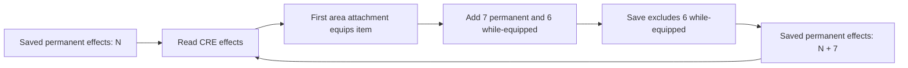

# Phase 0 — IMMCLOUD reload accumulation

October20,2026 PDT / October21 UTC. Pinned GemRB revision `bcb5cfaa9f19ffbe8a51f25a3c014fa344173351`, original manifested BG2EE2.7.3.0 fixture. **No engine source, engine/plugin binary or original game asset was changed.**

**Finding:** the previously unexplained seven-effect delta is reproducible accumulation from an item-equipping/persistence interaction. The Mephit's `IMMCLOUD` item has seven permanent equip effects and six while-equipped effects. GemRB reads the previously saved permanent effects, equips the item again, then saves the old and newly applied permanent effects. Repeating refresh within a session does not cause growth. This explains the observed delta. The subsequent original BG2EE reference also grows7→14→21; see the follow-up below. It does not justify a production fix.

[Machine-readable results and hashes](../compatibility/evidence/immcloud-lifecycle-results.json), [preceding GUI investigation](gui-save-and-presentation-results.md), [harness usage](../../tools/phase0/README.md).

## Reproduction and observed boundaries

The external host uses normal GUI/render initialization (`UseAsLibrary=0`), the stock GUILOAD button callback and normal `EnterGame`. It pauses after entry, snapshots state, calls the target's ordinary `RefreshEffects` twice, and writes a save through the ordinary non-forced save API with a real preview. Every reload is a fresh process/profile/cache. This isolates the lifecycle from inventory/record/save-menu traversal, which was already exercised by the preceding20-check GUI run. No screenshot traversal or controlled-tick API is claimed here.

A separate bounded Python reader decompresses the saved `AR0602.ARE`, locates the unique actor at `[2573,2461]`, reads its embedded CRE V1.0/v2 effect records and counts effects with source `IMMCLOUD`. The target also must carry `IMMCLOUD` in slot0 at runtime. Required missing/ambiguous data fails, not skips. Raw file counts distinguish already-saved effects from effects first observed after map entry.

Final run: `20261021T024237Z-immcloud-de4d6a2a`. Seven native processes exit0; **nine characterization assertions pass**. An earlier independent seven-process run produced the same count progression. These assertions intentionally confirm accumulation; they are not a save-fidelity pass.

| Stock cycle | Input saved IMMCLOUD effects | After normal entry | After two refreshes | Output saved effects | Output embedded CRE bytes |
|---|---:|---:|---:|---:|---:|
| Original fixture |7 |— |— |— |3,008 |
|0 |7 |20 |20 |14 |4,856 |
|1 |14 |27 |27 |21 |6,704 |
|2 |21 |34 |34 |28 |8,552 |
|3 |28 |41 |41 |35 |10,400 |

Runtime counts above exclude two effects from `REGHP1`; total actor effect counts are22,29,36,43. Each entry adds the item's13 effects. Six mode2 effects are discarded on save; seven mode1 effects persist. The saved CRE grows **1,848 bytes per cycle**, exactly7×264-byte effect records. This is measured uncompressed creature growth, not a compressed save-size or frame-time benchmark.

## Item data and the causal control

Read-only inspection finds `IMMCLOUD.ITM` in `data/Items.bif`, SHA256 `f85989bc7a8105b480f76c15f56aba7aa6f97c056f52afcacd6da1c54ed18f43`,738 bytes,13 equipping effects. The seven mode1 records are:

- Opcode267 protections for strings14665,41616,40979,40969,41495.
- Opcode101 protections for opcodes134 and216.

The remaining six equip effects use mode2. The opcode267 handler resets unused parameter2 to0, explaining that difference between raw item rows and runtime effects. [Handler](https://github.com/gemrb/gemrb/blob/bcb5cfaa9f19ffbe8a51f25a3c014fa344173351/gemrb/plugins/FXOpcodes/FXOpcodes.cpp#L7332).

For a **counterfactual control**, the runner copies this item into one run's private ModPath and changes only its seven timing bytes from1 to2. Byte offsets174,222,270,318,366,606,654 change; the item length and other bytes stay identical. No override is installed into the normal player profile or original dataset. This is an experimental intervention, not a recommended data patch.

| Control cycle | Input saved effects | After entry / two refreshes | Output saved effects |
|---|---:|---:|---:|
|0 |7 |20 /20 |7 |
|1 |7 |20 /20 |7 |
|2 |7 |20 /20 |7 |

The original seven already-saved permanent effects remain; the changed item now contributes13 unsaved while-equipped effects. Growth stops. This narrow intervention, the raw saved records and the repeated stock progression jointly identify the timing/persistence interaction as the cause. No speculative rewrite or broad deduplication rule is required to explain it.

## Verified source path

1. [CREImporter::ReadEffects](https://github.com/gemrb/gemrb/blob/bcb5cfaa9f19ffbe8a51f25a3c014fa344173351/gemrb/plugins/CREImporter/CREImporter.cpp#L1209) imports stored effects. Inventory loading deliberately postpones equip effects until an area exists. [ReadInventory](https://github.com/gemrb/gemrb/blob/bcb5cfaa9f19ffbe8a51f25a3c014fa344173351/gemrb/plugins/CREImporter/CREImporter.cpp#L1104).
2. [Actor::SetMap](https://github.com/gemrb/gemrb/blob/bcb5cfaa9f19ffbe8a51f25a3c014fa344173351/gemrb/core/Scriptable/Actor.cpp#L5080) equips items on the actor's first area attachment. Its `IF_GOTAREA` guard explains why ordinary repeated refresh is a different path.
3. [Inventory::AddSlotEffects](https://github.com/gemrb/gemrb/blob/bcb5cfaa9f19ffbe8a51f25a3c014fa344173351/gemrb/core/Inventory.cpp#L173) obtains the item's equip block. [Item::GetEffectBlock](https://github.com/gemrb/gemrb/blob/bcb5cfaa9f19ffbe8a51f25a3c014fa344173351/gemrb/core/Item.cpp#L54) applies self-targeted effects, without converting these mode1 records into mode2. [ITMImporter](https://github.com/gemrb/gemrb/blob/bcb5cfaa9f19ffbe8a51f25a3c014fa344173351/gemrb/plugins/ITMImporter/ITMImporter.cpp#L246) loads the equip records from the item.
4. [Effect::Persistent](https://github.com/gemrb/gemrb/blob/bcb5cfaa9f19ffbe8a51f25a3c014fa344173351/gemrb/core/Effect.cpp#L150) excludes while-equipped effects from saves; mode1 survives. [CREImporter::PutEffects](https://github.com/gemrb/gemrb/blob/bcb5cfaa9f19ffbe8a51f25a3c014fa344173351/gemrb/plugins/CREImporter/CREImporter.cpp#L2503) writes the retained effects. The next load repeats the sequence.

The item-data origin is established by the inspected KEY/BIFF resource and its timing rows, not by assuming that a missing font, GUI script or periodic refresh is responsible. The reproduction does not require rendering to be removed or simulation timing to be redesigned.

## Gameplay impact: what is and is not established

All256 base stats and256 modified stats for this actor are identical across the four stock cycles, three control cycles and the sampled refresh/persistence boundaries. Queries for the two opcode protections and five string protections stay true before and after refresh. The [opcode immunity check](https://github.com/gemrb/gemrb/blob/bcb5cfaa9f19ffbe8a51f25a3c014fa344173351/gemrb/core/EffectQueue.cpp#L748) and [string-display check](https://github.com/gemrb/gemrb/blob/bcb5cfaa9f19ffbe8a51f25a3c014fa344173351/gemrb/plugins/FXOpcodes/FXOpcodes.cpp#L4552) use existence queries; these observed duplicates do not increase a numeric bonus in those lookup paths. [Opcode protection handler](https://github.com/gemrb/gemrb/blob/bcb5cfaa9f19ffbe8a51f25a3c014fa344173351/gemrb/plugins/FXOpcodes/FXOpcodes.cpp#L3565).

**Established impact:** growing effect queue and serialized creature data. **Not established:** a changed combat outcome, measured runtime slowdown, behavior after dispel/removal, complete original BG2EE parity, or a general rule that all duplicate effects are harmless. No attack/spell challenge was performed. The later original-executable GUI save reference establishes only selected saved-record observations. Other actors/items and legitimate stacking need separate fixtures.

Twenty harness tests pass: five bounded saved-area/parser/content checks and the previous15 GUI/state mutation checks. Truncated saves, oversized decompression claims, impossible effect counts and changed protection parameters are detected. Existing engine core-test failures/skips are unchanged and were not rerun here.

## Disposition and next gate

Keep effect processing/resource importing as retain/wrap, with a **bounded compatibility investigation** at the equip/persistence boundary. This evidence does not justify replacing the effect system.

Before selecting a fix, compare untouched original BG2EE save→load→resave cycles for this same actor/item. That distinguishes a GemRB divergence from an inherited data/engine quirk and establishes the compatibility target. Then scan other equipping records with permanent timing and test legitimate stacking, effect removal and mod overrides. Candidate fixes may involve preserving equipment provenance or narrowly handling reapplication; blanket deletion of mode1 effects or global deduplication could destroy valid permanent/stacked effects. The seven-byte experimental override must not become a production patch without that evidence.

The harness now supplies a minimal repeatable lifecycle case and a causal control. Full save-fidelity acceptance remains open, and engine implementation remains deferred.

## Follow-up exposure scan

The [wider item/reference investigation](equip-exposure-and-original-reference.md) now scans32 candidates and supplies a negative cure-item contrast plus a second accumulating protection block. Original BG2EE GUI reload/resave evidence now shows the same7→14→21 count growth and matching CRE sizes. Opcode267 Parameter2 differs (original134/216, GemRB0); full fidelity remains open. Brief pre-pause AI activity and operator provenance limits are explicit in the linked report. Accumulation alone is not a GemRB-specific defect.
